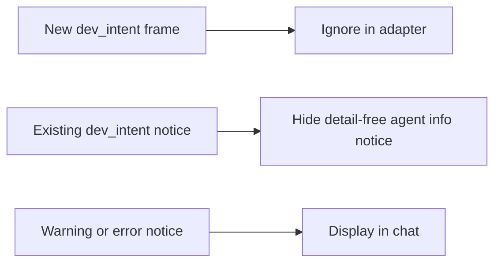

# Quiet developer intent on relaunch

## Status

| Unit           | Result                                                                              |
| -------------- | ----------------------------------------------------------------------------------- |
| Scope          | Approved: suppress repeated internal `dev_intent` notices                           |
| Implementation | Written, formatted and diff reviewed; unverified                                    |
| Verification   | Local build, install and signature verification passed; tests and UI checks not run |

## Current / Issue


The screenshot's conversation recorded two detail-free `dev_intent` notices each for Claude and DeepSeek during resume. Both agents share the Claude adapter. Its unknown-message fallback turns internal frames into durable notices.

## Proposed



## Code Changes

### `packages/adapter-claude/src/mapping.ts`

Treat `dev_intent` as quiet in both the top-level message switch and the system-subtype quiet set. Keep the fallback for other unknown SDK messages.

```ts
case 'dev_intent':
case 'tool_progress':
  return []
```

### `apps/desktop/src/renderer/src/transcript.ts`

Extend the existing historical startup-notice filter with:

```ts
text === 'tool_progress' || text === 'commands_changed' || text === 'dev_intent'
```

Retain the surrounding agent, info-level, system-source, empty-code, empty-detail and zero-omitted-byte guards. Apply through the shared reducer for live events and restored history. Preserve the append-only database and the existing agent startup behavior.

Task baseline: `/private/tmp/chorus-dev-intent-p5dnllvb`.
