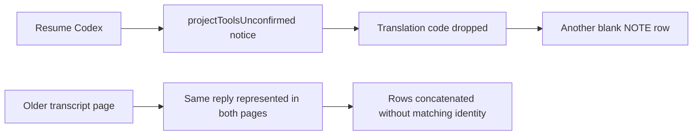
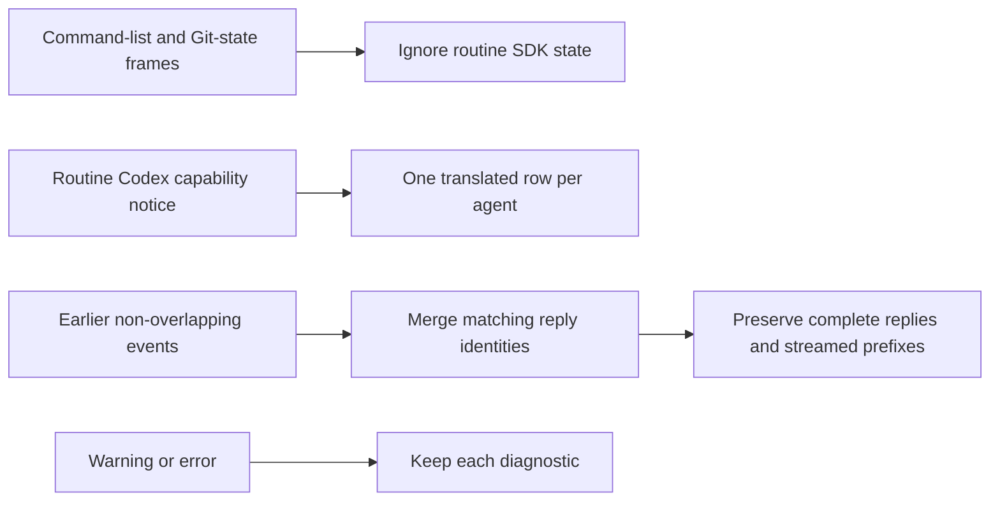

# Duplicate startup notices and history rows

## Status

| Unit           | Result                                                                              |
| -------------- | ----------------------------------------------------------------------------------- |
| Scope          | Approved: handle additional duplicate messages                                      |
| Implementation | Written, formatted and diff reviewed; unverified                                    |
| Verification   | Local build, install and signature verification passed; tests and UI checks not run |

## Current / Issue



The affected conversation contains three `projectToolsUnconfirmed` notices. Recent logs also contain ten `vcs_state_changed` info notices. The transcript already rejects replayed event sequences and replaces streamed replies by item identity; prepending older pages does not reconcile rows with the same identity.

## Proposed



## Code Changes

### `packages/adapter-claude/src/mapping.ts`

Ignore `commands_changed` and `vcs_state_changed` in the top-level and system-subtype paths, alongside the existing internal-frame exemptions.

### `apps/desktop/src/renderer/src/transcript.ts`

Extend historical startup filtering to detail-free Git-state notices. Preserve the existing severity, source and diagnostic guards.

Carry the complete notice line, including `noticeCode`, into the rendered message. Only plain agent `info` notices with system source, empty text/detail, zero omitted bytes and code `projectToolsUnconfirmed` receive a stable display key:

```ts
const key = once ? `notice:${event.actor}:${code}` : event.id
```

Skip an existing row with that key. Warnings, errors and notices with new diagnostic content retain their event identity.

In `prependEvents`, restrict earlier events to sequences before the existing first sequence. Reconcile equal row keys across page boundaries. Keep the latest completed reply, preserve its original timestamp, and concatenate disjoint streaming fragments in chronological order. Do not compare message text to decide identity. Keep working, pending replies, approvals and usage from the current view.

### `apps/desktop/src/renderer/src/transcript.test.ts`

Add regression coverage for complete replies split across pages, streamed prefixes, repeated page reads, identical text with distinct identities, coded notice translation metadata, startup notices across pages and independent diagnostic rows. Do not execute tests without a user request.

Task baseline: `/private/tmp/chorus-duplicate-notices-rb4zlvj9`.
