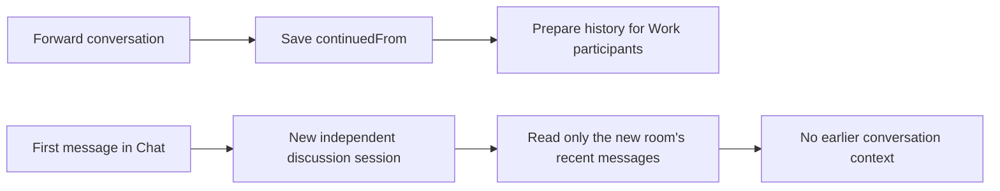
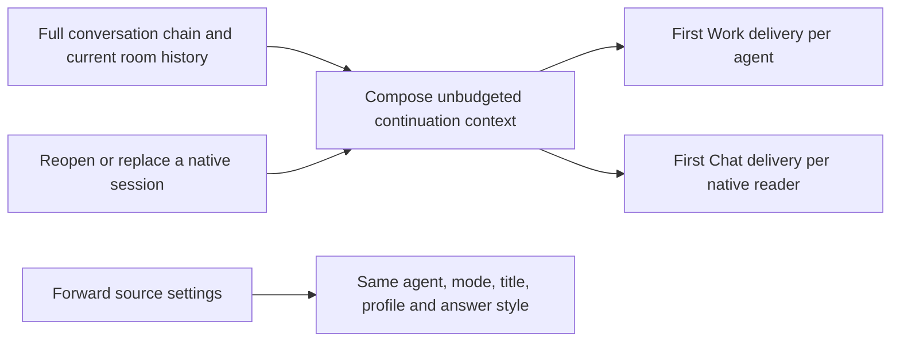

# Forward with full conversation context

The unbounded delivery policy below is superseded by [focused Forward context](63-focused-forward-context.md). Verification recorded here describes the earlier implementation; the new bounded implementation remains unverified.

## Status

| Unit           | Result                                                                            |
| -------------- | --------------------------------------------------------------------------------- |
| Scope          | Approved: full history and continuation settings on Forward                       |
| Implementation | Written, formatted, diff reviewed and regression tested                           |
| Verification   | Automated regression tests passed; production build and local installation passed |

## Current / Issue



The screenshot's new room records its parent correctly, but its first message is Discussion. That path never consumes the Work participant's pending history. The startup notice reports prepared context before either delivery path has received it.

## Proposed



## Code Changes

### `apps/desktop/src/main/runtime.ts`

Reuse `composeCarryover` for the entire recorded conversation chain, including messages in the receiving room before the current question. Preserve full user and assistant messages without applying the ordinary 100-entry, 10,000-character message or 24,000-character snapshot limits.

```ts
private continuationContext(conversationId: string, beforeSeq?: number): string | undefined
```

Build the full context at the first actual delivery, rather than sending an unsolicited startup turn. Track pending continuation delivery separately from other pending context. Include it for first Work messages and handoffs. On reopen, detect Work delivery per agent rather than treating any Chat message as proof that every primary agent received the seed. Reconstruct context for fresh replacement native sessions.

Capture the source's last addressed agent, title, permission profile, planning flag and answer style when Forward begins. Ordinary New and Restart keep their clean-start behavior.

### `apps/desktop/src/main/live-replies.ts`

```ts
readonly readInitialContext?: () => string | undefined
```

Each new discussion reader takes the full continuation context once. Its first question uses that full context instead of the bounded local snapshot. Reused readers keep their native memory and receive ordinary subsequent context updates. Recreated readers reconstruct the full chain again. Preserve Discussion's prompt instructions, project tools and approval handling.

### `apps/desktop/src/renderer/src/useConversationStarts.ts`

Copy the source conversation's persisted Work/Chat selection before publishing the new conversation to the renderer. Leave the source open.

### Existing start, discussion, deferred-restore and start-hook tests

Cover long and multi-hop histories, each new agent, reader reuse, Chat-to-Work continuation, first Work use after restoring a Chat-only room, source settings and the inherited composer mode. Tests are source changes only; no execution is authorized.

Task baseline: `/private/tmp/chorus-forward-context-j5mbwqjn`.
