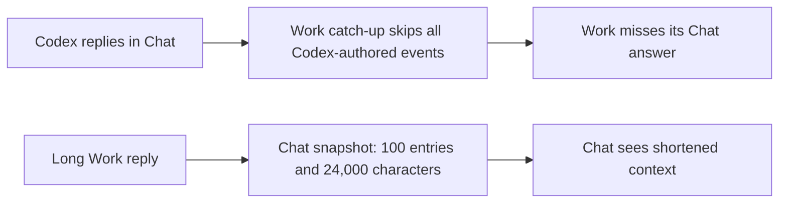
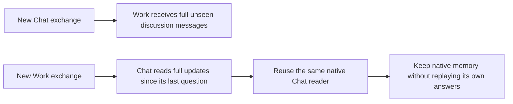

# Context across repeated Work and Chat switches

The unbounded delivery policy below is superseded by [focused Forward context](63-focused-forward-context.md). Verification recorded here describes the earlier implementation; the new bounded implementation remains unverified.

## Status

| Unit           | Result                                                                            |
| -------------- | --------------------------------------------------------------------------------- |
| Scope          | Preserve context when switching between Work and Chat                             |
| Implementation | Written, formatted, diff reviewed and regression tested                           |
| Verification   | Automated regression tests passed; production build and local installation passed |

## Current / Issue

Work and Chat retain separate native sessions. The Forward fix seeds each one, but later switches still need to deliver the exchanges written in the other mode.

## Proposed

## Code Changes

### `packages/orchestrator/src/catchup.ts`

Add an opt-in `includeOwnDiscussion` flag. Primary Work delivery uses it to retain Discussion replies by the same named agent. When Discussion messages are present, preserve their complete bodies and the full missed exchange rather than applying ordinary catch-up budgets. Keep existing behavior for other callers.

### `apps/desktop/src/main/runtime.ts`

Enable that flag for Work messages and handoffs. Build Chat context from the full earlier event range, without the 100-entry or message/character limits. Accept a per-reader sequence watermark and omit that reader's own Discussion responses and tool events, which are already in its native context. Keep Work output by the same agent. Preserve the current question as a separate prompt.

### `apps/desktop/src/main/live-replies.ts`

Store a sequence watermark on each native reader. Advance it only after successful delivery and completion. Use the next request's observed range for updates, and keep the full Forward seed for a new reader. Preserve full discussion handoff text.

### Existing catch-up and discussion tests

Cover repeated Work–Chat–Work–Chat transitions, long replies in both directions, same-agent responses, reader reuse and queued questions. Tests are authored but not executed without a user request.

Task baseline: `/private/tmp/chorus-mode-context-nzokkr2q`.
