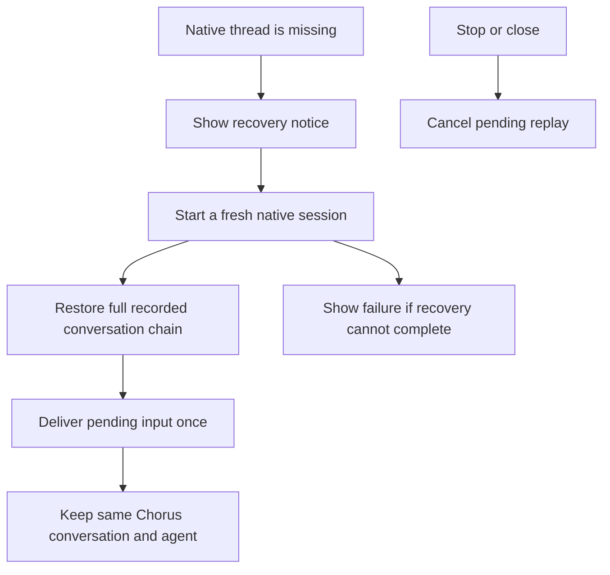
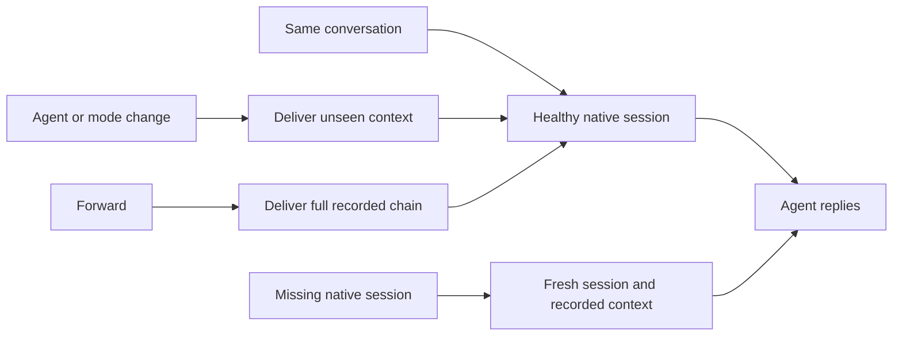

# Recover missing agent sessions and verify continuation

Recovery now uses the bounded context policy in [focused Forward context](63-focused-forward-context.md). Verification and installation recorded below describe the earlier implementation; the current context changes remain unverified.

## Status

| Unit           | Result                                                           |
| -------------- | ---------------------------------------------------------------- |
| Scope          | Approved: recovery, focused checks, build and local installation |
| Implementation | Written, formatted and diff reviewed                             |
| Verification   | 175 focused tests, workspace typechecks and manifest check pass  |
| Build/install  | Passed: signed arm64 app installed in `/Applications/Chorus.app` |

## Current / Issue

```mermaid
sequenceDiagram
    participant User
    participant Runtime
    participant Supervisor
    participant CLI
    Runtime->>Supervisor: Resume saved thread
    Supervisor-->>Runtime: No failure within startup window
    User->>Runtime: Send a message
    Runtime->>CLI: Deliver input
    CLI-->>Supervisor: Saved session does not exist
    Supervisor-->>Runtime: Fatal error; stream closes
    User->>Runtime: Send another message
    Runtime->>CLI: Deliver to the ended session
```

## Proposed



## Code Changes

### `packages/orchestrator/src/supervisor.ts`

```ts
readonly recover?: () => { readonly opts: SessionOpts; readonly context: string }
readonly onRecovery?: (state: 'starting' | 'ready') => void
```

Recover only a definitive missing-session failure. Permit one fresh replacement until a turn completes successfully. Preserve pending input and selected model, effort and permission mode. Reject sends after permanent shutdown, wait for replacement when sending, and cancel replay on Stop or Close. Close failed turns so the UI cannot remain busy indefinitely. Keep ordinary crash resume behavior.

### `apps/desktop/src/main/runtime.ts`

```ts
recover: () => {
  const conversation = this.active.get(conversationId)
  return {
    opts:
      conversation === undefined
        ? sessionOpts(false)
        : this.sessionOptsFor(conversation, agentId, false),
    context: composeCarryover(this.carriedChain(conversationId)) ?? '',
  }
}
```

Supply current project options and the full recorded chain. Localize recovery notices and persist changed native session references. Fresh sessions opened after restore receive the full transcript, including their own earlier messages.

### `packages/adapter-claude/src/claude-adapter.ts`

Reject delivery to a closed or ended stream instead of opening a fictitious turn. This also covers DeepSeek, which uses the same adapter.

### Existing supervisor, adapter, live-chat, deferred-restore and start-hook tests

Cover late missing-session failures, fresh-start failures, bounded retry, Stop and Close during recovery, no transcript duplicates, all agents, both Forward mode combinations, independent original/forwarded modes, multi-hop Forward and reopening. Correct the restart expectation to include the new loading state and give the multi-agent style-replacement test its required resume window.

Build workspace dependencies before running desktop tests because package imports resolve built orchestrator output. Run the focused tests and relevant static checks, then package and install Workbench without replacing its data directory or interrupting the running conversation.

The full repository gate passes typechecks but stops on 62 existing lint errors outside the recovery changes. Repository formatting reports 43 existing files. The focused recovery and context sources pass lint. After rerunning socket tests outside the sandbox and updating the pending-reply IPC fixture, the latest combined results are 3,965 passed, 13 existing failures in five other files, and four skipped. The production arm64 build, local signing and installation passed. Installed `/Applications/Chorus.app`; the running bundle was preserved at `/Applications/Chorus.app.replaced-1792152239253`. Quit and reopen Chorus to load the update. The existing Workbench profile and database were not replaced. All session/context cases and the focused lint checks pass.

The static checks also required normalizing optional reply snapshots in `Session.tsx` and updating existing Traffic test queries to the installed Testing Library types. Chat startup now schedules its opening callback after its promise is assigned, and cancellation checks read current state across awaits without suppressing type or lint rules.

The remaining failures are in `packages/adapter-codex/src/models.test.ts`, the Workbench surface/preload tests, and the Traffic panel/inspector fixtures. Native provider calls and the installed UI were not exercised; regression tests use fake adapters.

Task baseline: `/private/tmp/chorus-agent-recovery-zz9pmjjl`.

## Final Flow


