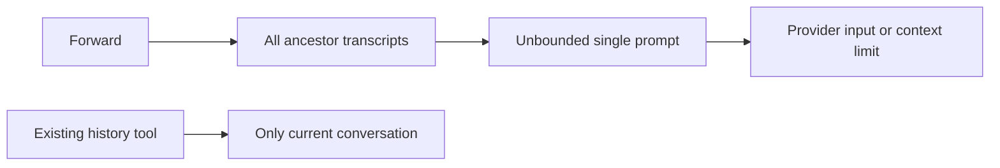
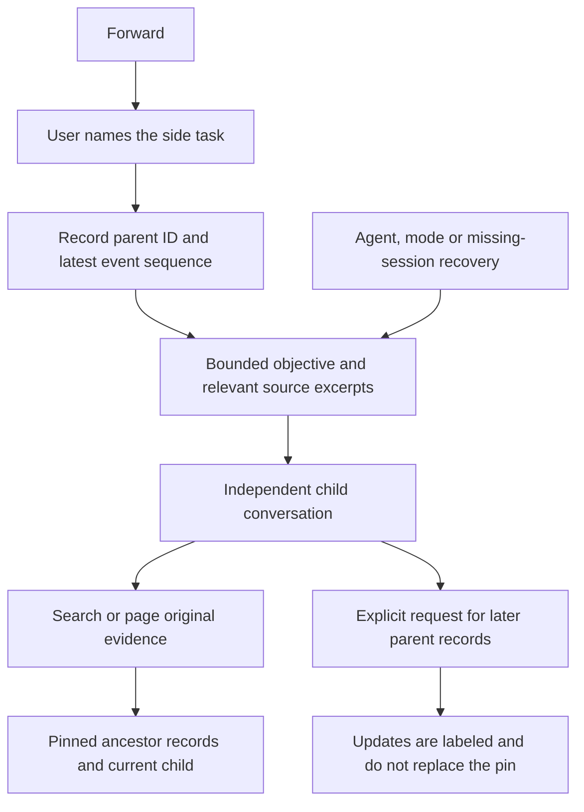
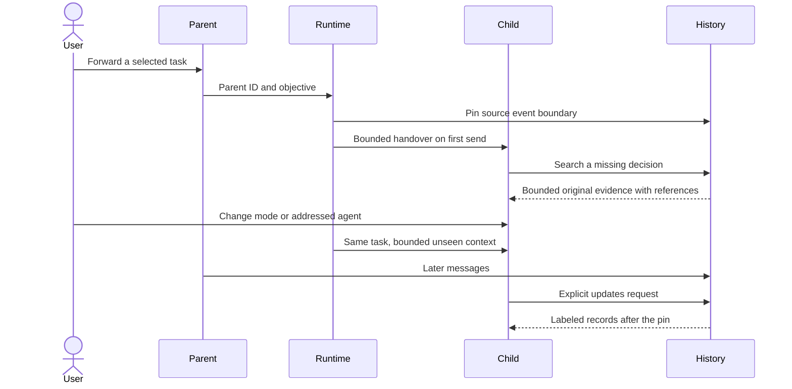

# Focused Forward with retrievable original evidence

## Status

| Unit                                  | Result                                                                                                                                                                                                                                                                                                                                                                     |
| ------------------------------------- | -------------------------------------------------------------------------------------------------------------------------------------------------------------------------------------------------------------------------------------------------------------------------------------------------------------------------------------------------------------------------- |
| Scope                                 | Approved: implement with Claude after switching to Work                                                                                                                                                                                                                                                                                                                    |
| Baseline                              | `/private/tmp/chorus-focused-forward-loksdd5n`                                                                                                                                                                                                                                                                                                                             |
| Context composition and adapter tools | Claude implemented and corrected the context layer; focused regression tests and package typechecks passed. Final review: `CarryoverOptions.currentConversationId` frames a fresh session of the same room as this conversation, so its own earlier requests stand as history and only earlier conversations are said to authorize nothing; runtime call sites now pass it |
| Runtime, persistence and Forward UI   | Implemented and source reviewed; automated regressions passed; live UI testing awaits Electron access                                                                                                                                                                                                                                                                      |
| Delivery integration                  | Context is prepared immediately before native send; one-time seeds are consumed synchronously, before awaiting provider acknowledgement                                                                                                                                                                                                                                    |
| Budget policy                         | Combined background plus frames is capped at 24,000 UTF-8 bytes; native headroom may reduce it                                                                                                                                                                                                                                                                             |
| Retrieval integration                 | Current and pinned ancestor records are available through both modes; Chat readers track separate usage                                                                                                                                                                                                                                                                    |
| Recovery integration                  | Fresh sessions recompose context before the pending message boundary and replay the current request once                                                                                                                                                                                                                                                                   |
| Verification                          | 409 focused tests across 17 files passed after targeted reruns; desktop and four package typechecks passed; dependency builds and focused lint passed; dev runtime ready with HTTP 200; live UI blocked by Electron permission; no installation                                                                                                                            |

Context-layer deviations: line collection moved to `transcript-lines.ts`; carryover and retrieval composition live in `transcript.ts`. `CarryoverOptions.retrieval`, `CatchupInput.maxTotalBytes`/`retrieval`, and `AgentSession.transcriptTool` let each delivery describe its actual history tool. Own Discussion replies are capped at 6,000 characters within the 12,000-byte catch-up ceiling. Ancestor headers are charged only when they contribute an excerpt; catch-up entries carry sequence/event references and their conversation ID. Empty parents carry nothing, even with an objective. Raw evidence stays out of the default listing, remains searchable, and a command ID reads its complete recorded output in pages.

Below the frame minimum, context composers and history readers return an explicit no-room note, which can exceed a tiny requested ceiling. Catch-up and carryover share `CONTEXT_DEFERRED_PREFIX`, so delivery can distinguish a note from actual carried records without inferring that from its length. Runtime delivers the current request with a fixed deferral note under 1,024 bytes when estimated headroom cannot fit history. It retains the seed and history watermark so later turns can retry the background after provider compaction. Each native session remembers current messages delivered during deferral and omits only those records from later catch-up; original history stays readable, and a fresh native session starts without those exclusions; the note is an explicit exception to the headroom estimate, never to the 24,000-byte absolute background/frame cap. Available native tokens reduce the ordinary cap using conservative byte accounting with 8,192 answer tokens and 2,048 framing tokens reserved; this remains an estimate, not provider tokenization.

Runtime review corrections: Codex's real missing-rollout error triggers recovery. `AgentInput.prepare` rebuilds queued deliveries against the active session; `recoveryBeforeSeq` prevents the pending request and its partial answer from being replayed inside the seed. Delivery factories and recovery metadata are stripped before entering an adapter. Retained live-answer seeds keep their newest tail. Handoffs budget the calling reply, parent handover, catch-up and frame together. The quote is labelled as the calling agent's reply, references its original event, keeps both ends within a byte budget and excludes the final call line already delivered as the current request. Successful context preparation advances the Work history watermark synchronously, so overlapping sends do not repeat the preceding current message. Failed preparation retains the supervisor's recovery seed, and native sends that fail without replacement restore it. Current-room Chat updates use shared-room catch-up with `includeOwnMessages` for the same agent's separate Work session; handoffs also state the original active discussion question explicitly.

UI review corrections: the Forward dialog belongs to `App`, so adopting a child does not unmount the typed task. It stays open until startup settles, supports retry after failure, and aborts cancelled starts. Forward dialogs retain focus for their whole lifetime: on Cancel while opening, and in the task field after failure when the parent composer remounts. Errors use the existing readable IPC error formatter. Child titles normalize whitespace and cut by code point. The task notice counts the collapsed preview before adding an ellipsis or disclosure, and keeps a long objective in the normal disclosure. Legacy objective inference uses the last user request rather than the folder title.

Regression sources now include overlapping Work sends, a live answer arriving during acknowledgement, a large calling reply plus parent handover, queued recovery and message boundaries, fresh recovery after old usage, independent Work/Chat windows, registered/unavailable history tools, empty parents, notice details, Unicode titles, IPC objective bounds, and Forward retry/cancellation. Final-pass additions cover low-headroom delivery and later catch-up in both modes, recovery preparation failures, absence of the preceding overlapping request, Unicode quote clipping, actual App dialog ownership across source unmount, focus containment during startup and after failure, deferred-body exclusion in both modes, readable errors and short/long notice rendering. These cases passed in the focused 409-test set across 17 files, after rerunning the corrected cases. Plain `+` startup rejection behavior remains unchanged; cleanup after a lost startup response is limited to Forward and restart.

Verification on 2026-10-16: reports are saved in `/private/tmp/chorus-focused-forward-verification-20261016.json`. Initial test failures included stale workspace package outputs; rebuilding exposed a nonexistent `plan.updated` event in the evidence type set, which was removed. Draft assertions now use `activeSessions`, and the rename fixture includes `previousTitle`. Two transcript lint corrections preserve existing output. The development app uses `/private/tmp/chorus-focused-forward-dev-20261016`; its runtime logged ready and its renderer returned HTTP 200 at `http://localhost:5173/`. Computer Use denied Electron access, so no live interaction or screenshot is claimed.

## Current / Issue



`composeCarryover` and Discussion catch-up bypass all size limits. `sessionOptsFor` exposes only local history. Claude has a transcript MCP tool; Codex currently registers only project dynamic tools. `continuedFrom` stores no snapshot boundary, so later parent messages enter the child's context implicitly.

## Proposed



No extra model request is required to generate a summary. Rank original excerpts using the objective, source references, user decisions and recency; label excerpts as evidence, not generated conclusions. State that important omitted facts must be retrieved. Old conversation instructions do not authorize new execution. The current user message and Work/Chat mode govern the task.

## Code Changes

### `packages/orchestrator/src/catchup.ts` and a focused transcript module

Extend the existing API compatibly. All composed context, including headings and omission markers, must have a hard UTF-8 byte ceiling. Remove the unbounded Discussion exception. Default carryover ceiling: 24,000 bytes; default catch-up ceiling: 12,000 bytes. Runtime can lower either ceiling from session headroom.

```ts
interface CarryoverSource {
  readonly title: string
  readonly events: readonly StoredEvent[]
  readonly conversationId?: string
  readonly throughSeq?: number
}

interface CarryoverOptions {
  readonly objective?: string
  readonly sourceEventIds?: readonly string[]
  readonly maxTotalBytes?: number
}

declare function composeCarryover(
  sources: readonly CarryoverSource[],
  options?: CarryoverOptions
): string | null

declare function composeTranscript(
  sources: readonly CarryoverSource[],
  request: TranscriptRequest,
  options?: { readonly maxTotalBytes?: number }
): string
```

Every excerpt references its actual conversation ID, event ID and sequence. Include retrieval instructions and snapshot boundaries in the bounded handover. Favor relevant evidence even when buried earlier than recent unrelated messages. An oversized individual event remains available through explicit event lookup and an offset cursor. Keep `composeHistory` compatible for existing consumers.

### `packages/agent-protocol/src/adapter.ts` and both adapters

```ts
interface TranscriptRequest {
  readonly skip: number
  readonly count: number
  readonly conversationId?: string
  readonly query?: string
  readonly eventId?: string
  readonly offset?: number
  readonly scope?: 'snapshot' | 'updates'
}
```

Use bounded, case-insensitive literal search rather than arbitrary regular expressions. Replies identify sources, matched/remaining entries, next skip and next offset for an oversized record. The runtime supplies only authorized current/ancestor sources. Default retrieval uses the snapshot; later parent records require `scope: 'updates'`. Never claim that missing private native context or unrecorded tool output exists in the event store.

The reader accepts an optional internal byte ceiling so each Chat reader can use its own context headroom. This argument is not exposed in the tool request schema. `transcript-evidence.ts` exposes original recorded command and file/tool evidence; private reasoning remains excluded.

Extend Claude's existing `chorus_transcript.read_transcript`. Add equivalent Codex `chorus_transcript` dynamic tool registration and dispatch beside the existing project tools. Follow installed/generated SDK shapes. Preserve project-tool fallback behavior; never silently claim a tool was registered after the provider rejected dynamic tools. Source-record retrieval is read-only and works for Chat readers as well as Work sessions.

### `packages/event-store/src/events.ts`, IPC and `runtime.ts`

```ts
forward: z.object({
  throughSeq: z.number().int().nonnegative(),
  objective: z.string().trim().min(1).max(2000),
  sourceEventIds: z.array(z.string()).max(20),
}).optional()
```

Add optional Forward metadata to `conversation.created`, alongside `continuedFrom`, so existing rows still parse. IPC adds an optional objective; original messages are always loaded from the event store. Pin the source before creation. Preserve inherited last agent, project, profile, language and mode. Legacy continuations pin parent records immediately before the child creation sequence.

Walk ancestry with a visited set and an upper boundary at every hop. `reseedCarriedContext`, first send, handoff, Chat initial/incremental context, mode changes, late seats and native recovery must all use bounded composition. Avoid duplicate parent delivery when a native reader already holds the snapshot. Budget the combined handover and catch-up, not each independently. Keep usage state in memory, reserving room for the current user input and the answer; fresh replacement sessions must not reuse stale usage measurements.

`sessionOptsFor` routes transcript requests to the pinned current/ancestor chain. Only explicit update reads see later parent events, clearly labeled. Lookup of an unrelated conversation or an out-of-snapshot event fails without exposing it. A disappearing source yields an explicit unavailable result rather than fabricated memory.

### `SessionHost.tsx`, `useConversationStarts.ts`, Forward dialog and `i18n/en.json`

Forward opens a small existing-style dialog asking which task to continue. Require a concise objective, then create the child without closing the parent. Use `useDialog`, which already owns the native-view overlay lifecycle. Keep the objective visible in the child's initial context and use the ordinary draft/send flow for its first message. Do not automatically execute historical instructions or create a second model summarization turn.

### Regression scenarios

Write deterministic cases for: a transcript above 1 MiB; Arabic/multibyte text and long headings; a relevant decision buried before unrelated recent messages; query/entry pagination and a single huge event; event provenance; unrelated-source rejection; parent updates excluded until explicitly read; two Forward hops with separate pins; legacy metadata; source missing/cycle handling; Work/Chat and agent switches; restore before the first send; native recovery with fresh headroom. Assertions inspect actual outgoing prompts, byte counts, stored metadata and source references. Development launch and focused verification were subsequently authorized; measured results are recorded in Status.

## Final Flow


