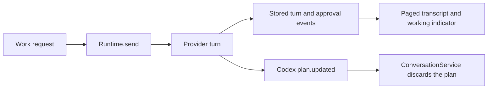
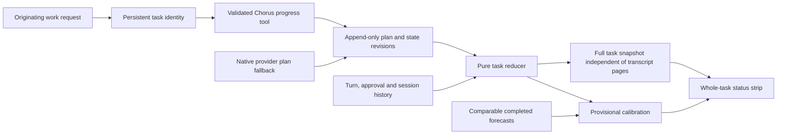
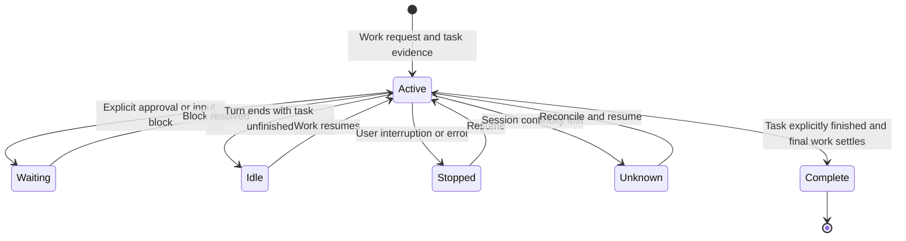

# Whole-task countdown and progress

## Status

| Unit                                                  | State                                                                                                                                                                                                                               |
| ----------------------------------------------------- | ----------------------------------------------------------------------------------------------------------------------------------------------------------------------------------------------------------------------------------- |
| Scope                                                 | Approved: implement the countdown design agreed with Claude                                                                                                                                                                         |
| Baseline                                              | `/private/tmp/chorus-task-progress-up8cdx9f`; existing edits must be preserved                                                                                                                                                      |
| Durable task lifecycle, estimation and provider tools | Implemented by Claude and reviewed by Codex against the feature baseline; unverified at runtime                                                                                                                                     |
| Status strip                                          | Implemented and source-reviewed, including the final exhausted-partial-estimate label; unverified at runtime                                                                                                                        |
| Integrated source review                              | Complete: supported recovery, wait ordering, Discussion provenance, native continuity, completion, fallback liveness, snapshot watermark and copy findings addressed in source                                                      |
| Verification                                          | Dependency builds and production packaging passed on the user's build/install request; installer signature verification passed. Regression tests, desktop typecheck, lint/format checks and runtime/UI behavior remain NOT VERIFIED |
| Delivery                                              | Built and installed at `/Applications/Chorus.app` on 2026-10-16; current session kept running; no commit or push                                                                                                                    |

Foundation review accepts the desktop shared reducer location: importing the event-store value barrel in the renderer would import SQLite. `main/ipc.ts` must transport the task bundle, and the catch-up switch is now in `transcript-lines.ts`. The Codex plan-array correction is required for the native fallback. Concurrent context-delivery edits remain outside this feature and are preserved.

Required review corrections: reconcile unended turns even before deferred agents restart; preserve real event order for projected waits and live evidence; exclude Discussion waits; preserve task identity across disjoint native plan revisions and ignore stale post-close reports; complete only settled, finished work across every lane; and request progress reporting explicitly in ordinary Work instructions.

Correction evidence: `EventStore.reconcileOrphanedSessions` already runs before restored providers start. Session prehistory is now grouped by payload agent ID, not the system actor. A durable `usage.blocked` event records explicit provider rejections, while ordinary usage percentages remain transient. Work instructions request reporting, native step IDs survive reordering, and both live/replay paths exclude newly marked Discussion waits. Runtime execution remains unverified.

UI integration baseline: `/private/tmp/chorus-task-progress-ui-5hn43837`. The final integration must also freeze on a blocking signal before a turn ends, keep Discussion blocking signals out of Work, invalidate settled completion intent when its agent starts new work, and avoid automatically closing an explicitly waiting/paused task. No new architecture is needed for these corrections.

Those four timing corrections are present in source. The strip, translated duration formatting, step bar, per-agent nested step rows and validated expected-task-ID close command are implemented. The two preload API bindings are necessary transport integration. Final review accepted the exhausted-partial forecast branch, session-end-aware fallback and snapshot merge at `throughSeq`. Canonical snapshots include last work evidence for ongoing segments. Execution remains unverified.

Known limits: forecasts require agent-supplied estimates and remain rough with insufficient comparable history or an unknown model. Previously created Codex threads may resume with only native checklist progress. Limit reset times are provider data, not task finish times. Layout, SQL execution, live tool registration, timer lifecycle and regression behavior have not been exercised.

### Local build and installation

The user explicitly requested build and install after implementation. The command completed with exit code 0:

```sh
CHORUS_INSTALL_KEEP_RUNNING=1 pnpm --dir /Users/mohamadtaleb/code/workbench app:install
```

All eight dependency builds succeeded, followed by production main/preload/renderer bundling and Apple Silicon packaging. The installer copied the app to `/Applications/Chorus.app` and verified its signature. The running bundle was retained at `/Applications/Chorus.app.replaced-1792168204154`; restarting Chorus loads the newly installed build. The installer does not replace the Workbench profile or database. No test suite, desktop typecheck, lint gate, app launch or UI verification was run.

## Current / Issue



Before this change, `ConversationService.handle` discarded `plan.updated`, and Claude's TodoWrite produced tool-row detail. Neither supplied a persistent, nested whole-task plan. The implementation adds a task spanning the existing durable turn, approval and user-input boundaries.

## Proposed



The task anchors to an actual originating message ID and keeps its original start across plan revisions, agent handoffs and turn boundaries. Creating a task lazily must preserve the normal event append timestamp and record the earlier start separately. A plan revision does not implicitly start a different task. Native turns without a plan still get an elapsed/activity fallback.

### Acceptance criteria

The result column describes execution verification. Implementation and source review do not establish a passing runtime result.

| Behavior         | Required result and source evidence                                                                                                      | Result       |
| ---------------- | ---------------------------------------------------------------------------------------------------------------------------------------- | ------------ |
| Task scope       | Origin message/start persist across turns and revisions; `main/runtime.ts`, `main/task-progress.test.ts`                                 | NOT VERIFIED |
| Countdown        | Approximate days/hours/minutes, rough label and range; `TaskProgress.tsx`, `task-strip.ts`, `task-strip.test.ts`                         | NOT VERIFIED |
| Missing forecast | Actual elapsed/activity; no invented forecast or bar; fallback/partial cases in `task-strip.test.ts`                                     | NOT VERIFIED |
| Nested steps     | Stable IDs, labels, separate main/substep counts; `progress-tools.ts`, `shared/task-progress.ts` and their regression sources            | NOT VERIFIED |
| Estimates        | Parent/child deduplication, sequential default, explicit parallel dependencies; `shared/task-progress.test.ts`                           | NOT VERIFIED |
| Waiting          | Canonical ordered waits, per-agent overlap, independent active collaborators; store/reducer and Discussion regression sources            | NOT VERIFIED |
| Pauses           | Forecast freezes while elapsed continues; provider `usage.blocked` mappings and `shared/task-progress.test.ts`                           | NOT VERIFIED |
| Overrun          | Reached/overrun/unestimated states, no negative forecast; `task-strip.test.ts`                                                           | NOT VERIFIED |
| Revision         | First forecast retained and changes explained; task log/reducer and strip revision regression sources                                    | NOT VERIFIED |
| Completion       | Finished, settled lanes required; total elapsed freezes on close; runtime/reducer regression sources                                     | NOT VERIFIED |
| Persistence      | Full state outside the page, tab carry and watermark merging; `transcript-task.test.ts`, `task-records.test.ts`                          | NOT VERIFIED |
| Recovery         | App-off elapsed, last evidenced work, no stale fallback; orphan/restart and session-end regression sources                               | NOT VERIFIED |
| Calibration      | Same known provider/model, sufficient history, scope growth separate; `shared/task-progress.test.ts`                                     | NOT VERIFIED |
| Host tools       | Scoped validated Claude/Codex reports and native fallback; both `progress-tool.test.ts` files and protocol validation sources            | NOT VERIFIED |
| Compatibility    | Optional schemas, classified exhaustive consumers, pending cards and existing edits preserved in source; no executed regression evidence | NOT VERIFIED |
| End tracking     | Expected task ID validated end to end; stale click cannot close replacement; `main/task-progress.test.ts`                                | NOT VERIFIED |

## Code Changes

### `packages/agent-protocol/src/adapter.ts`, `events.ts`, `index.ts` and a new progress-tool contract

Extend existing host-tool patterns (`transcript-tools.ts`, `project-tools.ts`) with bounded, validated task metadata. Add optional session plumbing so existing adapters and test fixtures remain compatible. Use installed SDK and generated Codex protocol types for registration and dispatch. Keep provider-specific payloads inside adapters.

Steps need stable IDs, display labels, optional parent IDs, a title, explicit status and optional leaf estimates. Validate duplicate IDs, missing parents, cycles, invalid estimates and any declared scheduling dependencies before recording a revision. A tool cannot write arbitrary history, another conversation or an unrelated task.

### Both provider adapters

Expose the host tool through Claude's in-process MCP pattern and Codex's `dynamicToolsFor`/`item/tool/call` pattern. Register only when a scoped handler exists. Preserve native tool fallback and scope host-tool approvals narrowly. Publish native TodoWrite and Codex plan updates as progress when richer metadata is absent, without inventing forecasts.

The standing progress instruction requests an early rough plan, meaningful updates and explicit final completion. It never authorizes additional work or changes the user's testing restrictions.

### `packages/event-store/src/events.ts`, `projections.ts`, `store.ts`, `index.ts` and a new pure task reducer

Add durable task lifecycle, plan revision and state-transition events, with optional additions to existing read schemas. The append-only log remains the source of truth; derived snapshots are rebuildable. Every downstream exhaustive consumer must classify the new events, with the repository-required reason for a deliberate no-op.

Working intervals come from evidenced turns and per-agent waits. Calculate interval unions before aggregating shared wall time. Keep stopped, waiting and unknown intervals distinct. The task's original forecast and subsequent scope revisions must remain available for future accuracy analysis.

Countdown arithmetic belongs in pure code. A running clock subtracts measured working time since its forecast baseline, not wall time since the user message. A revision uses remaining work without charging completed work twice. Historical correction is conservative and cannot turn unknown models or insufficient samples into claimed accuracy.

### `packages/orchestrator/src/conversation-service.ts` and `catchup.ts`

Persist normalized plans and lifecycle transitions rather than discarding them. Flush buffered output before lifecycle records. Preserve existing approval and question semantics. Task gaps require an explicit reason to display waiting; otherwise use idle. Exclude internal progress bookkeeping from ordinary cross-agent catch-up where no action depends on it.

### `apps/desktop/src/main/runtime.ts` and `apps/desktop/src/shared/ipc.ts`

Bind progress tools to the actual conversation, originating work request and current task. Scope collaboration to the shared task and distinguish each provider's lane. Supply complete task state alongside existing transcript-state reads so a 400-event page cannot hide the task start or its latest plan. Reconcile restore and session shutdown using persisted evidence. Discussion turns and ephemeral asides must not create or complete work tasks accidentally.

### `apps/desktop/src/shared/transcript-events.ts`, renderer transcript state, a new status-strip component, `Session.tsx`, `i18n/en.json` and `styles.css`

Consume snapshots and incremental task records through the existing event/state path. Keep ticking state inside the status strip so the transcript does not rerender every second. Render translated labels, compact duration formatting, explicit states, current nested step, distinct counts and a step-based progress bar only when a plan exists. Keep elapsed and estimated remaining work visually distinct.

### Regression sources and later verification

Write meaningful deterministic cases for task continuation, origin anchoring, nested-step validation and counting, revisions, overrun, overlapping waits, concurrent agents, interrupted turns, crash gaps, completion and old logs. Cover adapter host-tool registration, scoped dispatch and rejected capabilities; cover full-state restore when the visible page excludes the task start. These sources remain unrun until the user requests checks.

## Implementation order

1. Claude challenges and implements durable contracts, reducers, provider tools, runtime integration and snapshot transport; Codex reviews every changed file.
2. Claude implements the status strip against that reviewed contract; Codex reviews the complete integrated diff.
3. Correct supported findings, update this plan and deliver reviewed local changes with runtime verification explicitly unrun. No commit, push, build, install or deployment is included.

## Final Flow


