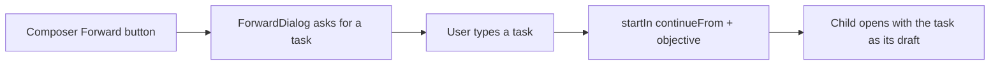
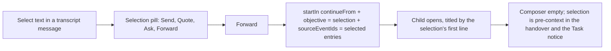
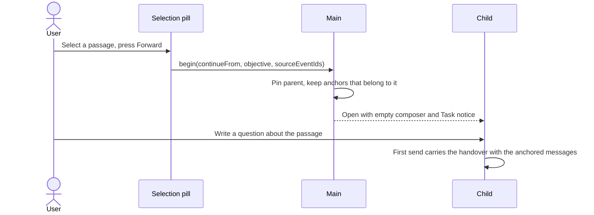

# Forward from a transcript selection

## Status

| Unit           | Result                                                                                                                                |
| -------------- | ------------------------------------------------------------------------------------------------------------------------------------- |
| Scope          | Approved by the user: Forward from a selected passage, no dialog, composer Forward button removed, new chat opens with an empty input |
| Implementation | Claude; written, unverified                                                                                                           |
| Verification   | Not requested; no tests, typechecks, builds or app runs                                                                               |

## Current / Issue



Typing a good task is the hard part: the user has to guess wording that matches the history, and the anchor is always the parent's last agent reply.

## Proposed



The selection is pre-context, not a message: the handover quotes it and always includes the message(s) it came from.

## Code Changes

### `renderer/src/Session.tsx`

`selected` gains the event ids of the entries the range starts and ends in; the pill gains a Forward action.

```ts
const sourceEventIds = [sourceEntryAt(range.startContainer), sourceEntryAt(range.endContainer)]
  .map((entry) => entry?.eventId ?? '')
  .filter((id, index, all) => id !== '' && all.indexOf(id) === index)

const forwardSelection = useCallback(() => {
  const passage = selected
  if (passage === null) return
  setSelected(null)
  window.getSelection()?.removeAllRanges()
  props.onForward({ text: passage.text, sourceEventIds: passage.sourceEventIds })
}, [selected, props.onForward])
```

`onContinue` is removed from `Session` and `Composer`, with the Composer button.

### `renderer/src/SessionHost.tsx`, `renderer/src/App.tsx`

`SessionHost` turns the selection into a start; App loses the dialog state and `ForwardDialog.tsx` is deleted.

```ts
const onForward = useCallback(
  (selection: ForwardSelection) => {
    startIn(projectId, {
      continueFrom: conversationId,
      objective: [...selection.text].slice(0, 2000).join(''),
      sourceEventIds: selection.sourceEventIds,
    })
  },
  [startIn, projectId, conversationId]
)
```

### `renderer/src/useConversationStarts.ts`, `shared/ipc.ts`, `main/ipc.ts`

`sourceEventIds` passes through to `beginConversation`; the child no longer receives `initialDraft`.

```ts
sourceEventIds: z.array(z.string().min(1).max(128)).max(20).optional(),
```

### `main/runtime.ts`

```ts
const anchors = (options.sourceEventIds ?? []).filter((id) =>
  sourceEvents.some((event) => event.id === id)
)
sourceEventIds: anchors.length > 0 ? anchors : /* last agent reply, as before */
title: first line of the objective, whitespace-collapsed, 80 code points
draft: ''
```

### `packages/orchestrator/src/transcript.ts`

The handover line reads as pre-context: "The user opened this room from this passage they selected, to continue on its topic: …".

## Edge Cases

| Case                                   | Behaviour                                                                       |
| -------------------------------------- | ------------------------------------------------------------------------------- |
| Selection spans two messages           | Both are anchored (start and end entries)                                       |
| Selection in chrome outside an entry   | No anchor; the latest agent reply is used, as before                            |
| Selection longer than 2,000 characters | Cut to 2,000 code points before the IPC schema sees it                          |
| Start fails                            | `startIn` reports it through the existing error banner; the parent is unchanged |

## Final Flow


