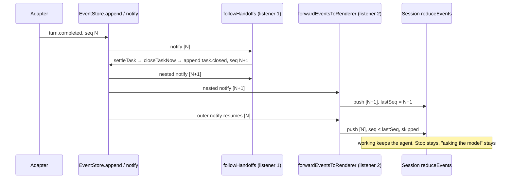
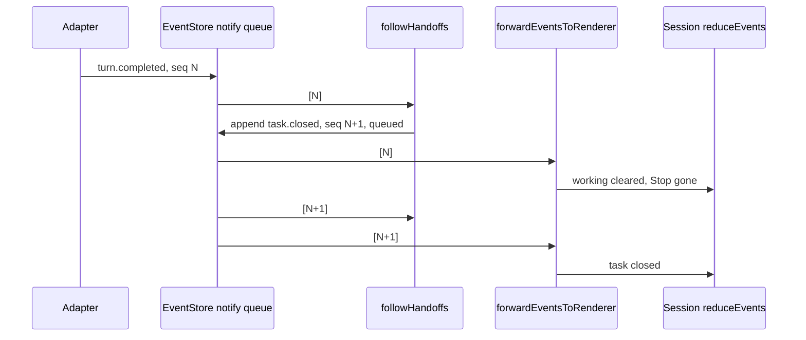
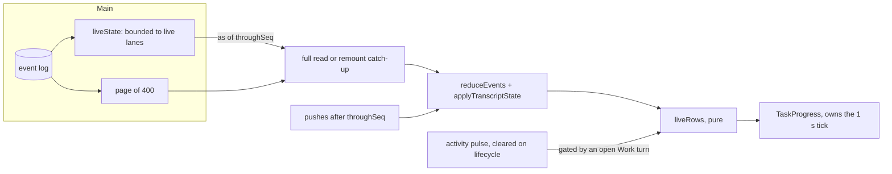
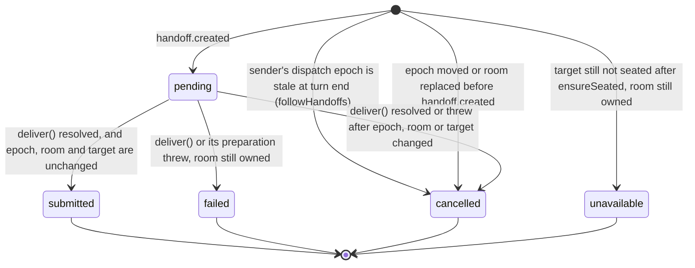
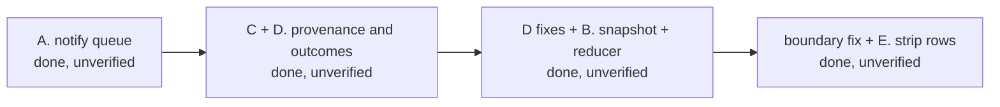
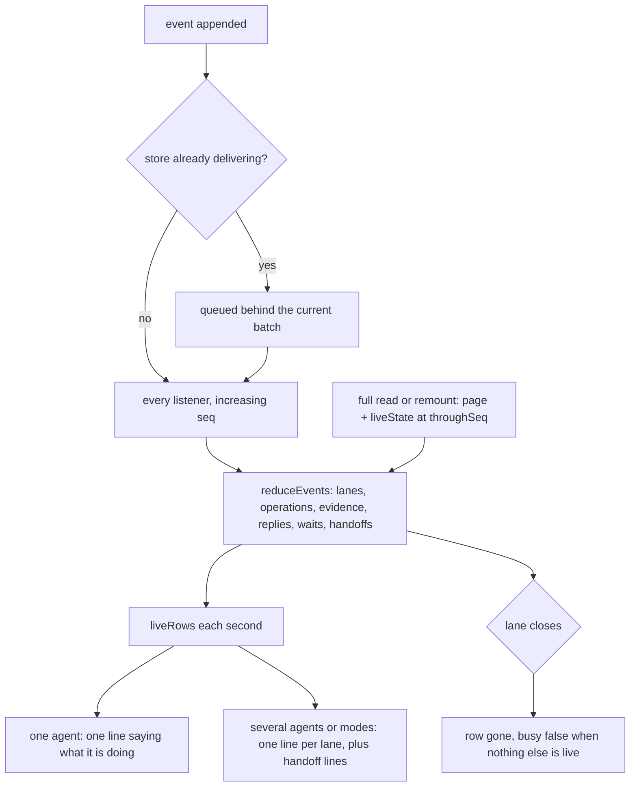

# Live agent tracking in the strip, for Work and Chat

## Status

| Unit                                  | State                                                                                                                                                                                                                                                                                                                                                                                                             |
| ------------------------------------- | ----------------------------------------------------------------------------------------------------------------------------------------------------------------------------------------------------------------------------------------------------------------------------------------------------------------------------------------------------------------------------------------------------------------- |
| Scope                                 | Codex-led full build. The strip shows what each agent is actually doing, for one agent or several, in Work and Chat, with or without a plan. The stuck busy indicator after an automatic task close is fixed first                                                                                                                                                                                                |
| Baseline                              | `/private/tmp/chorus-live-tracking-ygu8kvm4` (1,393 files, `manifest.json`). Unrelated edits in the tree must be preserved                                                                                                                                                                                                                                                                                        |
| Baseline for C+D                      | `/private/tmp/chorus-live-tracking-foundation-8gvpfie_` (`manifest.json`). It captures the accepted A and every then-current edit                                                                                                                                                                                                                                                                                 |
| A. Ordered event delivery             | Implemented in `packages/event-store/src/store.ts`. Regression sources written in `packages/event-store/src/store.test.ts` and `apps/desktop/src/main/task-progress.test.ts`. Codex source review found nothing. Not run: NOT VERIFIED                                                                                                                                                                            |
| C. Request provenance                 | Implemented as the producer side only: `events.ts`, `live-replies.ts`, optional fields in `ipc.ts`. Regression sources in `live-chat.test.ts` and `handoff-events.test.ts`. Not run: NOT VERIFIED                                                                                                                                                                                                                 |
| D. Handoff outcomes                   | Implemented: `events.ts`, `projections.ts`, `transcript-lines.ts`, `transcript-events.ts`, `runtime.ts`. Codex review found two gaps, now corrected in `runtime.ts`: the epoch is captured when the handoff is scheduled and checked before seating, and recipient ownership applies on the rejection path too. Regression sources in `collaboration.test.ts` and `handoff-events.test.ts`. Not run: NOT VERIFIED |
| Baseline for D corrections + B        | `/private/tmp/chorus-live-tracking-snapshot-lrl1_l8g` (1,392 files, `manifest.json`)                                                                                                                                                                                                                                                                                                                              |
| B. Live snapshot and reducer evidence | Implemented: `store.ts`, `runtime.ts`, `main/ipc.ts`, `shared/ipc.ts`, `transcript.ts`, and the remount request in `Session.tsx`. Regression sources in `live-state.test.ts` (new), `transcript-live.test.ts` (new), `ipc.test.ts` and `task-progress.test.ts`. Not run: NOT VERIFIED                                                                                                                             |
| Baseline for the boundary fix + E     | `/private/tmp/chorus-live-tracking-ui-ml2ivolt` (1,394 files, `manifest.json`)                                                                                                                                                                                                                                                                                                                                    |
| B boundary correction                 | Implemented. `session.started` and `session.ended` both end the agent's Work turn, keyed by payload `agentId`, in `transcript.ts` and in `reducePulse`. This matches `openTurns`. Regression sources in `transcript-live.test.ts` and `workspace/store.test.ts`. Not run: NOT VERIFIED                                                                                                                            |
| E. Strip rows                         | Implemented: `task-strip.ts`, `TaskProgress.tsx`, `Session.tsx`, `workspace/store.ts`, `en.json`, `styles.css`, and the activity ownership guard in `runtime.ts`. Regression sources in `task-strip.test.ts`, `workspace/store.test.ts` and `task-progress.test.ts`. Not run: NOT VERIFIED                                                                                                                        |
| Integrated review                     | Codex completed its integrated source review of A–E and their interactions. The one final finding was copy: the pending handoff label now reads "handoff submission unconfirmed"                                                                                                                                                                                                                                  |
| Verification                          | Source review only. One JSON syntax parse of `en.json` was run during E. No tests, type checks, lint, formatting, build, app or runtime checks have been run. Every acceptance case below is NOT VERIFIED in execution                                                                                                                                                                                            |

## Current / Issue

### The busy indicator outlives a completed task



With this subscriber order, the inversion is deterministic in source. Every automatic `completed` close is written from inside the `turn.completed` notify, so every listener registered after the runtime's own receives the close first.

| Evidence                                                                                               | Fact                                                                                                                                                        |
| ------------------------------------------------------------------------------------------------------ | ----------------------------------------------------------------------------------------------------------------------------------------------------------- |
| `packages/event-store/src/store.ts:174-181`, `229-237`                                                 | `append` and `appendMany` call `notify` synchronously after commit                                                                                          |
| `packages/event-store/src/store.ts` `notify`, before A                                                 | Listeners were iterated directly, with no reentrancy guard                                                                                                  |
| `apps/desktop/src/main/runtime.ts:1740`                                                                | The constructor subscribes `followHandoffs` first                                                                                                           |
| `apps/desktop/src/main/index.ts:521`, `main/ipc.ts:1481`, `1521`, `1582`                               | The renderer forwarder and the other pushes subscribe later                                                                                                 |
| `apps/desktop/src/main/runtime.ts:3768-3791`, `6277-6309`                                              | `turn.completed` → `settleTask` → `closeTaskNow` → `store.append(task.closed)`, all synchronously inside the outer notify                                   |
| `apps/desktop/src/renderer/src/Session.tsx:445-453`, `transcript.ts:405-406`, `workspace/store.ts:523` | Each push is folded as it arrives. Anything at or below `lastSeq` is skipped, and `lastSeq` advances before the disposition check                           |
| `apps/desktop/src/shared/task-progress.ts:1145-1149`                                                   | "Complete" is `task.closed` with `reason: 'completed'`. Its only automatic writer is `settleTask`, which requires `conversation.working.size === 0` in main |

The screenshot shows "Complete · 7 of 7" while Claude is "asking the model" with Stop. That is strongly supported as this defect: main had processed `turn.completed` and the view had not. It is not exclusive proof, because that conversation's log was not inspected.

### The strip says who, never what

| Evidence                                                      | Fact                                                                                                                                                                                                                                         |
| ------------------------------------------------------------- | -------------------------------------------------------------------------------------------------------------------------------------------------------------------------------------------------------------------------------------------- |
| `Session.tsx:2511-2518`, `task-strip.ts:108-119`              | The strip receives `task`, `working`, `workingSince` only. Without a task it shows agent names and one clock                                                                                                                                 |
| `transcript.ts:251-256`, `652-664`, `live-replies.ts:296-311` | `PendingReply` keeps only the latest phase. `LiveReplies.pending` keeps only the latest status event, so a full read loses when the request began                                                                                            |
| `transcript.ts:750-760`, `shared/transcript-events.ts:83-84`  | Command rows have no ref or status. `command.completed` and `command.output` are ignored                                                                                                                                                     |
| `Session.tsx:148`, `runtime.ts:6080-6107`                     | A full read is the newest 400 transcript events plus queried state. That state holds no current operation and no evidence time                                                                                                               |
| `live-replies.ts:563-620`                                     | Chat swallows `turn.*`, `session.*` and `usage.*`. It prefixes `itemRef` with its request id and stamps waits with `mode: 'discussion'`, but not with the request                                                                            |
| `live-replies.ts:258-283`                                     | A Chat handoff is parsed in `discuss`. The next round runs with no record of who asked                                                                                                                                                       |
| `runtime.ts:3774`, `3820-3824`, `3828-3885`                   | Three Work handoff exits leave no event: the epoch guard in `followHandoffs`, a missing target, and a moved epoch in `handOffOnward`. `handoff.created` is written before `deliver`, and a failed delivery's `error.raised` names no handoff |
| `event-store/src/migrations.ts:117-127`, `projections.ts:237` | A `handoffs` projection exists, with no status columns                                                                                                                                                                                       |
| `workspace/store.ts:622`                                      | `activityByActor` is carried unchanged through every log event                                                                                                                                                                               |

## Proposed





### Identity

| Thing     | Key                                                            | Opened by                                                                                                   | Closed by                                                                                       | Late evidence                                                                                                                                                              |
| --------- | -------------------------------------------------------------- | ----------------------------------------------------------------------------------------------------------- | ----------------------------------------------------------------------------------------------- | -------------------------------------------------------------------------------------------------------------------------------------------------------------------------- |
| Work lane | `work:{agentId}`, generation = seq of its `turn.started`       | `turn.started`                                                                                              | that agent's `turn.completed`, or a `session.started` or `session.ended` naming it in `agentId` | Ignored while the lane is closed. A replaced session's tail arrives after a session boundary and before the next `turn.started`, so it opens nothing                       |
| Chat lane | `requestId` (`discussion:{sourceId}:{agentId}:{round}`)        | first `reply.status` for it                                                                                 | `done`, `error` or `cancelled`                                                                  | An event whose `itemRef` prefix names no pending request is ignored                                                                                                        |
| Operation | `{lane}\|{itemRef}`, carrying its lane generation              | top-level `tool.started` or `command.started` in an open lane                                               | its own `*.completed`, or its lane closing                                                      | Refused if its generation is not the lane's current one                                                                                                                    |
| Work wait | approval or question with `mode` absent                        | `approval.requested`, `userinput.requested`                                                                 | decided, withdrawn or answered                                                                  | Matches the Work lane of its agent only                                                                                                                                    |
| Chat wait | approval or question with `mode: 'discussion'` and `requestId` | same                                                                                                        | same                                                                                            | Matches that `requestId` only                                                                                                                                              |
| Handoff   | `handoffId` (Work), target round `requestId` (Chat)            | Work: `handoff.created`, or a `handoff.outcome` with no created. Chat: a round's `reply.status` with `from` | Work: its one `handoff.outcome`. Chat: the round's terminal status                              | Several coexist, keyed by id. There is never a single global latest. Showing a line after its outcome is retention only, never a claim that the work it asked for finished |

### What a row may say

| Part              | Evidence                                                                               | Without it                              |
| ----------------- | -------------------------------------------------------------------------------------- | --------------------------------------- |
| Blocked           | A pending wait matching the lane, as above                                             | Not shown                               |
| Running operation | The newest open operation in the lane: name, bounded one-line detail, running-for      | Falls through to the phase              |
| Phase             | Chat: `reply.status` phase. Work: provider word, only while the turn is open           | "Working"                               |
| Last update       | `evidenceAt[lane]`, displayed directly as an age ("updated 4s ago")                    | Not shown                               |
| Elapsed           | Work: since `turn.started`. Chat: since the request's first status, kept across phases | Not shown                               |
| Relationship      | A Work handoff by id and outcome, or a Chat round's `from`                             | Not shown. A single agent never sees it |

A peer **wait** is never claimed. No source records that a sender expects an answer, so the sender's line reads "handed off to Codex", and its outcome says what happened to the handoff. A wait label needs a future explicit dependency fact, which this plan does not add.

### Handoff lifecycle (Work)



`pending` is a derived state, not an event: `handoff.created` with no outcome recorded. The UI labels it "handoff submission unconfirmed", not "not submitted yet". `handoff.created` precedes delivery, and the process can stop after delivering but before an outcome is appended, so a missing outcome proves nothing either way. Every outcome is terminal and written once. Nothing later, not even the recipient's next turn, is read as evidence that the handoff finished. `submitted` is shown as "handoff submitted", meaning session submission only. The UI does not tell submission into a running turn apart from submission into an idle one.

## Code Changes

### A. `packages/event-store/src/store.ts` (implemented, unverified)

```ts
  private readonly listeners = new Set<(events: readonly StoredEvent[]) => void>()
  private readonly undelivered: (readonly StoredEvent[])[] = []
  private delivering = false
```

```ts
  private notify(events: readonly StoredEvent[]): void {
    if (events.length === 0) return
    this.undelivered.push(events)
    if (this.delivering) return
    this.delivering = true
    try {
      for (
        let batch = this.undelivered.shift();
        batch !== undefined;
        batch = this.undelivered.shift()
      ) {
        for (const listener of this.listeners) {
          try {
            listener(batch)
          } catch {
            // Intentionally swallowed: the write already succeeded, and one bad
            // subscriber should not take down the others.
          }
        }
      }
    } finally {
      this.delivering = false
    }
  }
```

- **What is preserved.** Writes, projections and the `append` return stay synchronous. An `appendMany` batch is delivered whole. An empty batch notifies no one. A throwing listener is isolated, and the next append still notifies.
- **What changes.** A batch appended inside a listener reaches every listener after the current batch, in seq order.

### B. Live snapshot and reducer evidence (implemented, unverified)

**Wire** (`apps/desktop/src/shared/ipc.ts`, `LiveStateShape`, carried as optional `state.live`). It is structural: lanes are named by agent or `requestId`, so no lane-key string convention crosses the wire.

```ts
{
  work: { agentId, generation, startedAt, evidenceAt }[],
  chat: { requestId, agentId, startedAt, evidenceAt }[],
  operations: { agentId, requestId: string | null, generation, itemRef,
                kind: 'tool' | 'command', name, detail: string | null, startedAt }[],
  handoffs: { handoffId, from, to, sourceEventIds, createdAt: number | null,
              outcome: 'submitted' | 'failed' | 'cancelled' | 'unavailable' | null,
              outcomeAt: number | null }[],
}
```

- **Reading it.** The `conversation:transcript` request gains optional `live: boolean`. A read returns `state` when it is not a catch-up, as before, **or** when it asks for `live`. Session's remount catch-up asks. Older-page reads ignore `state`, as they always did. There is no new channel.
- **The state copier.** `toTranscriptState` in `main/ipc.ts` copies `live` (through `toLiveState`) instead of dropping it.

**Store** (`packages/event-store/src/store.ts`, `liveState(conversationId, { chatRequests, ignoredItemRefPrefixes })`). Every read is bounded to a live lane; nothing reads the whole conversation.

- **Work lanes.** `openTurns` is the same open-turn query `transcriptState` uses, extracted so the two can never disagree about who is working. A lane's `generation` is the seq of its `turn.started`, and its `startedAt` is that event's time.
  - Operations: the agent's own `tool.*` and `command.*` events after that seq, minus completed ones, top-level only.
  - Evidence: `MAX(created_at)` from that seq, across every type. It excludes `reply.status`, anything with `mode: 'discussion'`, and any `itemRef` under the ignored prefixes. Excluding by prefix alone would leave Chat statuses and Chat waits, which have no `itemRef`, counting as Work.
- **Chat lanes.** Only the requests the runtime still holds: `runtime.transcriptState` passes `liveReplies.pendingReplies`.
  - `startedAt` is the request's first `reply.status`, and its seq bounds the reads.
  - Operations: refs under `{requestId}:`.
  - Evidence: those refs, plus `reply.status`, `approval.requested` and `userinput.requested` that name the `requestId`.
- **Handoffs.** `handoff.created` and `handoff.outcome` after the latest Work `user.message` (not Chat, not a live question), folded by `handoffId`. A standalone outcome is kept with `createdAt: null`. The first outcome wins.
- **Waits.** `transcriptState` approvals take `mode` and `requestId` from their `approval.requested` payload through a correlated subquery on `approvalId`. Questions join `events` on `questions.event_id`. Both are optional, so older shapes still read.

**Renderer view** (`apps/desktop/src/renderer/src/transcript.ts`):

| Field                                                                  | Key                                                     | Set by                                                                                             | Cleared by                                                                                      |
| ---------------------------------------------------------------------- | ------------------------------------------------------- | -------------------------------------------------------------------------------------------------- | ----------------------------------------------------------------------------------------------- |
| `turns`                                                                | agent                                                   | `turn.started` (generation = its seq)                                                              | that agent's `turn.completed`, or a `session.started` or `session.ended` naming it in `agentId` |
| `operations`                                                           | `{lane}\|{itemRef}`, lane `work:{agent}` or `requestId` | top-level `tool.started`, `command.started` in an open lane                                        | its `*.completed`, or its lane closing or changing generation                                   |
| `evidenceAt`                                                           | lane                                                    | any event resolved to an open lane, including the ignored `command.output` and `command.completed` | its lane closing                                                                                |
| `handoffs`                                                             | `handoffId`                                             | `handoff.created`, `handoff.outcome` (first outcome wins)                                          | the next Work `user.message`                                                                    |
| `PendingReply.startedAt` / `.phaseSince` / `.from`                     | `requestId`                                             | first status / each phase change / the payload's `from`                                            | terminal status                                                                                 |
| `PendingApproval` / `PendingQuestion` `.mode` (`'chat'`), `.requestId` | —                                                       | payload, or state on a full read                                                                   | as before                                                                                       |

- **One fold point.** `foldLive` runs after `apply` for rendered types and alone for ignored ones. For an ignored type it only refreshes evidence or closes an operation; it never adds a row. So the disposition map is unchanged, and the test that ignored types leave a view with no open lane untouched still holds.
- **Divergence from ignored types is bounded.** A live push sees `command.output` and `command.completed`; a page or catch-up read does not. Every full read and every remount replaces the live fields with the snapshot, so the gap closes at each read.
- **`applyTranscriptState` makes the snapshot authoritative at the watermark.**
  - When `state.live` is present, `turns`, `operations` (only the current generation or a pending request), `evidenceAt` and `handoffs` are replaced, and each pending reply takes its `startedAt` from the snapshot.
  - An empty snapshot clears them.
  - When `live` is absent, from an older main, the view is pruned to the lanes still live.
  - Held pushes with a newer seq then fold on top.
- **Helpers exported for E:** `workLane`, `operationKey`, `laneOfOperation`.

### C. Request provenance (implemented, unverified)

**`packages/event-store/src/events.ts`**: three optional fields, so every stored row still parses.

```ts
    phase: z.enum(['waiting', 'thinking', 'replying', 'done', 'error', 'cancelled']),
    from: AgentIdSchema.optional(),
```

```ts
    mode: z.literal('discussion').optional(),
    requestId: z.string().min(1).optional(),
```

`requestId` goes on both `approval.requested` and `userinput.requested`.

**`apps/desktop/src/main/live-replies.ts`**:

- **Waits.** `recordDiscussion` stamps `approval.requested` and `userinput.requested` with `mode: 'discussion'` and the `requestId` of the `DiscussionTurn` that is actually current, the same id its own `reply.status` uses. Decisions, withdrawals and answers keep `mode` only, because they correlate by approval or question id.
- **`from` comes from `discuss`.** `discuss` sets `from = current.agentId` only after `findReplyHandoff` returned a handoff for the next participant. That round's `answerDiscussion` and its `DiscussionTurn` carry it, so `waiting`, `thinking`, `replying`, `done` and `error` all write it. Round 0 never has one.
- **`from` survives cancellation.** The job's `requests` map now stores a `ReplySource` with `from`, so Stop's `cancelled` status keeps it.
- **The unavailable Chat case is gone from the plan.** `findReplyHandoff` recognises only the participant ids `discuss` passes in (`mentions.ts:98-121`), so a Chat handoff to a non-participant cannot happen. A real Chat failure is the round's own `error` status (a reader that cannot start) or `cancelled` (Stop), both carrying `from`.

**`apps/desktop/src/shared/ipc.ts`**: `TranscriptStateShape` approvals and questions accept optional `mode` and `requestId`. B fills them.

### D. Handoff outcomes (implemented, unverified)

**`packages/event-store/src/events.ts`**, beside `handoff.created` and shaped like it:

```ts
  z.object({
    type: z.literal('handoff.outcome'),
    handoffId: z.string(),
    from: AgentIdSchema,
    to: AgentIdSchema,
    sourceEventIds: z.array(z.string()),
    outcome: z.enum(['submitted', 'failed', 'cancelled', 'unavailable']),
  }),
```

The actor is `system`, like the `error.raised` already written on a failed delivery. An outcome is the orchestrator's record, not the sender's speech, and it must not count as the sender's activity. `sourceEventIds` is the sender's reply, so an outcome correlates even when no `handoff.created` was ever written.

**`apps/desktop/src/main/runtime.ts`**:

- `followHandoffs` mints the `handoffId` as soon as `findReplyHandoff` finds a handoff in a completed turn, and passes it to `handOffOnward`. That one id is used for `handoff.created` and for the outcome.
- `handOffOnward` records through a local `settle`, which writes at most once. Each exit:

| Exit                                                                                                                                          | Created? | Outcome                                                      |
| --------------------------------------------------------------------------------------------------------------------------------------------- | -------- | ------------------------------------------------------------ |
| Sender's `dispatchEpoch` is stale at turn end: the user guided or stopped after dispatch                                                      | No       | `cancelled`                                                  |
| The epoch captured when the handoff was scheduled moved before `handOffOnward` began                                                          | No       | `cancelled`, with no seating                                 |
| `ensureSeated` returned without the target, room still owned                                                                                  | No       | `unavailable`                                                |
| Same, but epoch moved or room replaced while seating                                                                                          | No       | `cancelled`                                                  |
| Target seated, but epoch moved or room replaced                                                                                               | No       | `cancelled`                                                  |
| `deliver()` resolved, and epoch, room and target participant are unchanged                                                                    | Yes      | `submitted`                                                  |
| `deliver()` resolved after any of those changed                                                                                               | Yes      | `cancelled`                                                  |
| `deliver()` or its preparation threw, with epoch, room and target participant unchanged                                                       | Yes      | `failed` (the existing `error.raised` stays)                 |
| Anything threw before `handoff.created`, room still owned                                                                                     | No       | `unavailable`                                                |
| Anything threw after the epoch, room or target participant changed, for example a send rejected after `setAnswerStyle` replaced the recipient | Either   | `cancelled` (the `error.raised` still reports the rejection) |

A single `owned()` check covers the epoch, the room and, once a target is chosen, the target participant. The resolved and rejected paths apply the same rule.

- **What `submitted` means.** The input was handed to the recipient's current agent session. For Claude, that means queued on its inbox (`claude-adapter.ts:373-399`). For Codex, it means `turn/start` or `turn/steer` returned (`codex-adapter.ts:323-337`). It never means the model read it.
  - Codex's `send` also resolves without submitting when its `inputEpoch` moves. The only caller of `service.interrupt()` is `runtime.interrupt`, which moves `handoffEpoch` too (`runtime.ts:5961`), so the ownership recheck records `cancelled` there.
- **Interrupted or failed turns record nothing.** Handoffs are parsed only from completed turns. A reply cut off by Stop or an error is not a handoff in this system, and parsing its partial text would invent one.

**Every consumer that must classify it** (the five-file rule, with the files found by grepping `handoff.created`):

| File                                            | Disposition                                                                                            |
| ----------------------------------------------- | ------------------------------------------------------------------------------------------------------ |
| `packages/event-store/src/events.ts`            | Schema                                                                                                 |
| `packages/event-store/src/projections.ts`       | Explicit no-op, with the mandated comment. No query reads it from a table                              |
| `packages/orchestrator/src/transcript-lines.ts` | Explicit no-op, with the mandated comment. The recipient learns of the handoff by receiving it         |
| `apps/desktop/src/main/runtime.ts` recap ledger | Joins the existing no-op group, whose comment already covers it: the ledger carries proof of work done |
| `apps/desktop/src/shared/transcript-events.ts`  | `render`, so a reopened view reads it. Until B folds it, the reducer's `default` arm ignores it        |
| `apps/desktop/src/shared/unread.ts`             | Unchanged and not counted. It is a positive list, and a failure already counts through `error.raised`  |

The general permission rules are unchanged. Nothing here decides or auto-approves anything.

### E. Strip rows (implemented, unverified)

**Model** (`task-strip.ts`, pure `liveStrip(source, now)`, beside the unchanged `taskStrip`):

- **One Work row per agent in `working`.** `working` is the same list that drives busy and Stop. Its elapsed time comes from `turns`, falling back to `workingSince`.
- **One Chat row per pending reply.** Its elapsed time is the request start, never the phase start. Its `from` is the reply's own metadata.
- **Per row:**
  - `blocked`: a matching approval first, then a matching question. Work rows match the agent's non-Chat waits. Chat rows match `mode: 'chat'` plus their own `requestId`; a legacy wait without `requestId` matches only when the agent has exactly one pending request.
  - `operation`: the newest open operation in the lane (`laneOfOperation`), with name and detail cut to one line and 160 characters.
  - `moreOperations`: how many others are still open in that lane.
  - `phase`: Chat is `queued`, `thinking` or `replying`. Work uses the provider word, else `working`.
  - `elapsedMs`, and `updatedMs`: the age of `evidenceAt[lane]`, shown directly with no threshold.
- **Handoff lines:** the three latest, by id, each with its outcome or `pending`, and its age.
- **`mixed`:** true when Work and Chat rows are both present.
- **`tickingLive`:** true while any row or line exists. Handoff lines never add a row, so they never imply anyone is busy.

**Display** (`TaskProgress.tsx`, the existing strip above the composer):

| Case                                         | Head                                                 | Below                                                |
| -------------------------------------------- | ---------------------------------------------------- | ---------------------------------------------------- |
| No task, nothing live                        | Strip hidden                                         | —                                                    |
| No task, only Chat                           | "Chat in progress"                                   | Chat rows, then handoff lines                        |
| No task, only handoff history                | "Recent handoffs"                                    | Handoff lines                                        |
| No task, Work running                        | "Working" plus the Work clock                        | One row per lane                                     |
| Task open                                    | The existing head, clocks, plan lanes, bar and notes | A "Now" caption when plan lanes exist, then the rows |
| Task complete, Chat running                  | "Work task complete"                                 | The Chat row, which explains the Stop button         |
| Tracking ended manually, agent still working | "Work tracking ended"                                | The Work row, which explains the Stop button         |

- **Row layout:** agent; a `Chat` badge on Chat rows, and a `Work` badge too when both modes are present; "asked by X"; the wait; `Running …` with detail, running-for and "+N more running", otherwise the phase; elapsed so far; "last activity N ago".
- **Timer:** the 1 s tick stays in `TaskProgress` and runs only while the task strip or a live row or line needs it. There is no polling and no read per tick.

**Pulse and runtime:**

- `reducePulse` clears an agent's provider word on its `turn.started` and `turn.completed`, and on `session.started` and `session.ended` keyed by `agentId`. It also removes that agent from `working` at either session boundary.
- `runtime.ts` drops `onActivity` callbacks from a service that is no longer the participant's, the same check `recordNativePlan` uses.

Chat never enters `working` or `workingSince`, so Work clocks, the forecast, calibration and the close rules are untouched by it.

## Expected timeline

```text
One agent, Work, no plan
  1s   turn.started claude               Claude · Working · 0s
  3s   tool.started Read src/a.ts        Claude · Running Read · src/a.ts · for 1s · updated 0s ago
  5s   tool.completed                    Claude · Thinking · updated 0s ago
  9s   approval.requested                Claude · Needs your approval
 20s   command.started pnpm test         Claude · Running $ pnpm test · for 4s
 50s   command.output …                  … · updated 0s ago        (age keeps refreshing)
 99s   turn.completed, task.closed       row gone, Stop gone

Same agent, Chat, alongside
 30s   reply.status waiting              Claude · Chat · Queued · 0s
 31s   reply.status thinking             Claude · Chat · Thinking · 1s
 33s   tool.started read_transcript      Claude · Chat · Running read_transcript · 3s
 36s   reply.status replying             Claude · Chat · Writing the reply · 6s (request clock, not phase)
 40s   reply.status done                 Chat row gone. The Work row never changed

Two agents, Work handoff
 99s   handoff.created claude→codex      Claude → Codex · pending
 99s   handoff.outcome submitted         Claude → Codex · submitted
100s   turn.started codex                Codex · Working       Claude → Codex · submitted
130s   turn.completed codex              Codex row gone. The relationship line is retained until
                                         the next user message: retention, not a "finished" claim
```

## Acceptance cases and their regression sources

Written for every batch. None run: every case is NOT VERIFIED in execution.

| Case                                                                                                                                                                                                                                                                                                                                                                                                                       | Source                                                                             |
| -------------------------------------------------------------------------------------------------------------------------------------------------------------------------------------------------------------------------------------------------------------------------------------------------------------------------------------------------------------------------------------------------------------------------- | ---------------------------------------------------------------------------------- |
| Nested append, nested `appendMany`, a chain of nested appends, several later listeners, a throwing listener, an empty batch                                                                                                                                                                                                                                                                                                | `packages/event-store/src/store.test.ts` (written)                                 |
| An automatic close reaches a later subscriber as `turn.completed` then `task.closed`. Folding what it received through `reduceEvents` and `reducePulse` leaves no working agent and no busy, with no further message                                                                                                                                                                                                       | `apps/desktop/src/main/task-progress.test.ts` (written)                            |
| A pending Chat reply stays busy after the Work task closes. The other agent stays working until its own turn ends. A newer turn after the close shows as working                                                                                                                                                                                                                                                           | `apps/desktop/src/main/task-progress.test.ts` (written)                            |
| D corrections: a Stop delivered between scheduling and start cancels with no seating and no delivery; a send rejected after the recipient was replaced records `cancelled`, not `failed`                                                                                                                                                                                                                                   | `apps/desktop/src/main/collaboration.test.ts` (written)                            |
| Store snapshot: an open operation behind 450 later tool pairs is recovered; colliding refs stay per agent; Chat and live-question activity stay out of the Work lane; a finished or replaced generation leaves nothing open; a Chat request keeps its start; only held requests are reported; handoffs fold by id since the current Work message; wait provenance                                                          | `packages/event-store/src/live-state.test.ts` (written)                            |
| Renderer folds: lanes per agent; `command.output` freshness with no row; closed generations and late evidence refused; Work and Chat separated; only the named request blocked; request start kept live and after a read; a pre-page generation seeded and newer pushes folded on top; an empty authoritative state clears; pruning without a snapshot; handoffs by identity; batch parity                                 | `apps/desktop/src/renderer/src/transcript-live.test.ts` (written)                  |
| A catch-up returns state only when it asks for `live`; the copier carries `live` and the response schema accepts it                                                                                                                                                                                                                                                                                                        | `apps/desktop/src/main/ipc.test.ts` (written)                                      |
| The runtime snapshot equals what folding the same log live produces, for turns, operations and evidence                                                                                                                                                                                                                                                                                                                    | `apps/desktop/src/main/task-progress.test.ts` (written)                            |
| `handoff.outcome` accepts only its four outcomes and requires `sourceEventIds`. It round-trips, and leaves the handoffs projection alone on append and on rebuild. Old waits and statuses still parse. `requestId` cannot be empty, and `from` must be a real agent                                                                                                                                                        | `packages/event-store/src/handoff-events.test.ts` (written)                        |
| Work handoffs: ordinary submission tied to its created row, with nothing recorded for the recipient's later turn; a delivery failure; unavailable seating; a redirect before the handoff, correlated by source reply with no created row; Stop while seating; Stop while delivering; two handoffs with their own ids                                                                                                       | `apps/desktop/src/main/collaboration.test.ts` (written)                            |
| Chat: waits stamped with the current request; `from` on every status of a handed-off round and on none of the lead's; `from` kept on Stop's `cancelled` and on a reader-start `error`                                                                                                                                                                                                                                      | `apps/desktop/src/main/live-chat.test.ts` (written)                                |
| The sender's relationship line persists while the recipient works, keyed by id                                                                                                                                                                                                                                                                                                                                             | `transcript.test.ts`, `task-strip.test.ts` (B, E)                                  |
| `liveStrip`: one agent with no plan gets one row; provider word, then phase; Work and Chat for one agent with their own waits; only the named Chat request blocked, plus the legacy single-request rule; a wait kept beside concurrent operations with a count; handoff history that is never busy; one-line bounds; Work complete with Chat running; tracking ended with work running; ticking stops when nothing is live | `apps/desktop/src/renderer/src/task-strip.test.ts` (written)                       |
| A new `session.started` ends the agent's old turn and operations, keeps the other agent and Chat, and lets only the newer generation work                                                                                                                                                                                                                                                                                  | `transcript-live.test.ts`, `workspace/store.test.ts` (written)                     |
| The provider word clears at its own agent's lifecycle boundaries only. A replaced service's activity callback is dropped and the new service's is heard                                                                                                                                                                                                                                                                    | `workspace/store.test.ts`, `apps/desktop/src/main/task-progress.test.ts` (written) |
| Measured freshness: event `createdAt` to strip text, p95 within 1 s plus one tick                                                                                                                                                                                                                                                                                                                                          | A later e2e driver in `apps/desktop/e2e/`, when verification is authorised         |

## Implementation order and ownership



C and D went first because they settle the contract that B's snapshot and E's rows consume.

| Batch                    | Files                                                                                                                                                                                                                                                                                                                                                                                                                                                                     |
| ------------------------ | ------------------------------------------------------------------------------------------------------------------------------------------------------------------------------------------------------------------------------------------------------------------------------------------------------------------------------------------------------------------------------------------------------------------------------------------------------------------------- |
| C + D (done)             | `packages/event-store/src/events.ts`, `packages/event-store/src/projections.ts`, `packages/orchestrator/src/transcript-lines.ts`, `apps/desktop/src/main/runtime.ts`, `apps/desktop/src/main/live-replies.ts`, `apps/desktop/src/shared/transcript-events.ts`, `apps/desktop/src/shared/ipc.ts`. Tests: `handoff-events.test.ts` (new), `collaboration.test.ts`, `live-chat.test.ts`                                                                                      |
| D corrections + B (done) | `apps/desktop/src/main/runtime.ts`, `packages/event-store/src/store.ts`, `apps/desktop/src/main/ipc.ts`, `apps/desktop/src/shared/ipc.ts`, `apps/desktop/src/renderer/src/transcript.ts`, `apps/desktop/src/renderer/src/Session.tsx` (one line: the remount read passes `live: true`). `transcript-events.ts` and `index.ts` unchanged. Tests: `live-state.test.ts` and `transcript-live.test.ts` (new), `collaboration.test.ts`, `ipc.test.ts`, `task-progress.test.ts` |
| Boundary fix + E (done)  | `apps/desktop/src/renderer/src/task-strip.ts`, `TaskProgress.tsx`, `Session.tsx`, `workspace/store.ts`, `transcript.ts`, `i18n/en.json`, `styles.css`, plus the `onActivity` guard in `apps/desktop/src/main/runtime.ts`. Tests: `task-strip.test.ts`, `transcript-live.test.ts`, `workspace/store.test.ts`, `task-progress.test.ts`                                                                                                                                      |

The batches run in order, with one writer per file at a time.

## Risks

- **A changes nested timing.** A batch appended inside a listener is now delivered after the current batch. In source, the only nested appender found is `settleTask`. No existing store test asserting the old timing was found while writing the new ones, but the whole suite was not read.
- **Queries scale with the live turn.** `liveState` reads are bounded to live lanes, but within a very long turn the operation read grows with that turn's tool and command events. Evidence is a single aggregate.
- **Unindexed lookups.** A Chat request's first status is found through the `type` index and filtered by conversation and JSON. The latest Work `user.message` is found the same way. Both are lookups, not page reads, but neither has a dedicated index.
- **Ignored types now feed the live fold.** `command.output` and `command.completed` change `evidenceAt` and `operations` on live pushes, which a page or catch-up read cannot reproduce. The existing comment over the disposition skip warns of exactly this; here the snapshot replaces the live fields at every full read and remount.
- **A catch-up with `live` now carries the full state.** The comment over the handler's state rule predates this. Ordering stays safe because Session applies the state before held pushes, as it does on a cold read.
- **`submitted` is session submission, never model acceptance.** If an epoch, room or target change lands during delivery, the outcome is recorded conservatively as `cancelled`. Under a guide, which is not a Stop, input a session already queued may still be consumed.
- **Nested outcome appends ride on A.** The stale-epoch outcome is appended from inside the `followHandoffs` listener. Its order relative to the `turn.completed` that produced it depends on A's queue.
- **The provider word can lag.** Activity pushes and log events race on separate channels, so the word may lag a lifecycle boundary by one push. The open-turn gate keeps a stale word from showing.
- **Stuck panes do not heal.** A pane stuck before A ships needs a reload. No healing or polling is added.
- **Live questions stay out.** Live-question asides write no `reply.status` and are not shown.

## Final Flow


