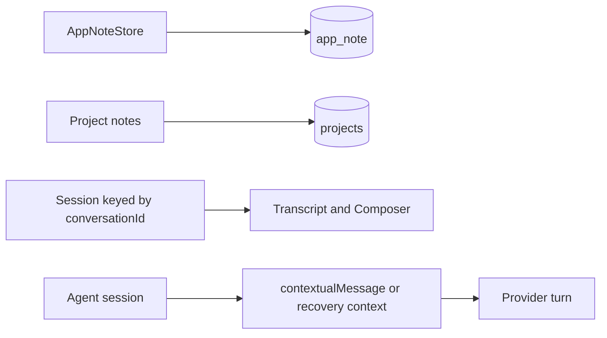
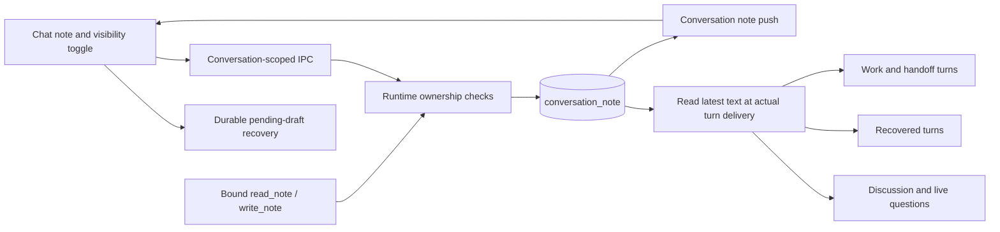

# One persistent sticky note per chat

## Status

| Unit                    | State                                                                                                                                                                                                                                                                                                   |
| ----------------------- | ------------------------------------------------------------------------------------------------------------------------------------------------------------------------------------------------------------------------------------------------------------------------------------------------------- |
| Scope                   | Codex leads; Claude implements. One plain-text note per stable conversation ID, with chat-bounded dragging/resizing, visibility, durable saving, shared agent tools, and turn reminders                                                                                                                 |
| Baseline                | `/private/tmp/chorus-sticky-notes-7vldls8y/manifest.json`. Preserve the existing uncommitted work                                                                                                                                                                                                       |
| A. Storage and IPC      | Implemented by Claude and accepted in Codex's independent source review. Storage regression sources are written, unrun                                                                                                                                                                                  |
| B. Agents and renderer  | Implemented by Claude and source-reviewed by Codex. Corrections cover current pane bounds during gestures, read-only live-question tools, storage retries, and reachable controls in short panes                                                                                                        |
| Atomic recovery journal | Implemented in main's SQLite store, with a strict synchronous preload boundary and transactional compare-and-set. The journal is separate from saved note content, counters, pushes and reminders                                                                                                       |
| Content-only bounds     | Implemented by Claude and accepted in Codex's source review: the note mounts in the positioned, clipped message viewport above the input dock. Drag/resize and restore use its observed bounds. Runtime remains NOT VERIFIED                                                                            |
| Explicit chat closure   | Implemented by Claude and accepted in Codex's source review: closing a chat deletes its note and journal, cancels queued saves and drops its cache in every window. Late mutations are refused while inactive. Deletion failures reach the close error path after cleanup. Runtime remains NOT VERIFIED |
| Review                  | Codex completed the integrated feature and correction reviews. One native persistence reviewer was launched and reused for a second audit. Its two important findings were corrected; the second audit reported no important findings                                                                   |
| Verification            | Source review and baseline-relative diff inspection completed. Regression sources were written; tests, typechecks, lint, formatting, builds, migration application, app launches, screenshots and runtime acceptance were not run. Execution acceptance remains NOT VERIFIED                            |

## Current / Issue



The existing app and project notes store current state beside the append-only conversation log. `SessionHost` passes `conversationId`; active tabs mount/unmount independently of the agents in main. `SupervisedSession.send` uses a separate context callback after recovery. Discussion and live questions have their own delivery paths.

Source anchors: `packages/event-store/src/app-note.ts`, `packages/event-store/src/purge.ts`, `apps/desktop/src/renderer/src/SessionHost.tsx`, `apps/desktop/src/main/runtime.ts` (`sessionOptsFor`, `contextualMessage`, `startParticipant`), `packages/orchestrator/src/supervisor.ts` (`send`, `recoveredInput`), and `apps/desktop/src/main/live-replies.ts`.

## Proposed



The note is plain text, capped at 4,000 UTF-16 code units. It starts empty and hidden. Explicitly closing a chat deletes its saved note and recovery journal and releases its renderer cache. Leaving a chat open across application shutdown/relaunch preserves its note; switching tabs and hiding the panel preserve it too. A newly created or continued conversation has its own empty note. A closed chat reopened from History also starts with an empty note. An edit never starts an agent turn.

### Save and conflict contract

- Main owns the authoritative row and validates the conversation exists.
- Text uses compare-and-set against `revision`; only text changes advance that revision. A stale differing write returns a conflict with the current note. Identical text is acknowledged without advancing counters or changing authorship, including an identical stale retry.
- `version` advances on every stored change, including geometry and visibility. Push and invoke-response reconciliation keeps the maximum version and ignores equal or older states, so a view-only update cannot disappear behind an unchanged text revision.
- User and agent writes share the same text operation. Main supplies the author, rather than accepting an author from the renderer or tool arguments.
- The renderer retains a dirty draft during conflicts. Explicit “Keep mine” retries against the current revision; “Use saved” adopts the current saved text. An external push never silently discards a dirty draft.
- A change is saved after main acknowledges its SQLite write. Before asynchronous note saving, pending text/view is journaled through a narrow synchronous preload API into main's SQLite registry. Journal comparison and mutation occur in one transaction, so a late acknowledgment from another renderer cannot delete or replace a newer draft between an ownership check and mutation. Recovery reads this journal on reopen/relaunch and exposes text conflicts. The queue stays bound to the originating conversation across tab unmount.
- A nonempty journal whose removal fails remains an explicit, retryable cleanup failure. An already empty journal is healthy. Journal storage is separate from the saved note's text, layout, counters, pushes and agent reminders.
- Load/save/storage failures are visible and retryable. Read failure cannot be treated as an empty note that overwrites saved text.
- A newly starting chat does not yet have its `conversation.created` projection row. Defer note loading/writing while `session.starting === true`, then load once ready. A cancelled start creates no note. Asides do not mount this chat note and receive no note access closure.
- Explicit close removes the note row before reporting closure. Refuse text, view and all recovery-journal compare operations for an inactive conversation, so late requests cannot recreate the row. Broadcast cache disposal to all shell windows, dispose that conversation's note sync, cancel its timer and ignore outstanding load/save callbacks. A deletion failure still allows normal chat/resource teardown and cache disposal, then rejects the close through the existing error path. A temporary tab unmount or application shutdown does not delete the note. Keep the conversation log and unrelated chats intact.

### Geometry contract

The note mounts inside `.pane-split`, the message viewport above `.dock`, without a portal or an overlay across the native workbench. It is a sibling of the scrolling `.score`, so scrolling messages does not move the note. The message container owns its positioning and clips its overlay; the input box, controls and approval area are outside its bounds. Store position and size as fractions of this content area. Pointer capture owns a drag/resize gesture; pointer cancellation and lost capture release it safely. Clamp drawing to the available bounds, with a 160 by 96 pixel minimum capped by the available area. Re-clamp when the composer grows or the pane shrinks, without persisting the temporary clamp. Save the resulting geometry when the user finishes a gesture. Clamp during the gesture, not merely on release. The header and resize grip keep focus away from the composer.

### Agent contract and compatibility

`read_note` has no arguments. `write_note` accepts only text and an expected revision. Both are bound to the owning conversation; neither accepts a target conversation ID. Writes from a removed/replaced Work session are refused using the existing service-owner pattern. Discussion and ephemeral read-only forks receive reading alone.

Read fresh at actual send time in normal Work/handoff preparation, recovery context, Discussion delivery, and live-question delivery. Include the note once and include it in context-budget accounting. Frame it as shared user/agent context, with revision and author, below the latest user message and existing instructions; it grants no authority. An edit made during a running turn takes effect on the next delivery or explicit note read.

Codex's checked-in `ThreadResumeParams` and the [upstream resume contract](https://github.com/openai/codex/blob/main/codex-rs/app-server-protocol/src/protocol/v2/thread.rs) have no field for installing a new dynamic-tool catalog on an existing thread. Preserve provider threads and existing resume behavior. Register note tools on new threads and bind handlers on resumed threads; report restored tool availability as unconfirmed. Older threads may lack the new tools. Automatic reminders must work independently. Do not introduce a separate MCP transport or reset provider history to hide this limitation.

## Code Changes

### NEW: `packages/shared/src/conversation-note.ts`

```ts
export const CONVERSATION_NOTE_MAX_LENGTH = 4_000

export interface ConversationNote {
  readonly body: string
  readonly revision: number
  readonly version: number
  readonly visible: boolean
  readonly x: number | null
  readonly y: number | null
  readonly width: number | null
  readonly height: number | null
  readonly updatedBy: string | null
  readonly updatedAt: number
}

export type ConversationNoteWrite = {
  readonly status: 'saved' | 'conflict'
  readonly note: ConversationNote
}
```

Export from `packages/shared/src/index.ts`. IPC schemas and agent schemas enforce the same cap and finite geometry/revisions.

### NEW: `packages/event-store/src/conversation-note.ts`

```ts
read(conversationId: string): ConversationNote
setText(conversationId: string, body: string, expectedRevision: number,
        author: string, now: number): ConversationNoteWrite
setView(conversationId: string, view: ConversationNoteView): ConversationNote
```

Add migration 21 with `conversation_id` as primary key, body, text revision, state version, visibility, nullable geometry, and text-author/time fields. Keep the registry outside `PROJECTION_TABLES`; `purge.ts` already deletes rows by `conversation_id`. Use transactional compare-and-set and preserve unrelated columns on each write. Export the store from `packages/event-store/src/index.ts`.

### `apps/desktop/src/shared/ipc.ts`, `main/runtime.ts`, `main/ipc.ts`, `main/index.ts`, `preload/index.ts`

```ts
'conversation:getNote' // { conversationId } -> ConversationNote
'conversation:setNoteText' // { conversationId, text, baseRevision } -> ConversationNoteWrite
'conversation:setNoteView' // { conversationId, visible?, x?, y?, width?, height? } -> ConversationNote
'conversation:note' // push { conversationId, note }
```

Runtime CRUD publishes acknowledged updates to every open renderer. Note mutations require an active conversation, while agent mutation additionally validates service ownership. The existing note push accepts a null note to dispose a closed chat's cache in every renderer. Read-only access to a closed chat returns the empty note after deletion. No new conversation log event or transcript row is required.

### NEW: `packages/agent-protocol/src/note-tools.ts`; adapter integrations

Define the shared tool namespace, strict schemas, descriptions, formatting, and bound `NoteAccess` contract. Extend `SessionOpts`, protocol exports, Claude's in-process server, and Codex's dynamic namespace/dispatch. DeepSeek uses the Claude adapter. Keep read-only restrictions effective on fresh starts, resumes, and forks. Do not add dependencies or modify generated provider bindings.

### `apps/desktop/src/main/runtime.ts`, `main/live-replies.ts`

Bind note access in `sessionOptsFor`; guard Work writes in `startParticipant`'s `owned` wrapper. Include fresh reminders in `contextualMessage`, the recovery context callback, Discussion turn preparation, and live-question send preparation. Do not add note text to the permanent system/developer instruction string or twice through `recoveryText`.

### NEW: `apps/desktop/src/renderer/src/useConversationNote.ts`, `ConversationNote.tsx`

The hook owns loading, version-aware push reconciliation, the per-conversation saving queue, durable pending edits, errors, and conflicts. The component owns its pointer/resize-observer lifecycle and translated controls. Update `Session.tsx`, `Composer.tsx`, `styles.css`, and `i18n/en.json` for mounting, the toggle, focus protection, styling, and copy. Use existing React/store patterns; do not add a provider or dependency.

### Atomic recovery journal correction

This feature's unshipped migration 21 includes a nullable journal column in `conversation_note`. `ConversationNoteStore.readJournal(conversationId)` and transactional `compareJournal(conversationId, expectedRaw, nextRaw)` own recovery state. A mismatch returns the current record without mutation; a successful comparison changes the journal alone. Reads of a not-yet-created starting conversation return null; journal insertion requires a real conversation. No shipped migration was altered or applied during this task.

Preload exposes `readConversationNoteJournal` and `compareConversationNoteJournal` on `conversation:noteJournal`. The synchronous handler validates the shell sender, bounded requests and responses, and always returns a serialized success/failure; it performs no renderer callbacks or asynchronous waits. It is separate from the Promise-based note APIs. The renderer uses the atomic compare result. No direct shared `localStorage` journal mutation remains. Synchronous IPC latency under busy main-process workloads is NOT VERIFIED.

### Regression sources and later verification

Write focused regression sources for transactional text conflicts, separate view/text revisions, conversation isolation, invalid tool arguments, read-only tool behavior, and draft/push reconciliation where the logic is pure. Do not run them. Execution acceptance cases:

| Acceptance criterion                                                                     | Observable evidence when authorized                                                                                              | Current result |
| ---------------------------------------------------------------------------------------- | -------------------------------------------------------------------------------------------------------------------------------- | -------------- |
| One note per chat; inactive-agent writes stay in their owning chat                       | Two independent rows, tool outputs, and two chat panels                                                                          | NOT VERIFIED   |
| Text, visibility, position and size in still-open chats survive relaunch                 | Fresh app launch against the same profile and persisted row                                                                      | NOT VERIFIED   |
| Explicit chat close removes its note, journal and cache; late saves cannot recreate them | Inspect the deleted row and every renderer cache, settle delayed saves and load responses, and check another chat remains intact | NOT VERIFIED   |
| Immediate app quit preserves pending text in open chats                                  | Type and immediately quit, then relaunch and inspect the saved or recovered draft                                                | NOT VERIFIED   |
| Drag/resize stays in the message viewport above the input and restores in a smaller pane | Actual measured panel rectangles during gestures, after resize and while the composer grows                                      | NOT VERIFIED   |
| User/agent conflicts preserve both intentions                                            | Competing expected revisions; conflict result and retained local draft                                                           | NOT VERIFIED   |
| Hidden note is supplied on normal, handoff, resumed and recovered turns                  | Actual adapter inputs, including Discussion/live questions                                                                       | NOT VERIFIED   |
| All available provider tools remain scoped and read-only boundaries hold                 | Tool catalogs and calls on fresh/resumed/forked sessions                                                                         | NOT VERIFIED   |
| Existing note surfaces and unrelated dirty work remain intact                            | Baseline-relative source review plus later targeted checks                                                                       | NOT VERIFIED   |

Source-review result: PASS, including the transactional journal, sender/error boundaries, explicit-close deletion, inactive mutation guards and inert callbacks after cache disposal. All execution cases above remain NOT VERIFIED. Focused unrun regression sources are `packages/event-store/src/conversation-note.test.ts`, `packages/agent-protocol/src/note-tools.test.ts`, `packages/adapter-codex/src/note-tools.test.ts`, `apps/desktop/src/main/conversation-note.test.ts`, `apps/desktop/src/main/ipc.test.ts`, `apps/desktop/src/renderer/src/conversation-note.test.ts`, and `apps/desktop/src/renderer/src/conversation-note-lifecycle.test.ts`.

## Final Flow

```mermaid
sequenceDiagram
    actor User
    participant Note as Conversation note
    participant Main as Runtime and registry
    participant Agent
    User->>Note: Edit, move, resize, or toggle
    Note->>Main: Write for captured conversationId
    Main-->>Note: Acknowledged state or text conflict
    Main-->>Note: Versioned push to open views
    Agent->>Main: read_note / compare-and-set write_note
    Main-->>Agent: Saved note or current conflicting revision
    Main-->>Note: Updated state
    User->>Main: Send next chat message
    Main->>Main: Read latest saved note
    Main->>Agent: Current request with scoped note reminder
```
