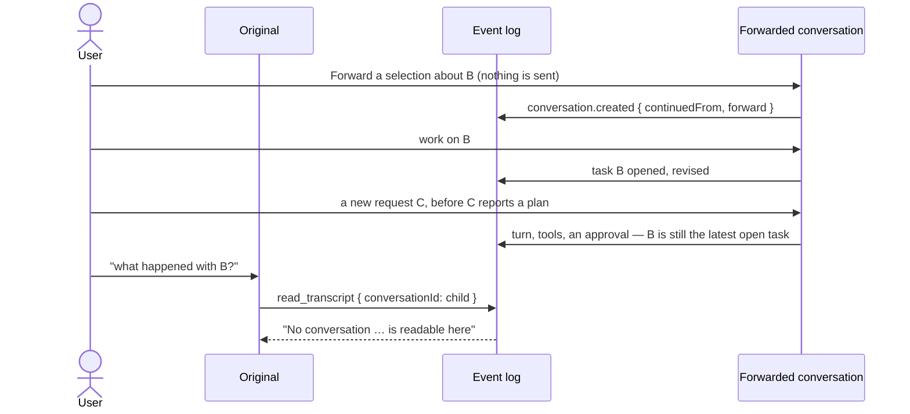
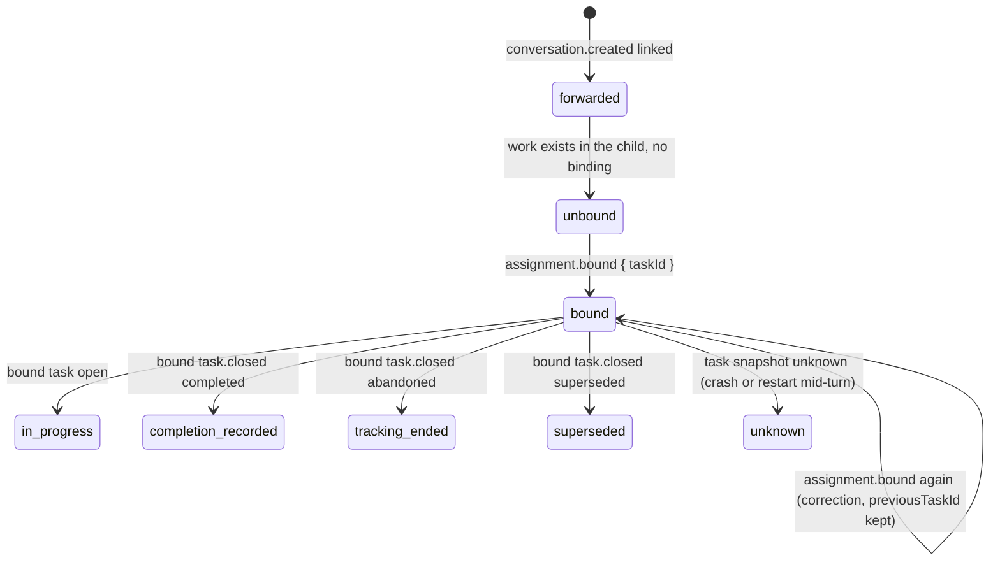
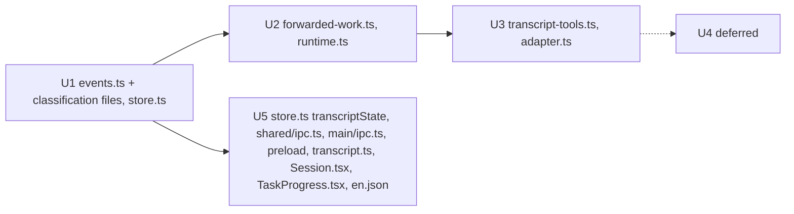
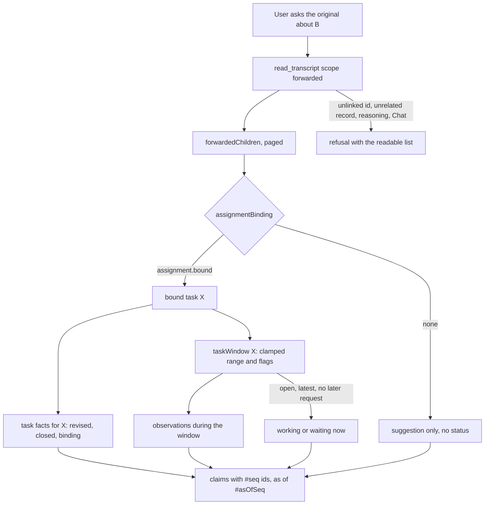

# Asking the original about work it forwarded

## Status

| Unit                                                | State                                                                                                                                                                                                                                                                                                                                             |
| --------------------------------------------------- | ------------------------------------------------------------------------------------------------------------------------------------------------------------------------------------------------------------------------------------------------------------------------------------------------------------------------------------------------- |
| Scope                                               | Read-only monitoring of forwarded work, bound by the user's explicit choice of the child task that is B. The original lists the work it forwarded and answers about one assignment from that task's own records, after idling or a restart                                                                                                        |
| Plan                                                | Third revision, which Codex source-reviewed as final. It keeps exact task facts apart from observations, makes binding explicit, and clamps the historical read at both ends                                                                                                                                                                      |
| User checkpoint                                     | **Approved** by the user, including the "This is the forwarded work" binding action                                                                                                                                                                                                                                                               |
| Baseline                                            | U1: `/private/tmp/chorus-forward-monitoring-yh3akmvc`. U2 and U3: `/private/tmp/chorus-forward-monitoring-reader-3p72_c9u` (1,409 files, `manifest.json`, `git-status.txt`), with the review corrections diffed against `/private/tmp/chorus-forward-monitoring-reader-review-g45mownc`. U5: `/private/tmp/chorus-forward-monitoring-ui-9s1e37c2` |
| U1. Store: link lookup, binding, windowed task read | **Implemented and source-reviewed.** Codex's re-review accepted the corrections in source. The last occurrence case was fixed in the U2 batch and accepted: a reused tool ref with no path no longer inherits an older start's path. Not run: NOT VERIFIED                                                                                        |
| U2. Main: digest, reader branch, bind action        | **Implemented and source-reviewed.** Codex accepted it in source after the six review corrections below. Three narrow store additions (window search, as-of title fact, cut-off session boundary). Not run: NOT VERIFIED                                                                                                                          |
| U3. `read_transcript` scope                         | **Implemented and source-reviewed.** Codex accepted the routing in source. Not run: NOT VERIFIED                                                                                                                                                                                                                                                  |
| U5. Binding transport and child-strip action        | **Implemented and source-reviewed.** Codex's U5 source review found no remaining actionable findings (see "U5 as implemented"). Not run: NOT VERIFIED. That includes the click, the pending and error behaviour, and the marking reaching other open panes                                                                                        |
| Integrated source review                            | **Complete.** Codex reviewed U1–U3 and U5 together in source and found no remaining actionable findings. This is a source review only, not execution evidence                                                                                                                                                                                     |
| U4. Forward this step                               | Deferred. Owns `forward.step` entirely; nothing in the core depends on it                                                                                                                                                                                                                                                                         |
| Verification                                        | Source work and source review only. Nothing has been run: no tests, type checks, lint, formatting, build or app launch, no click, no pending or error behaviour, and no cross-pane runtime behaviour. Every execution acceptance criterion is NOT VERIFIED                                                                                        |

## Current / Issue



| Evidence                                                                                                                    | Fact                                                                                                                                                                          |
| --------------------------------------------------------------------------------------------------------------------------- | ----------------------------------------------------------------------------------------------------------------------------------------------------------------------------- |
| `packages/event-store/src/events.ts:113-120`, `apps/desktop/src/main/runtime.ts:2285-2290`                                  | The link is child-side and written only when the carryover is non-empty. It names no task                                                                                     |
| `packages/orchestrator/src/transcript.ts:444-459`, `runtime.ts:5265-5272`, `packages/agent-protocol/src/adapter.ts:152-160` | Reads reach only self and ancestors. `TranscriptRequest.scope` is its own union                                                                                               |
| `packages/event-store/src/store.ts:750-878`                                                                                 | `taskRecords` starts at `latestTaskOpened` and has no end boundary. `inRange` and `waits` read to the end of the log, and `current` uses `markerSeq: Number.MAX_SAFE_INTEGER` |
| `runtime.ts:2972`, `6210-6231`                                                                                              | Every Work dispatch resets the origin, so `originEventId` cannot identify the first request                                                                                   |
| `runtime.ts:6177-6181`                                                                                                      | `closeTask(…, 'completed')` records completion with no agent declaration                                                                                                      |
| `runtime.ts:6223-6231`                                                                                                      | `task.opened` is appended by the host, not by an agent                                                                                                                        |

**Root issue.** Membership in a time window is not task identity. A new request C can start, run tools and wait on an approval while B is still the latest open task, because C has not reported a plan yet.

## Proposed

### Two kinds of evidence, never mixed

| Kind             | What it is                                                    | Where it comes from                                                                                                                                                                                                                              | Can state B's status                                                      |
| ---------------- | ------------------------------------------------------------- | ------------------------------------------------------------------------------------------------------------------------------------------------------------------------------------------------------------------------------------------------ | ------------------------------------------------------------------------- |
| **Task facts**   | Records that name B's `taskId`, and the binding record        | `task.opened`, `task.revised` and `task.closed` with `taskId = B`, and `assignment.bound` in the linked child. Read by id with no actor filter, because the host writes `task.opened` and `task.closed` and the user's action writes the binding | **Yes**, and only these                                                   |
| **Observations** | Work activity recorded in the child while B was being tracked | Turns, tools, commands with exit codes, files and errors inside B's window, under the Work filter (agent actor, not `reply.status`, not `mode: 'discussion'`, not ignored `itemRef` prefixes)                                                    | **No.** Always phrased "observed in the child during B's tracking window" |

**Currently working or waiting.** Claimed for B only when it can be shown:

- B is the child's latest `task.opened`;
- B has no `task.closed`;
- no Work `user.message` exists after B's `task.opened`.

Then every running turn and pending Work wait comes from requests that B's task was opened for. Otherwise those claims are omitted. The digest may still say "the child is working now; not shown to be part of B". No causality framework is added to manufacture more.

### Binding (D1, recommended)

- **The action.** In a forwarded child, the existing strip head gains one action, "This is the forwarded work". It targets **the task the strip is showing**, the child's latest task, open or just closed. It does not offer arbitrary historical selection.
- **The record.** The action appends `assignment.bound { taskId, previousTaskId }`. `previousTaskId` is `null` the first time, otherwise the task it replaces. That is the correction's provenance, and a later bind deliberately changes the binding; the latest one wins.
- **The guarantee.** The recorded `taskId` is exactly the user's selection. The user can still select the wrong task, and the digest names the bound task and the binding record so that is visible and correctable.
- **Until bound,** the assignment is unbound. The child's first `task.opened` after creation may be offered as an **unconfirmed suggestion**, citing that event. Its progress and completion are never reported as B's status.



### Status claims and their references

| Claim                                             | Basis                                                                                                                     | Reference                                                                        |
| ------------------------------------------------- | ------------------------------------------------------------------------------------------------------------------------- | -------------------------------------------------------------------------------- |
| Bound to task X                                   | Latest `assignment.bound` in the child                                                                                    | That event, plus its `previousTaskId` when it is a correction                    |
| Suggested (unconfirmed)                           | First `task.opened` after creation, while unbound                                                                         | That event                                                                       |
| Plan progress per agent                           | Latest `task.revised` for that agent with `taskId = X`                                                                    | That event                                                                       |
| Agent declared complete                           | Every agent's **latest** `task.revised` for X has `complete: true`. A later revision without it withdraws the declaration | Each of those latest revisions                                                   |
| Completion recorded / tracking ended / superseded | `task.closed` for X                                                                                                       | That event. "Recorded", not "declared", unless the row above exists              |
| Working or waiting now                            | Only under the three conditions above                                                                                     | `turn.started`, `approval.requested` or `userinput.requested`                    |
| Observations                                      | Commands with exit codes, files, failures, last activity, last reply                                                      | Each event's `seq` and `id`. `command.output` cites id and time, never the chunk |

### Retrieval contract

`scope: 'forwarded'` on the existing `read_transcript`:

| Request                                    | Meaning                                                                                                                                                                                                                                                    | Refused, with a reason                                                                                                                                       |
| ------------------------------------------ | ---------------------------------------------------------------------------------------------------------------------------------------------------------------------------------------------------------------------------------------------------------- | ------------------------------------------------------------------------------------------------------------------------------------------------------------ |
| No `conversationId`                        | Direct children, newest first, paged by `skip` and `count` (default 20, at most 50)                                                                                                                                                                        | `query`, `eventId`, `offset`                                                                                                                                 |
| `conversationId` = a linked child          | The digest                                                                                                                                                                                                                                                 | —                                                                                                                                                            |
| Plus `query`                               | Search the observations in the window only                                                                                                                                                                                                                 | Any other record                                                                                                                                             |
| Plus `eventId` (and `offset`)              | Resolve one cited record if it is either:<br/>(a) an exact task fact: `task.*` naming the bound or suggested `taskId`, or an `assignment.bound` in that child, regardless of the window; or<br/>(b) an observation inside the window under the Work filter | Anything else, including reasoning, Chat and unrelated records. A `command.output` record resolves to metadata only: `itemRef`, stream, time and byte length |
| `conversationId` not a linked direct child | —                                                                                                                                                                                                                                                          | Refused, with the readable list                                                                                                                              |

- **Bounded reads.** The list is one paged `conversation.created` query, plus a fixed number of `LIMIT 1` lookups per child: the latest binding, the bound task's close, the child's latest `task.opened`, and the first `task.opened` (the suggestion). A detail read is the clamped task read below plus observation queries, each with its own `LIMIT`. Every answer ends with `As of #asOfSeq`, taken from `logPosition()` before the reads.
- **No missing-child status.** A linked child always has its `conversation.created`. A child whose link record is gone cannot be discovered.

### The historical task read

`taskRecords` today seeds `reduceTask` from the latest task with these parts (`store.ts:750-878`): `inRange`, `waits`, `pendingApprovals`, `pendingQuestions`, `before`, crash `evidence` and `current` evidence. The proposed `taskRecordsFor(window)` keeps every part and clamps it:

| Part                                             | Latest path (unchanged)               | Historical path                                                             |
| ------------------------------------------------ | ------------------------------------- | --------------------------------------------------------------------------- |
| `inRange`                                        | `seq ≥ fromSeq`                       | `fromSeq ≤ seq ≤ toSeq`; then `task.*` kept only where `taskId = X`         |
| `waits`                                          | `seq ≥ fromSeq`                       | `fromSeq ≤ seq ≤ toSeq`                                                     |
| `pendingApprovals`, `pendingQuestions`, `before` | Seeds before `fromSeq`                | Unchanged seeds, used only for `reduceTask`'s clocks, never shown as claims |
| Crash `evidence`                                 | Marker = the session event            | Unchanged; the session events are already inside the clamped range          |
| `current`                                        | `markerSeq = Number.MAX_SAFE_INTEGER` | `markerSeq = toSeq + 1`, so later work cannot become B's last evidence      |

`toSeq` is the first of: B's `task.closed` seq, the next `task.opened` seq − 1, or `asOfSeq`.

## Code Changes (proposed interfaces)

### U1. `packages/event-store/src/events.ts`

```ts
  z.object({
    type: z.literal('assignment.bound'),
    taskId: z.string().min(1),
    previousTaskId: z.string().min(1).nullable(),
  }),
```

It is classified in `projections.ts` (no-op), `orchestrator/src/transcript-lines.ts` (no-op), the runtime recap ledger (no-op) and `shared/transcript-events.ts` (`render`, so the child pane can fold it), with the mandated comments only.

### U1. `packages/event-store/src/store.ts` (proposed)

```ts
export interface TaskWindow {
  readonly conversationId: string
  readonly taskId: string
  readonly fromSeq: number
  readonly toSeq: number
  readonly open: boolean
  readonly latest: boolean
  readonly requestAfter: boolean
}

forwardedChildren(parent: string, page: { skip: number; count: number }): ForwardedChildRow[]
assignmentBinding(child: string): { readonly bound: StoredEvent | null; readonly firstTask: StoredEvent | null }
taskWindow(child: string, taskId: string, asOfSeq: number): TaskWindow | null
taskRecordsFor(window: TaskWindow, options?: TaskRecordOptions): TaskRecords | null
windowObservations(window: TaskWindow, options: { ignoredItemRefPrefixes: readonly string[] }): ObservationRows
```

- **One body, two entry points.** `taskRecords(conversationId, options)` becomes `taskRecordsFor(latestWindow, options)`, where `latestWindow` uses `toSeq = Infinity`, keeps `markerSeq = Number.MAX_SAFE_INTEGER` and skips the `taskId` filter. Every existing caller gets the same records.
- **`taskWindow` sets the attribution flags.** `latest` is true when no `task.opened` follows X. `requestAfter` is true when a Work `user.message` exists after X's `task.opened`.
- **`windowObservations`** returns rows of `seq`, `id`, `created_at` and only the payload fields the claim table names, never `command.output` chunks.

### U1 as implemented (the contract U2 consumes)

All of it is in `packages/event-store/src/store.ts`, exported through the existing `export *` in `index.ts`. `assignment.bound` is in `events.ts` and classified in `projections.ts`, `transcript-lines.ts`, `shared/transcript-events.ts` (`render`) and the runtime recap ledger.

| Method                                                   | Returns                                                                                                                                                                                                                                                                                                                         | Bounds                                                                                                                                                                                                                                                                  |
| -------------------------------------------------------- | ------------------------------------------------------------------------------------------------------------------------------------------------------------------------------------------------------------------------------------------------------------------------------------------------------------------------------- | ----------------------------------------------------------------------------------------------------------------------------------------------------------------------------------------------------------------------------------------------------------------------- |
| `forwardedChildren(parent, { skip, count, asOfSeq })`    | `ForwardedChildPage { children, total, skip, count, asOfSeq }`. Each child is `{ conversationId, created: EventRef, title, titleRef: EventRef, objective, sourceEventIds, throughSeq }`. The title is the latest `conversation.renamed` at or before `asOfSeq`, else the creation title; `titleRef` cites whichever supplied it | Newest first by `seq`; `count` clamped to `FORWARDED_PAGE.max` (50); `seq ≤ asOfSeq`; reads only `conversation.created` rows plus one bounded rename lookup per listed child                                                                                            |
| `forwardedChild(parent, child, asOfSeq)`                 | `ForwardedChild \| null`                                                                                                                                                                                                                                                                                                        | Direct link only, which is the refusal check                                                                                                                                                                                                                            |
| `assignmentBinding(child, asOfSeq)`                      | `{ current, history, suggestion, asOfSeq }`. Each binding is `{ ref, taskId, previousTaskId }`; `suggestion` is the first `task.opened`                                                                                                                                                                                         | History newest first, at most 20                                                                                                                                                                                                                                        |
| `taskWindow(child, taskId, asOfSeq)`                     | `TaskWindow { opened, originEventId, closed, fromSeq, toSeq, open, latest, requestAfter, asOfSeq }`, or `null` for an unknown id or one opened after `asOfSeq`                                                                                                                                                                  | Four `LIMIT 1` lookups                                                                                                                                                                                                                                                  |
| `taskRecordsFor(window, options)`                        | `TaskRecords`, as `taskRecords` returns them, clamped                                                                                                                                                                                                                                                                           | `inRange` and `waits` to `[fromSeq, toSeq]`, `task.*` filtered to the window's id, `current` marker `toSeq + 1`; seeds unchanged                                                                                                                                        |
| `taskFacts(window)`                                      | `{ opened, latestRevisions (one per agent), closed }`. "Declared complete" is derived by U2 only when **every** agent's latest revision has `complete: true`, so a withdrawn or superseded declaration never reads as current. No field reports a historical declaration on its own                                             | By task id, `seq ≤ toSeq`                                                                                                                                                                                                                                               |
| `windowObservations(window, { ignoredItemRefPrefixes })` | `{ commands (each with its completion), files, failures, lastActivity, lastOutput, lastReply }`, every item with an `EventRef`                                                                                                                                                                                                  | Each list with its own `LIMIT` (`OBSERVATION_LIMITS`); Work filter; `lastOutput` carries no chunk. See the correlation rule below                                                                                                                                       |
| `currentWork(window)`                                    | `{ turns, approvals, questions }`, or `null` unless `open && latest && !requestAfter`                                                                                                                                                                                                                                           | Everything as of `window.asOfSeq`. Open turns use `openTurns(conversationId, asOfSeq)`. A wait counts only if it was requested in `[fromSeq, asOfSeq]` with no decision, withdrawal or answer at or before `asOfSeq`. Work waits only. Today's projections are not read |
| `assignmentRecord(child, eventId, scope)`                | `fact`, `observation`, `output` (metadata and byte count only) or `refused` with `unknown`, `later`, `private`, `unrelated` or `not-work`                                                                                                                                                                                       | One lookup by id                                                                                                                                                                                                                                                        |

**Correlation rule** (the fix for Codex's U1 review):

- **A command's result** is the first `command.completed` with the **same actor** and `itemRef`, after the start and at or before `toSeq`. Nothing may come between them: no other start of that ref by that actor, and no `session.started` or `session.ended` for that agent. Otherwise the result is `null`.
- **A patch's path** comes only from the same agent's own `tool.started` with that `itemRef`, inside the window (`seq ≥ fromSeq`) and before the completion, with no completion of that ref and no session boundary for that agent in between. The latest such start is taken first, and its path is used, or `null` if it carries none. An older start's path is never borrowed, including by a later start of the same ref that has no path.

**`openTurns(conversationId, asOfSeq = Number.MAX_SAFE_INTEGER)`.** The default keeps `transcriptState` and `liveState` unchanged.

**Deviations from the drafted names:**

- `taskRecordsInWindow` became `taskRecordsFor`, sharing a private `recordsFrom` body with `taskRecords`. The latest path keeps its `this.read` call and `Number.MAX_SAFE_INTEGER` marker; its `waits` query gains `seq <= MAX_SAFE_INTEGER`, which matches the same rows.
- `taskFacts`, `currentWork`, `forwardedChild` and `assignmentRecord` were added so U2 needs no SQL of its own.
- `openTurns` now also returns the turn's event id, so a current turn can be cited exactly. Its other callers read only `seq` and `at`.
- `lastReply.excerpt` is cut at 600 code points, never inside a surrogate pair (changed in the U2 batch; it was cut at 600 UTF-16 units).

### U2 and U3 as implemented (the contract U5 and the reader consume)

**Store additions** (`packages/event-store/src/store.ts`; SQL stays in the store):

| Method or constant                                                     | Returns                                                                                                                                                                                                                                                                                                                                                                                                                                                                                                                                                                             | Bounds                                                                                                                                                                                                                                                                                                                                                                                                                                                                                                                                                                               |
| ---------------------------------------------------------------------- | ----------------------------------------------------------------------------------------------------------------------------------------------------------------------------------------------------------------------------------------------------------------------------------------------------------------------------------------------------------------------------------------------------------------------------------------------------------------------------------------------------------------------------------------------------------------------------------- | ------------------------------------------------------------------------------------------------------------------------------------------------------------------------------------------------------------------------------------------------------------------------------------------------------------------------------------------------------------------------------------------------------------------------------------------------------------------------------------------------------------------------------------------------------------------------------------ |
| `searchWindow(window, query, { skip, count, ignoredItemRefPrefixes })` | `WindowSearchPage { matches, total, skip, count }`. Each match is an `EventRef` plus `actor`, `type`, `snippet`, `clippedStart`, `clippedEnd`                                                                                                                                                                                                                                                                                                                                                                                                                                       | `[fromSeq, toSeq]` only; types `WINDOW_SEARCH_TYPES` (`agent.message.completed`, `command.started`, `tool.started`, `tool.completed` summary, `file.change.completed` paths, `error.raised`); the Work filter, except `error.raised`, as `windowObservations` treats it. Newest first, `count` clamped to `WINDOW_SEARCH.max` (50); the snippet is 200 characters before and 400 after the match, cut by SQLite on whole characters. `command.output`, reasoning, Chat, discussion and user or host records are never searched. An empty query returns an empty page without a query |
| `assignmentRecord` (widened)                                           | `conversation.renamed` resolves as a `fact` only when it is the child's latest rename at or before `scope.asOfSeq`, which is exactly the `titleRef` that `forwardedChild` cites at that point. Any other rename is `refused: unrelated`                                                                                                                                                                                                                                                                                                                                             | One extra `LIMIT 1` lookup, only for a rename                                                                                                                                                                                                                                                                                                                                                                                                                                                                                                                                        |
| `assignmentRecord` (session-boundary exception)                        | A `session.started` or `session.ended` resolves only if it lies inside the window and at or before `asOfSeq`, and it cut off a turn: the same agent had a `turn.started` at or after `fromSeq`, with no `turn.completed` and no other session boundary for that agent between them. That is exactly the boundary `interruptedTurns` cites. It returns the new kind `boundary { ref, agentId, boundary, reason, resumed }`: metadata only, never `sessionRef`, `cwd`, `model` or `cliVersion`. Any other host record stays `not-work`; anything outside the window stays `unrelated` | One extra `LIMIT 1` lookup, only for a session event inside the window                                                                                                                                                                                                                                                                                                                                                                                                                                                                                                               |

**Case-folding is ASCII only.** Search uses SQLite `instr(lower(text), lower(query))`, and SQLite's `lower` folds ASCII letters only. A non-ASCII letter matches in its exact case. The answer says so ("ASCII letters match either case").

**`apps/desktop/src/main/forwarded-work.ts` (pure, no store access):**

```ts
export type AssignmentState =
  'unbound' | 'open' | 'completion-recorded' | 'abandoned' | 'superseded' | 'unknown'

export interface Claim {
  readonly kind: 'link' | 'binding' | 'suggestion' | 'task' | 'current' | 'observation'
  readonly text: string
  readonly refs: readonly EventRef[]
}

export interface DigestInput {
  readonly child: ForwardedChild
  readonly binding: AssignmentBinding
  readonly window: TaskWindow | null // the marked task's, or the suggestion's
  readonly facts: TaskFacts | null // marked task only
  readonly observations: WorkObservations | null
  readonly current: CurrentWork | null // marked task only, and null unless attributable
  readonly interrupted: readonly InterruptedTurn[]
}

export function digestAssignment(input: DigestInput, asOfSeq: number): AssignmentDigest
// AssignmentDigest { conversationId, title, taskId, bound, state, declared, window, claims, asOfSeq }

export function renderDigest(digest: AssignmentDigest, maxBytes: number): string
export function renderForwardedList(
  page: ForwardedChildPage,
  entries: readonly ForwardedListEntry[],
  maxBytes: number
): string
export function renderNotForwarded(
  conversationId: string,
  page: ForwardedChildPage,
  maxBytes: number
): string
export function renderRecord(
  record: AssignmentRecord,
  eventId: string,
  context: ForwardedReadContext,
  offset: number,
  maxBytes: number
): string
export function renderSearch(
  page: WindowSearchPage,
  query: string,
  context: ForwardedReadContext,
  maxBytes: number
): string
export function interruptedTurns(events: readonly StoredEvent[], fromSeq: number): InterruptedTurn[]

export type BindAssignmentResult =
  | {
      readonly outcome: 'bound'
      readonly taskId: string
      readonly previousTaskId: string | null
      readonly ref: EventRef
    }
  | { readonly outcome: 'unchanged'; readonly taskId: string; readonly ref: EventRef }
  | {
      readonly outcome: 'refused'
      readonly reason: 'not-forwarded' | 'no-task' | 'not-latest' | 'unavailable'
    }
```

- **Status needs a marking.** `task` and `current` claims are produced only when `binding.current` exists, and the window must be that task's. Unmarked, the digest holds the link, the "not marked" statement, the suggestion citing the first `task.opened`, and observations from the suggestion's window. It never holds that task's progress or close.
- **Each state is distinct.** `completion-recorded`, `abandoned` and `superseded` come from `task.closed.reason`. `open` needs no close and `latest`. `unknown` is no close plus a later `task.opened`, or a marked task with no readable window.
- **Declared** (the aggregate flag) means every agent's latest revision has `complete: true`; a later revision without it withdraws that agent's declaration. The wording follows the lanes exactly:
  - Every lane declares: "Every agent's latest plan revision declares it complete", plus "no completion is recorded yet", or "but tracking closed as …".
  - Only some lanes declare: "Only some agents declare it complete: the latest plan revision of A does, and that of B does not". With a recorded completion, it adds "Completion was recorded without every agent declaring it".
  - No lane declares, and completion was recorded: "No agent's latest plan revision declares it complete, so completion was recorded without an agent declaration". With no plan at all: "No plan was reported for it, so…".
- **Current claims** need `open && latest && !requestAfter`. Otherwise one line says current activity is not shown, and why.
  - A turn cut off by a session boundary reads "ended without a recorded result … unknown" (`interruptedTurns`). It cites the turn and the boundary, and both resolve. It is a current claim, not a task state.
  - **An empty result is never "idle".** `currentWork` sees only turns and waits that began at or after `fromSeq`. A turn that began before the window, such as the one running when guidance reset the origin before the first report, is not attributed to the task. So the empty case reads: "No running turn or open wait that began in this task's tracked window was found as of #N. That does not show the conversation is idle: work that began before the window is not attributed to this task."
- **Observations** sit under a heading naming the window `#fromSeq–#toSeq`, which says "records, not status". A `tool.patch` reads "recorded a patch; that alone does not show the file changed". An exit code is reported as a number, never as success. The last-activity line carries its stored time ("recorded <ISO time>"), so recent news can be told from old activity with no clock or polling.
- **Budget.** Every renderer stays within `maxBytes` (the reader's `maximum`, else the existing `contextBudget(…, 16_000)`). Text is cut on code points. The head and the as-of line are kept first; dropped lines are counted. If nothing fits, the answer is a clipped `FORWARDED_NO_ROOM`.
- **Records are formatted here**, not by `composeTranscript`. Its `transcript-lines` deliberately omits `task.*` and `assignment.bound`, so routing facts through it would leave them uncitable.
  - A fact or an observation is shown as `actor type:` plus its JSON payload, paged by byte `offset` exactly as `readRecord` pages. The head says whether it is a task fact or an observation from the window, and gives its stored time ("written <ISO time>").
  - `command.output` shows only metadata: stream, actor, `itemRef`, byte size and time. A `boundary` shows the agent, the boundary and its reason, its time, and that it is an observation.
  - **Citations are never cut.** Both metadata records fall back to a brief line that keeps the whole reference, then to a clipped `FORWARDED_NO_ROOM`, which holds no reference. A claim line fits its prose and appends its references intact. A list line keeps the conversation, the link reference, the title reference (when the title comes from a rename) and the marking, and fits only the title and objective text.

**`apps/desktop/src/main/runtime.ts`:**

- **Reader.** The session's `transcript` closure sends `scope: 'forwarded'` to the private `readForwarded(parentId, request, maxBytes)`. Every other scope goes to `composeTranscript`, as before. `readForwarded` takes `asOfSeq = logPosition()` once and passes it to every store call.
  - **List** (no `conversationId`): it rejects `query`, `eventId` and `offset` a second time, after the shared validation. It reads `forwardedChildren` with paging, and for each listed child `assignmentBinding` plus the marked task's `taskWindow`.
  - **Detail:** `forwardedChild` is the refusal check. Unlinked or transitive ids get `renderNotForwarded` with the first page.
  - **Scope:** the marked task, else the suggestion, is the only task id passed to `assignmentRecord` and to the window.
- **`bindAssignment(conversationId, taskId): BindAssignmentResult`.** Public, for U5's IPC handler to call on the user's click. It is not an agent tool. It refuses, appending nothing:
  - `not-forwarded`: no `continuedFrom`, or not resolvable by `forwardedChild`;
  - `no-task`;
  - `not-latest`: not the child's latest `task.opened`, whether open or closed, which is what the strip shows.

  It returns `unchanged` without appending when the current marking already names that task. Otherwise it appends `assignment.bound { taskId, previousTaskId: current?.taskId ?? null }` as `user` through `store.append`, the same path `closeTask` uses with no service.

**`packages/agent-protocol`:**

- **The scope type.** `adapter.ts` exports `TranscriptScope = 'snapshot' | 'updates' | 'forwarded'`, and `TranscriptRequest.scope` takes it. `TRANSCRIPT_SCOPES` lists the same three, checked with `satisfies readonly TranscriptScope[]`.
- **Descriptions.** `SCOPE_TEXT`, `CONVERSATION_TEXT` and `TRANSCRIPT_TOOL_DESCRIPTION` describe the forwarded list, the marked-task read, the line between status and observation, and the as-of point.
- **Validation.** `runTranscriptTool`'s argument schema refuses `query`, `eventId` or `offset` with `scope: 'forwarded'` and no `conversationId`, as "Invalid arguments: <field>: not accepted when listing forwarded conversations…", before any read.
- **Adapters.** Both already parse through `runTranscriptTool`, and the Codex schema is generated from the same `TRANSCRIPT_SCOPES`, so neither adapter was edited.

**`packages/orchestrator/src/transcript.ts`:** `composeTranscript` returns `TRANSCRIPT_FORWARDED_ELSEWHERE`, bounded, for `scope: 'forwarded'`, before any view is built. So the scope can never be read as ancestor access, and `viewOf` and `readRecord` keep their `'snapshot' | 'updates'` types. Snapshot and updates are otherwise unchanged.

**U2 review corrections** (Codex's U2 source review, all six now in source):

| Finding                                                       | Correction                                                                              |
| ------------------------------------------------------------- | --------------------------------------------------------------------------------------- |
| A crash citation could not be opened                          | The session-boundary exception above, with the metadata-only `boundary` record kind     |
| A mixed declaration was called "without an agent declaration" | The lane-exact wording above. The aggregate rule and withdrawal are unchanged           |
| An empty attributable query read as "nothing is running"      | The qualified empty line above, and no idle or no-waiting claim from empty arrays       |
| A listed renamed title cited only the creation record         | The list cites `titleRef` beside `created`, outside the fitted text                     |
| An output record could lose its reference to a small budget   | A whole-reference brief line, else no-room                                              |
| The last activity had no time                                 | `recorded <ISO>` on the claim, and `written <ISO>` on every fact and observation record |
| A test objective exceeded the 2,000-character schema limit    | The fixture uses 450 moons (904 UTF-16 units). The product schema is unchanged          |

**Deviations from the drafted U2 and U3:**

- **No reuse of `composeTranscript` for `query` and `eventId`** (the draft proposed it). Its lines omit task facts, so those citations would not resolve. Formatting and paging mirror it instead.
- **`TaskSnapshot` is not an input.** Status comes from `TaskWindow` and `TaskFacts`. The crash case is `interruptedTurns` over `taskRecordsFor(window).events`, read only when current attribution holds.
- **The `unknown` state** in the diagram above covers no close plus a later task, and an unreadable window. "A crash mid-turn" is reported as a current claim, because the task record still says open.
- **`searchWindow` and the rename fact** are the two store additions this batch needed.

### U5 as implemented: binding transport and the strip action

| File                                             | Change                                                                                                                                                                                                                                                                                                                                                                                                                                                                                                                                                                                                                                                               |
| ------------------------------------------------ | -------------------------------------------------------------------------------------------------------------------------------------------------------------------------------------------------------------------------------------------------------------------------------------------------------------------------------------------------------------------------------------------------------------------------------------------------------------------------------------------------------------------------------------------------------------------------------------------------------------------------------------------------------------------- |
| `packages/event-store/src/store.ts`              | `TranscriptState.assignment: TranscriptAssignment { linked, boundTaskId }`, from a private `transcriptAssignment`. `linked` mirrors `bindAssignment`'s check: the first `conversation.created` has a string `continuedFrom`, and `forwardedChild(parent, child, MAX)` resolves it. Old forwards with no `forward` details are linked. `boundTaskId` is the latest `assignment.bound`'s `taskId` (one `LIMIT 1` query), and `null` when unlinked, so a stray record in an ordinary conversation never shows a marker. The first-task suggestion never counts. These are queries, not a fold, so a page that starts after the link and the marking still recovers both |
| `apps/desktop/src/shared/ipc.ts`                 | `TranscriptAssignmentShape = { linked: boolean, boundTaskId: string \| null }` and its type `TranscriptAssignment`. `TranscriptStateShape.assignment` is optional for older responses. `task:bindAssignment`: request `{ conversationId: string, taskId: string (1–64) }`, the same bound as `task:close`; response `{ bound: boolean }`. `ChorusApi.bindAssignment`. `boundTaskId` is left unbounded on the wire, so an odd stored id cannot fail a whole transcript read's response validation                                                                                                                                                                     |
| `apps/desktop/src/main/ipc.ts`                   | `'task:bindAssignment'` maps `runtime.bindAssignment(conversationId, taskId).outcome` to `bound`: `true` for `bound` and `unchanged`, `false` for `refused`. It adds no checks of its own; the runtime's linked, latest and duplicate checks are the gate. It is registered through the existing loop, with `isShellSender`, request and response validation. `toTranscriptState` now takes `assignment` as optional and copies it field by field when present                                                                                                                                                                                                       |
| `apps/desktop/src/preload/index.ts`              | `bindAssignment: invoke('task:bindAssignment')`                                                                                                                                                                                                                                                                                                                                                                                                                                                                                                                                                                                                                      |
| `apps/desktop/src/renderer/src/transcript.ts`    | `TranscriptView.assignment`, `NO_ASSIGNMENT = { linked: false, boundTaskId: null }` in `EMPTY_VIEW`, and `Mutable.assignment` carried through `reduceEvents`. `applyTranscriptState` takes `assignment` when the state has it; when absent (an older main) the view keeps what it holds, which starts at `NO_ASSIGNMENT`. `case 'assignment.bound'` folds `boundTaskId` only; `linked` comes only from authoritative state. `prependEvents` and earlier pages never change it                                                                                                                                                                                        |
| `apps/desktop/src/renderer/src/Session.tsx`      | One prop: `assignment={view.assignment}`                                                                                                                                                                                                                                                                                                                                                                                                                                                                                                                                                                                                                             |
| `apps/desktop/src/renderer/src/TaskProgress.tsx` | On the task-shaped head only: when `linked` and `boundTaskId !== model.taskId`, the button "This is the forwarded work" (`task-progress-close task-progress-bind`). It sends the shown `model.taskId`, is disabled while any bind is pending, clears pending in `finally`, and reports `{ bound: false }` or a rejection through `onError` (`taskProgress.forwarded.stale`). When `boundTaskId === model.taskId`, a `task-progress-badge` reading "Forwarded work". Nothing shows when unlinked, or for activity and live-only strips                                                                                                                                |
| `apps/desktop/src/renderer/src/i18n/en.json`     | `taskProgress.forwarded.{mark, markHint, bound, boundHint, stale}`. None of them says done, complete or accepted; `markHint` says it does not mark the task done or accepted                                                                                                                                                                                                                                                                                                                                                                                                                                                                                         |
| `apps/desktop/src/renderer/src/styles.css`       | One rule, `.task-progress-close ~ .task-progress-bind { margin-left: 0 }`. Two `margin-left: auto` buttons in one flex head would otherwise split the free space between them                                                                                                                                                                                                                                                                                                                                                                                                                                                                                        |

**Ordering, not optimism.** The click does not touch the view. The marking arrives as the `assignment.bound` push, which every open pane folds. A cold or returning read applies the queried state first, then the pushes buffered while it was in flight, which is the existing order in `Session.tsx`. So a newer marking pushed during the read lands after the older snapshot. A push already covered by the read's `throughSeq` is dropped by the `seq` guard, and the snapshot that includes it stands. The remount carry keeps `assignment` through `{ ...EMPTY_VIEW, ...carry.view }`. A carry from an older build without it falls back to `NO_ASSIGNMENT` until its read returns the state.

**Not changed:** `runtime.ts`, the accepted reader, `taskStrip`'s task-versus-activity rule, busy and Stop, composer focus, forecasts, clocks, calibration, steps, live tracking, and the local timer. No polling, no new effect, no dialog, no historical task selection.

**Regression sources (none run):**

- **`assignments.test.ts`:** an ordinary conversation unlinked even with a stray record; an old forward linked; the first task not counted; the latest marking after a correction; the link and the marking recovered when both precede the loaded page.
- **`main/ipc.test.ts`:** exact ids forwarded; `bound` and `unchanged` reported as `true`, `refused` as `false`; the response schema; missing, empty, 65-character and missing-conversation requests refused; `assignment` carried through the copier and absent when absent, with the response schema parsing both.
- **`transcript-task.test.ts`:** the default and the state; an absent field keeping the held value; a pushed mark, a correction, and unrelated pushes preserving it; a stray push never linking; the snapshot-then-held ordering in both race directions; the remount carry; a carry from an older build; an earlier page.
- **`TaskProgress.test.tsx`** (new; `renderToStaticMarkup` under node, as in `Entry.test.tsx`): the action on an open task, on a closed task, and on a task differing from the marking; the marker on the marked task; neither when unlinked. Clicking, pending and the error path are NOT VERIFIED.
- **Existing `forwarded-monitoring.test.ts`:** `bindAssignment` refusals and duplicates; not duplicated here.

### U4. Deferred

`forward.step` (schema, start-time validation and the "Forward this step" action) ships together if ever approved. Nothing in U1–U3 or U5 reads or writes it.

## Acceptance cases (none run)

U1's cases are written. Where the table below says `store.test.ts` for a U1 case, the source lives in one of these two files:

- `packages/event-store/src/task-records.test.ts`: B readable after C, bounded at its close; only B's lifecycle; current evidence stopping at the window end; the latest path unchanged; unknown and too-late ids refused; a later request before C's first plan marking `requestAfter` and suppressing current work.
- `packages/event-store/src/assignments.test.ts` (new, because these cases span parent and child conversations): newest-first paging with an as-of point; old links with no forward details; grandchild and unrelated refusals; suggestion versus binding with corrections; B complete while C runs and waits; output cited by metadata only; record resolution and every refusal reason.

U2 and U3's cases are written too. Where the table names `task-progress.test.ts` for a runtime reader case, the source is in the new `apps/desktop/src/main/forwarded-monitoring.test.ts` instead: it uses the same `FakeAdapter` harness, and keeps `task-progress.test.ts` to the strip. In each file:

- **`assignments.test.ts`** (additions):
  - a latest start with no path never inheriting an older start's `old.ts`;
  - the title rename resolving only as the as-of title fact;
  - whole-character reply excerpts;
  - the window search keeping to the window and the Work filter, with output, reasoning, Chat, discussion, requests and C's records unsearchable;
  - search paging, the ceiling and an empty query;
  - multibyte snippets;
  - after the U2 review, the session-boundary exception: a boundary that cut off a turn in the window resolves as metadata with no `sessionRef`; a later boundary with no open turn is `not-work`; one before the window is `unrelated`; one after the as-of point is `later`.
- **`apps/desktop/src/main/forwarded-work.test.ts`** (new, the pure digest over a real in-memory store). After the U2 review it also covers:
  - every emitted citation resolving through `assignmentRecord`;
  - the crash boundary resolving as metadata, with boundaries before, unrelated to, or after the window refused;
  - mixed-lane declarations, open and recorded;
  - a turn that began before the window producing the qualified empty line;
  - the last-activity time, and its record's `written` time;
  - a renamed child's list line citing both references;
  - small-budget output records with no partial reference.

  The original cases:
  - an unmarked completed suggestion;
  - "no task recorded" without "nothing done";
  - a marking after close, then a correction with provenance;
  - B complete while C runs and waits;
  - a later request before C's plan;
  - current work only when attributable;
  - a crash mid-turn reading unknown;
  - a withdrawn declaration;
  - a manual completed close without a declaration;
  - abandoned and superseded;
  - Chat exclusion;
  - budgets on whole characters;
  - `command.output` as metadata;
  - multibyte record paging that rebuilds exactly;
  - list paging, and refusal bounds;
  - search labelling;
  - `interruptedTurns`.

- **`apps/desktop/src/main/forwarded-monitoring.test.ts`** (new, runtime). After the U2 review:
  - the guidance case uses a real `turn.started` before a `guide` message, asserts the origin reset, and expects the qualified empty line with no idleness;
  - every citation in a digest is read back through the reader.

  The original cases:
  - the original's reader after later child work and after a reopen;
  - an unmarked suggestion;
  - guidance before the first plan;
  - a later request suppressing current claims;
  - cited records, search and refusals, including list mode and unlinked ids;
  - snapshot and updates unchanged;
  - byte budgets;
  - `bindAssignment`'s not-forwarded, no-task, not-latest, unchanged and correction outcomes.

- **`packages/agent-protocol/src/transcript-tools.test.ts`:** forwarded pass-through, list-mode refusals, and the scope offered to both providers.
- **`packages/orchestrator/src/transcript.test.ts`:** `composeTranscript` refusing `forwarded` without reading ancestors.

| Case                                                                                                                                                                                                                                           | Harness                                                                                                                                                        |
| ---------------------------------------------------------------------------------------------------------------------------------------------------------------------------------------------------------------------------------------------- | -------------------------------------------------------------------------------------------------------------------------------------------------------------- |
| Forwarded, nothing sent: `forwarded`, no claims                                                                                                                                                                                                | `apps/desktop/src/main/forwarded-work.test.ts` (new, pure), `live-chat.test.ts` (`forwardConversation`)                                                        |
| Unbound with work: only a suggestion citing the first `task.opened`; no status, even when that task completes                                                                                                                                  | `forwarded-work.test.ts`                                                                                                                                       |
| Bound, then corrected: the latest binding wins; the digest cites both records and `previousTaskId`                                                                                                                                             | `forwarded-work.test.ts`, `packages/event-store/src/store.test.ts`                                                                                             |
| Binding recorded after B closed: the binding resolves by `eventId` though it lies outside B's window                                                                                                                                           | `store.test.ts`, runtime reader case in `task-progress.test.ts`                                                                                                |
| Guidance before B's first plan: binding by the user's selection is unaffected by the origin reset                                                                                                                                              | `task-progress.test.ts`                                                                                                                                        |
| **C starts while B is still the latest open task, before C's first report:** B's progress comes from B's `task.revised` only; C's tools appear only as observations; no "B is working" or "B is waiting" claim, because `requestAfter` is true | `forwarded-work.test.ts`, `store.test.ts` (`taskWindow` flags)                                                                                                 |
| B complete while C runs and waits: B is `completion-recorded`, citing its `task.closed`, with "declared" only beside a `complete: true` revision; none of C's activity appears                                                                 | `forwarded-work.test.ts`, `store.test.ts`                                                                                                                      |
| `closeTask(…, 'completed')` with no declaration: "completion recorded", never "declared"                                                                                                                                                       | `forwarded-work.test.ts`                                                                                                                                       |
| Historical read: once C opens, `taskRecordsFor(B)` is clamped at both ends; `current` stops at `toSeq + 1`; later decisions do not leak; `taskRecords` (latest) returns what it returns today                                                  | `packages/event-store/src/task-records.test.ts`, `store.test.ts`                                                                                               |
| Chat in the child during B: absent from task facts and observations                                                                                                                                                                            | `store.test.ts`                                                                                                                                                |
| Multiple attempts: two children, each with its own binding                                                                                                                                                                                     | `store.test.ts` (`forwardedChildren` paging), `forwarded-work.test.ts`                                                                                         |
| Reopen and restart: the same digest; a crash mid-turn reads `unknown`                                                                                                                                                                          | `task-progress.test.ts` (hard-kill reopen)                                                                                                                     |
| Retrieval refusals: list plus `eventId`; an unrelated id; reasoning; Chat; a `command.output` resolving to metadata only; `snapshot` and `updates` unchanged                                                                                   | `packages/orchestrator/src/transcript.test.ts`, runtime reader case in `task-progress.test.ts`                                                                 |
| Binding transport: a forwarded child's strip offers the action, a non-forwarded one does not; `bindAssignment` refuses a task that is not the latest                                                                                           | `TaskProgress.test.tsx` (static render), `transcript-task.test.ts`, `apps/desktop/src/main/ipc.test.ts`, `assignments.test.ts`, `forwarded-monitoring.test.ts` |

Future runtime evidence, once execution is authorised: a driven run that forwards B, binds it, starts C, restarts, and asks the original.

## Implementation order and ownership



One writer per file at a time. `store.ts` is touched in U1, narrowly in U2 (the U1 correlation fix, `searchWindow`, the as-of title fact, whole-character excerpts), then in U5. `runtime.ts` is touched in U2 only: the reader branch, `readForwarded` and `bindAssignment`.

## Open decision

- **D1 (user checkpoint).** Approve the one-action explicit binding. The trade-off: without it, the original can only show an unconfirmed suggestion and observations, never B's status.
- **Settled by the lead.** Direct children only. Forward-this-step is deferred.

## Final Flow


