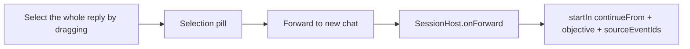
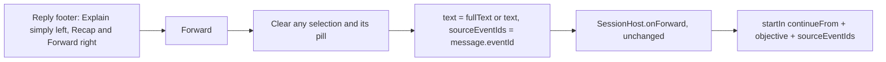
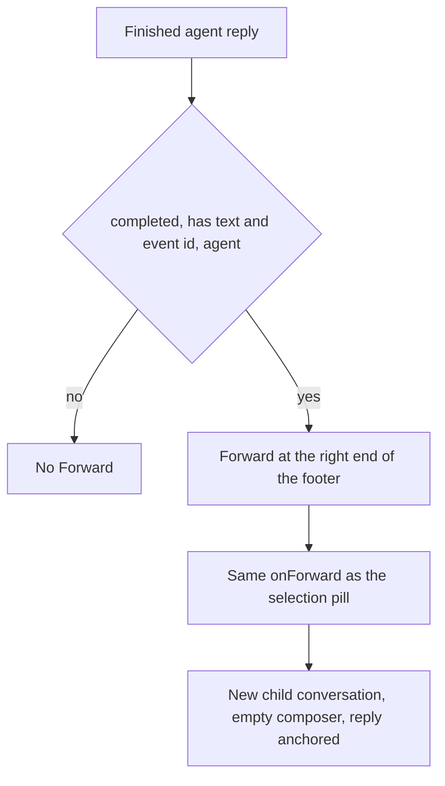

# Forward a whole response

## Status

| Unit           | Result                                                                                                                                 |
| -------------- | -------------------------------------------------------------------------------------------------------------------------------------- |
| Scope          | Requested by the user: a Forward action at the right end of every finished agent response, the same as forwarding the whole selection |
| Implementation | Claude; written and source-reviewed against `/private/tmp/chorus-forward-response-2src8skl`. Codex source-reviewed and accepted the shortcut flow, then the carry-budget correction that came from that review, with no remaining actionable findings |
| Build and install | Succeeded. Codex ran `env CHORUS_INSTALL_KEEP_RUNNING=1 pnpm --dir /Users/mohamadtaleb/code/workbench app:install`, which exited 0: all eight dependency builds succeeded from cache; Electron main, preload and renderer built; the arm64 app was packaged and signed with Chorus Local Dev; and the installer verified its signature and installed `/Applications/Chorus.app`. The running old copy was kept at `/Applications/Chorus.app.replaced-1792198779958`. Chorus must be restarted to use the new build. The existing missing `GITHUB_TOKEN` configuration warning appeared in the cached dependency logs and in packaging; it did not fail the command |
| Verification   | NOT VERIFIED. No tests and no separate typecheck, lint or formatting runs; the app has not been launched. Click behaviour, layout and the backgrounded-tab trim are unobserved; every execution-dependent acceptance case is NOT VERIFIED |
| Delivery       | Commit and push pending, owned by Codex |

## Current / Issue

Forwarding a whole reply means dragging across all of it first. A reply that ends in a `## Summary` list is split by the reducer: `message.text` keeps only the prefix and the list is drawn as a separate card. A reply that is only a Summary has an empty `message.text`.

## Proposed

- **One route.** The button calls the same `onForward` the selection pill calls. `SessionHost` keeps its objective trimming and its 2,000-unit clip, and main keeps the anchored-source carryover, so the child opens the same way: same project, parent link, startup handling and empty composer.
- **The whole recorded reply.** `agent.message.completed` now also keeps the complete payload text as `fullText`, set only when a trailing Summary was cut off. Display text, the Summary card and Explain are unchanged. It is computed during the fold, so old logs replay into it.
- **Eligibility in `Entry`.** A completed `message` row with non-empty forwardable text and an event id, from an agent (Session passes the callback only for agent rows, and `Entry` also refuses `user` and `system`). Final and non-final replies both qualify, Work and Chat both qualify, and the Explain language setting has no effect on it.
- **Placement.** The row stays `space-between`. Explain stays alone in `entry-actions-do` on the left; Recap and Forward share a new `entry-actions-end` group on the right, Forward last. Go ahead keeps its second line.

Deliberately not done: no dialog, no automatic send, no draft prefill, no change to the selection path, `SessionHost`, main or IPC.

## Code Changes

| File | Change |
| --- | --- |
| `renderer/src/transcript.ts` | `TranscriptMessage.fullText?: string`; `agent.message.completed` sets it to the whole payload text when a Summary was cut |
| `renderer/src/Entry.tsx` | `onForward?: (message) => void`; `forwardable` computed from the row; the row's union includes it; `entry-actions-end` holds Recap and Forward |
| `renderer/src/Session.tsx` | Stable `forwardReply` (`useCallback` on `onForward`): clears the selection and its pill, then forwards `{ text: fullText ?? text, sourceEventIds: [eventId] }`; passed for agent rows |
| `renderer/src/styles.css` | `.entry-actions-end` shares the `.entry-actions-do` rule and takes `margin-left: auto` |
| `renderer/src/i18n/en.json` | `conversation.forwardReply` ("Forward") and `conversation.forwardReplyHint` |
| `renderer/src/carry.ts` | Added from Codex's review: `weigh` counts `fullText.length` beside `text`, `detail`, `patch` and the rest, in the first sum, so the existing early exits still apply. The budget, persistence and trim behaviour are unchanged |

## Acceptance (written, not run)

- `Entry.test.tsx`: Forward on a completed agent reply with no Explain or Recap; on a summary-only reply; absent on streaming, empty, user and system rows and without a callback; it sits in the right-hand group after Recap while Explain stays on the left.
- `transcript.test.ts`: a completion with a Summary keeps the display prefix and items and records `fullText`; a summary-only completion has empty text and a full `fullText`; a plain completion has no `fullText`.
- `SessionHost.test.tsx`: a whole multi-line reply with its Summary reaches `startIn` as the objective with its single source event id.
- `carry.test.ts`: a Summary-bearing reply whose display body and `fullText` are each under the budget but exceed it together is refused, and `trimCarry` drops the view while keeping the draft, scroll position and follow state; a small `fullText` stays retained.

## Final Flow

