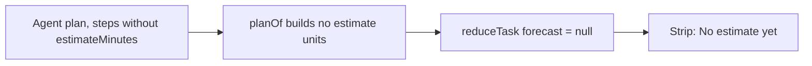
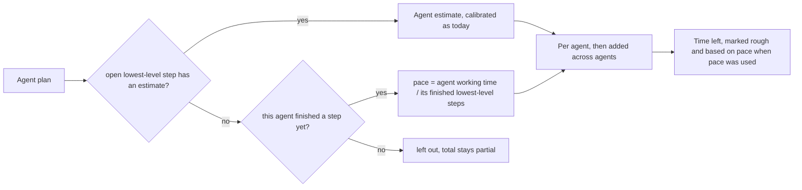
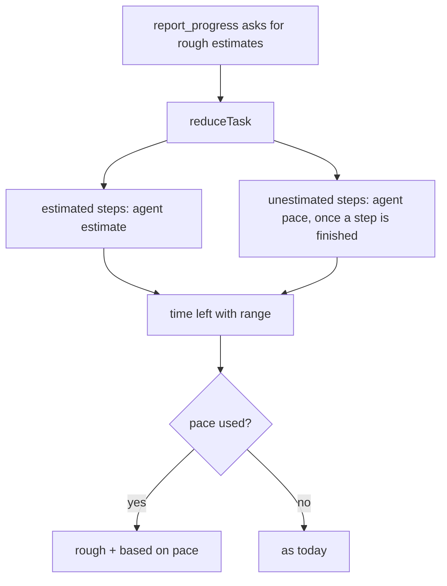

# Always show an estimate

## Status

| Unit           | Result                                                                                                     |
| -------------- | ---------------------------------------------------------------------------------------------------------- |
| Scope          | Approved by the user: firmer estimate wording in the progress tool, and a pace-based fallback in the strip |
| Implementation | Claude; written, not reviewed                                                                              |
| Verification   | NOT VERIFIED. No tests, typechecks, lint, formatting, builds or app runs; the user has not asked for them  |

## Current / Issue

- The forecast is built only from `estimateMinutes` on plan steps (`shared/task-progress.ts`, `planOf` and the forecast block in `reduceTask`). A plan with none gets no forecast at all.
- The progress tool tells agents to "leave out estimates you cannot make rather than guessing" (`progress-tools.ts`, `ESTIMATE_TEXT` and `PROGRESS_TOOL_DESCRIPTION`), so they often do. Plans a CLI reports natively never carry estimates.

## Proposed

1. **Firmer wording.** Both the step field and the tool description ask for a rough estimate on every lowest-level step instead of saying to leave estimates out. The field stays optional: a rejected call would lose the whole plan.
2. **Pace fallback.** For each agent, open lowest-level steps with no estimate are filled with that agent's pace: its working time (time not spent waiting on the user) divided by the lowest-level steps it has finished. Agent estimates keep priority and their calibration is unchanged.
3. **Mixed plans.** Pace fills only the unestimated steps, so a mixed plan is no longer `partial`. It stays `partial` only when an agent has unestimated open steps and no finished step yet.
4. **Label.** A forecast that used pace is `paced` and always `rough`; the strip shows a "based on pace" badge.
5. **Before the first finished step.** No pace exists, so "No estimate yet" stays. No past-task average is invented.

Deliberately not done:
- Pace never feeds calibration. `firstForecastMs`, `plannedMs` and the samples count agent estimates only.
- Overrun stays agent-estimate only.
- The schema stays optional.
- No change to native-plan ingestion.

**Behaviour change accepted:** a native plan with a finished step now shows a paced countdown instead of none, which is the point.

**Known limit:** pace assumes steps are similar in size, so a large final step is underestimated. The rough label and the range carry that uncertainty.

## Code Changes

| File | Change |
| --- | --- |
| `packages/agent-protocol/src/progress-tools.ts` | `ESTIMATE_TEXT` and the estimate sentence in `PROGRESS_TOOL_DESCRIPTION` ask for a rough estimate on every lowest-level step |
| `apps/desktop/src/shared/task-progress.ts` | `TaskForecast.paced`; an agent pace from `agentOf(agentId).workingMs` and finished leaves; the forecast includes lanes with paced steps; paced time adds to the point, low (×0.6) and high (×2); `partial` only when unestimated steps have no pace |
| `apps/desktop/src/renderer/src/task-strip.ts` | `StripForecast` `remaining` carries `paced` |
| `apps/desktop/src/renderer/src/TaskProgress.tsx` | The "based on pace" badge beside "rough" |
| `apps/desktop/src/renderer/src/i18n/en.json` | `taskProgress.paced`, `taskProgress.pacedHint` |

## Acceptance (written, not run)

- `shared/task-progress.test.ts`:
  - a plan without estimates gets a paced, rough forecast once a step is done (pace × open steps);
  - none before the first finished step;
  - a mixed plan is filled and no longer partial;
  - pace does not change `plannedMs` or `firstForecastMs`;
  - the native-plan case now counts down.
- `renderer/src/task-strip.test.ts`: a paced forecast reaches the strip as `remaining` with `paced: true`.
- `renderer/src/TaskProgress.test.tsx`: the "based on pace" badge renders for a paced forecast.

## Final Flow

