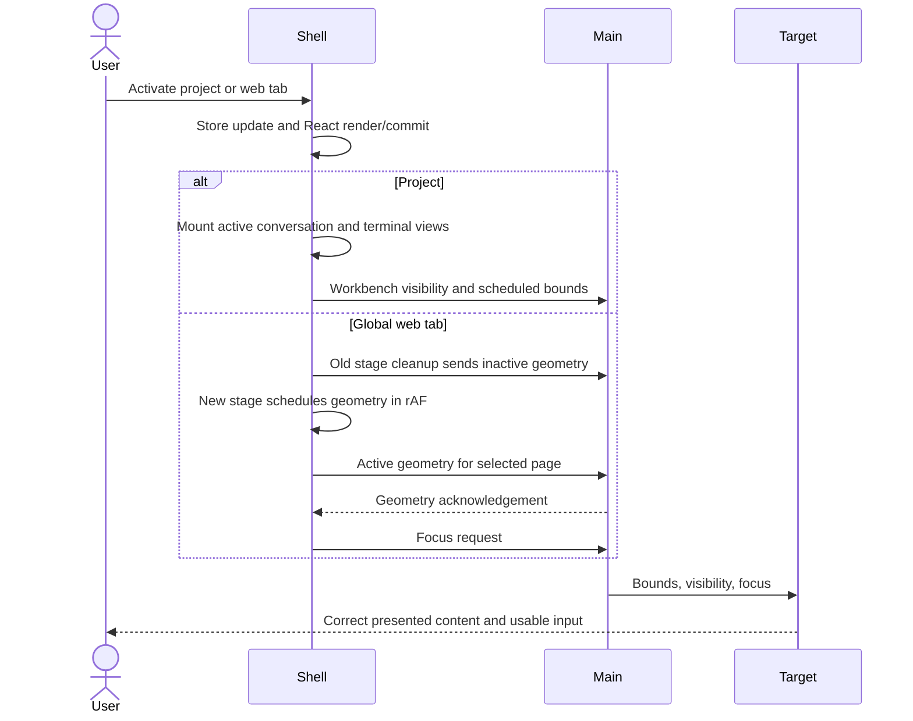
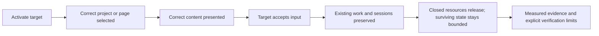

# Project and web-tab switching performance

## Status

| Stage | State |
| --- | --- |
| Scope | Project switching, global embedded web tabs, and resources these transitions own |
| Source investigation | Fractional browser geometry rejection is confirmed; scaled project switching spends substantial shell work mounting and laying out transcripts |
| Baseline | Synthetic controls and scaled fixtures measured on the user's Mac; original workload details remain unconfirmed |
| Product changes | Browser geometry fix and scoped transcript rendering with reader anchors integrated; ineffective clamp batching reverted |
| Implementation | Claude implemented; Codex independently reviewed the integrated performance changes and evidence; concurrent feature edits preserved |
| Verification | Final isolated browser checks and lifecycle runs passed; shared-tree TypeScript checks and 35 focused tests passed; native input and live streaming remain unverified |

Recorded on 2026-10-17. Source revision: `a784cb0cba5ba90830a74a5e6f152cfe0e4f9e99`. Installed app metadata reports `0.20.0`; its source revision is unknown. Installed dependency manifests resolve Electron `43.2.0` and React DOM `19.2.8`. Machine: `Mac15,7`, 18 GiB RAM. Do not attribute a source result to the installed binary without establishing which build is measured.

The user explicitly approved production builds, controlled isolated launches, traces, memory measurements, isolated-window screenshots/input, and focused before/after regression tests, and asked Claude to run them using computer access with Codex reviewing afterward. Reuse this authorization; no repeated confirmation is needed for actions inside that batch. This supersedes the earlier sequencing that asked Codex to review diagnostic changes before the first run. Claude must inspect isolation changes before launching and return all raw evidence and diffs for independent review. Native computer-use input proved unreliable; do not repeat that route. Read-only captures of a positively identified isolated instance remain available.

## Current / Issue

The user reports about one second of freezing before the correct project appears, and heavy switching between embedded web tabs. Project/tab counts, affected regions, activity during the pause, build in use, and warm/first/after-idle behavior remain unknown. A reproduction question is already pending with the user.



The sequence records dependencies, not measured duration. Ordering asynchronous calls does not prove a full blank frame. A shell commit, geometry acknowledgement, target rAF, or double-rAF alone does not prove target presentation or usable native input.

### Source evidence

| Path | Observed code behavior |
| --- | --- |
| Rail activation | `App.tsx:1087` calls `openProject`; `workspace/store.ts:788` updates the project layout and hides global web tabs. Detached projects take a separate window-focus branch. |
| Project strip | `workspace/PaneTabStrip.tsx:224` calls activation; `workspace/store.ts:809` updates the pane. |
| Project content | `workspace/EditorPane.tsx:166` selects the project; `:443` keys notes, `:547` builds conversation columns, and `:661` keys the terminal pane. |
| Workbench lifetime | `workspace/PaneWorkbench.tsx:18` documents preserved views per open project; `EditorPane.tsx:498` renders them. `workbench/WorkbenchFrame.tsx:262` updates visibility; `:331` owns the active geometry loop. Ordinary switching preserves the native editor. |
| Transcript restoration | `SessionHost.tsx:14` wraps the session; `Session.tsx:299` restores carried state, `:382` derives rows, and `:477` queries missing events or a 400-event initial page. `carry.ts:14` limits carried transcript text to 120,000 characters. Bigger carries drop their reduced view. |
| Main transcript work | `main/ipc.ts:692` routes the read to `runtime.transcriptHistory` or `transcriptPage` and, for live reads, `transcriptState`. `main/runtime.ts:6305` reads synchronously through the store. Catch-up is not the same workload as a capped initial page. |
| Terminal restoration | `ProjectTerminalPane.tsx:108` mounts visible terminal views. `TerminalView.tsx:129` creates xterm; `:189` attaches and `:206` writes its snapshot. Cleanup at `:351` detaches the view and disposes xterm without killing the shell. |
| Global web activation | `workspace/WebTabStrip.tsx:272` calls `activateWebTab`; `workspace/store.ts:714` updates selection. `Workspace.tsx:560` keys `WebTabStage` by active tab. |
| Web geometry and focus | `workspace/WebTabStage.tsx:101` measures geometry, `:140` mounts observers and schedules it, `:149` cleans up old geometry, and `:176` requests focus after placement. `workspace/web-pages.ts` retains the browser ID and page state independently of the stage; main owns the native record in `browser-surface.ts:340`. |
| Per-project browser | `BrowserPanel.tsx:210` uses resize/mutation/scroll notifications, not a continuous geometry loop. It stays mounted per open project. |
| Main view work | `main/workbench-surface.ts:1601` handles bounds and `:1619` handles visibility. `main/browser-surface.ts:546` handles geometry and lazy creation, then placement/visibility/state push. Plain switches do not take the overlay JPEG-capture branch. |

Native views surviving a switch is intentional retention, not evidence of a leak. There is no source-proven leak from this pass and no runtime evidence establishing leak absence.

### Competing explanations

| Hypothesis | Confirming signature | Evidence against it |
| --- | --- | --- |
| Shell mount/render delays the project swap | Click-to-commit long task; transcript rendering or xterm setup dominates; native visibility IPC follows it | Shell finishes promptly while the target remains late |
| Main is blocked by event/store/terminal/traffic work | Renderer sends promptly; main receives or replies late; CPU trace locates synchronous work | Main receives and completes the request promptly during slow switches |
| Geometry/focus handover adds visible delay | Old-view hide, new-view placement, presented frame, or input acknowledgement shows a gap attributable to scheduling/IPC | Target presentation and input remain prompt despite that scheduling |
| Target repaint/compositing is slow | Main shows the right view promptly; target layout/raster/presentation follows late | The target presents promptly and the delay lies upstream |
| Hidden views sustain avoidable activity | Hidden-target rAF/visibility/CPU and GPU frame work grow with open projects | Resource activity settles while the same slow switch remains |
| Memory pressure stalls return after idle | Slow switch aligns with compression/page-in/swap pressure and a larger working set | Equivalent slow switches show stable pressure and paging counters |
| A lifecycle fails to release resources | Repeated equivalent-state cycles retain additional objects, registrations, targets, or processes; owner/retainer is identified | Counts plateau and retained resources match the surviving open state |

`backgroundThrottling: false` is set in `main/workbench-surface.ts:1103` and `:1189`. Electron 43.2.0 documents a window-wide frame-production effect. It does not establish that hidden browser timers are unthrottled or that `setVisible(false)` fails to change page visibility; measure those separately. Overlay capture is relevant only when an overlay event actually overlaps a slow switch.

## Proposed

```mermaid
flowchart LR
    Repro[Establish actual workload] --> Approval[Approve isolated measurement batch]
    Approval --> Baseline[Capture baseline and identify the delayed phase]
    Baseline --> Targets[Record numeric acceptance targets]
    Targets --> Cause[Confirm one causal hypothesis]
    Cause --> Fix[Claude fixes a measured cause and validates the predicted change]
    Fix --> Review[Codex reviews the complete diff]
    Review --> Compare[Repeat the same workload and lifecycle cycles]
    Compare --> Evidence[Report results and unverified cases]
```



### Authorized batch to request

Production baseline and fix builds, isolated launches, latency/CPU/trace recordings, separate memory/lifecycle measurements, and focused before/after regression checks. Include visual capture and native input only for a positively identified isolated window if the user authorizes that interaction with the batch. No installation, release, commit, push, or control of the Chorus hosting this conversation.

Reuse `e2e/harness.mjs` for `CHORUS_USER_DATA`, private session data, and debugger port zero. Keep all profiles and measurement output under a task-specific temporary directory. If the current app is a dev build using this checkout's output, build in a separate checkout so rebuilding cannot restart it. Use a fresh profile for each build from the same fixture template, then perform identical warm-up. Confirm that loaded renderer script URLs match that build's emitted asset inventory; `main/index.ts:621` documents a previous stale-cache false result.

Start with fresh browser session data and deterministic local pages. For representative transcript load, use synthetic fixtures matching the user's message sizes/counts, or a consistent read-only database backup after the user authorizes that data source. The real database is `chorus.v2.db` (`main/runtime.ts:7402`), not the `chorus.db` expected by the older transcript driver. Do not copy browser credentials or authentication partitions. Actual authenticated-page performance remains unverified unless separately reproduced with the user's approved setup.

Use `CHORUS_PROFILE_READONLY=1`: it suppresses session restore and CLI resolution, so opening copied history cannot start coding agents. Re-establish the fixture's project layout explicitly; suppressed restore does not recreate the real open-project workload automatically. Workbench extraction/state and extension directories must resolve inside the private profile; reuse only an already-cached immutable runtime archive where supported. Real agent spawning, live project dev commands, and extension execution against the user's repositories require explicit inclusion in the workload authorization.

Before any launch, enforce these additional isolation conditions:

- Disable saved traffic forwarding/capture in the fixture, including any copied project's origin, proxy port, and environment redirect. `runtime.ts:1854` can prepare a listener when an editor requests terminal environment, without running a dev command. Verify the fixture is disabled before launch; inspect any known live proxy ports before/after without changing their owner. `adb-reverse.ts` removes ports from its instance's `applied` map; keep this instance's desired/applied ports empty so it never forwards or removes a live port.
- Skip `app.setAsDefaultProtocolClient('chorus')` at `main/index.ts:664` during read-only profiling, using a narrowly scoped startup guard reviewed before launch. An isolated user-data directory does not isolate LaunchServices protocol registration. Record the existing `chorus` handler and confirm it remains unchanged; do not launch a binary without this guard for the isolated batch.
- Default fixture project roots to temporary repositories. A fresh profile has no user extensions; record that workload difference. Loading the user's extensions or opening their real repositories is a separately authorized workload, not an implied consequence of copying history.

### Workload and endpoints

| Dimension | Measurement |
| --- | --- |
| Cases | Initial project/editor activation; already-live A/B project switches; already-live A/B web switches; after-idle return; destroyed-page restoration if that scenario is observed. Keep each distribution separate. |
| Load | User's project/tab counts and representative transcript/terminal sizes. Compare against the same active target with fewer background surfaces. Keep machine, power state, viewport, extensions, build configuration, and fixture data fixed. Before every sample record shell visibility and reject non-visible runs; record minimization, occlusion, Space, and display sleep separately, especially during idle. |
| Input | Timestamp the driver's send, the trusted activation event, and the handler start on calibrated clocks. Report send-to-dispatch separately so input queueing is not omitted. Record the selected project/tab and actual target identity; reject wrong-target samples. Label non-reproducing fixture results as controls rather than evidence that the reported pause is fixed. |
| Correct content | Confirm the target's presented surface/frame and expected project root or page identity. A shell webContents screenshot excludes native child views; use an isolated OS-window capture for composited correctness when permitted. Otherwise label main-show plus target-frame submission as a proxy, with actual presentation NOT VERIFIED. Shell `paintedApprox` marks remain approximations. |
| Responsive input | Confirm focus and a non-destructive input acknowledgement or reversible scroll through the isolated window. Native capture/input may require OS permissions and occupies the screen. Before every native event, verify the isolated window identity, foreground state, and point containment; abort on mismatch. Child-target CDP input cannot alone establish native hit testing. Unsupported native input coverage remains NOT VERIFIED. |
| Repetition | Begin with 30 warm switches balanced across A/B directions and at least two batches. Report all samples, median, p95, maximum, and spread; extend only when variation makes a conclusion uncertain. First/after-idle runs get separate counts and disclose their smaller samples. Idle duration follows the user's reproduction. |
| Attribution | Separate driver-send-to-dispatch, input-to-shell-commit, IPC-send-to-main-handler, main work, main-show-to-target-presentation, and input acknowledgement. Correlate process/frame identities and trace clock domains before subtracting timestamps. |
| Control | Record uninstrumented timings separately from diagnostic traces/CPU/React profiles. Use a fresh per-build profile cloned from the same fixture, with the same defined initial cache state and identical warm-up. Do not clear caches partway through a warm batch or change the workload between revisions. |

### Tools and artifacts

- Use Electron `contentTracing` or CDP tracing only after confirming that the recording contains the shell, main, selected target, and relevant GPU/compositor tracks. A renderer-only trace cannot establish main-process timing.
- Main access requires a small optional launch-argument seam in `e2e/harness.mjs`, which currently has no `args` option. Bind a supported Node inspector to loopback on a dynamic port and connect only to the endpoint announced by the isolated child. Use it for `contentTracing`, main CPU samples, and `listenerCount` on identified emitters. Count debuggable target entries from that child's port, and confirm native web contents through main enumeration; neither target count nor process count alone equals native-view count. Renderer subscription retention comes from heap/retainer evidence, not an invented total. Unsupported counts or CPU coverage remain NOT VERIFIED.
- Start with the Chromium timeline and IPC boundaries. Add main-process CPU sampling, target performance records, or a profiling React build only when the first trace points to that layer. Existing `profile-marks.ts` records transcript receive/reduce/commit/approximate paint; it does not identify every stage of native view presentation.
- Keep CPU and memory per PID/process type. On macOS use process physical-footprint information where accessible, plus `vm_stat`, memory pressure, and swap deltas. Report metric units and limitations. Do not sum process RSS as unique device RAM or divide total CPU by process count.
- In a separate memory run, warm the fixed workload, then repeat at least ten open/switch/close cycles and wait for actual view/storage cleanup. Compare equivalent surviving states. Count native web contents, renderer/REH processes, subscriptions/listeners, and heap usage. Compare heap snapshots and retainers when retention grows; use native allocation/ownership evidence for native growth. GC/snapshots do not run inside latency samples. A bounded cache plateau is distinct from per-cycle unintended retention; native footprint need not return byte-for-byte to its initial value.
- Keep trace files, CPU profiles, raw sample JSON, per-process memory/CPU logs, workload/build metadata, and any retention snapshots locally. Every result records revision, dirty patch if any, runtime versions, app build mode, fixture identifiers, sample counts, and timing endpoint coverage.

### Acceptance criteria

The reviewed baseline and initial fix targets below were recorded before implementation. They apply to the controlled fixture, not a universal latency or leak-free claim.

| Criterion | Current result | Evidence required |
| --- | --- | --- |
| Original pause reproduced and classified | NOT VERIFIED for the user's workload; PASS for the synthetic scaled fixture | Source and traces identify transcript mount/layout work; actual project/tab counts and reproduction variant remain unknown |
| Correct project becomes visible and responds to input | PASS for target identity, browser-driven interactions and reader restoration; native end-to-end input NOT VERIFIED | `f7-anchor2`, `f7-preserve`, trajectories; native rAF remains a proxy rather than presentation proof |
| Correct embedded page becomes visible and responds to input | PASS for fractional/integer geometry, correct live page and browser-driven focus; native input NOT VERIFIED | Zero rejected geometry and visible page, plus composited isolated capture; live-page time origins unchanged |
| Supported cause and faster switching | PASS for aggregate controlled-fixture median targets; one final block and individual tails exceed them | `f7-onoff`: median summed long frames 393.3 ms ON versus 849.5 ms OFF (driver convention); ON shell-busy block medians 578.5–591.5 ms |
| Resource retention stabilizes | PASS for measured counts, shell heap and delayed watcher cleanup; long-term/native retained size NOT VERIFIED | Ten actual project open/switch/close cycles; closed editor target/renderer exits; watchers return to six after idle; post-reap footprint not recorded |
| Editors, unsaved text, terminal processes, agents, conversation state, web history and logins survive | PASS for exercised reader/follow/resize/expand/find/copy/draft cases and no live-page reload; full real-session preservation NOT VERIFIED | Real agents, terminal alternate-screen state, authenticated pages, editor unsaved work, project notes and detached-window scenarios were not exercised in the fixture |
| Loading/error/empty states and rapid A/B/A switching remain correct | PASS for rapid switching, valid zero-size rectangles, resize and delayed transcript reads; other runtime loading/error cases NOT VERIFIED | Focused stage tests plus S1–S7 and C1–C10; destroyed-page restoration and network-error states were not exercised |

## Code Changes

Claude added `apps/desktop/e2e/perf-switch.mjs` and the read-only profiling protocol guard in `main/index.ts`. No harness seam was needed. Codex read both changed files in full, checked the guard diff, raw result JSON, analysis scripts, and check logs. The LaunchServices handler snapshots match. The driver is diagnostic code, not a performance fix.

### Reviewed baseline and fix units

Raw artifacts: `/private/tmp/chorus-switch-perf-20261017-131809/`. Build: Electron 43.2.0, production renderer `index-CKxqVumB.js`, baseline revision plus the profiling guard. Empty scratch repositories and synthetic messages; no live agents, extensions, or active terminal workload.

| Evidence | Result and limit |
| --- | --- |
| `run3b-geometry/result.json` | Fractional stage `[96,144.1953125,1180,711.8046875]`: 1,214 geometry rejections in ten seconds, page hidden. Dismissing the fixture banner made geometry integral: zero rejections and page visible. |
| Browser geometry cause | `WebTabStage.tsx:105` sends unrounded bounds; `shared/browser-ipc.ts:47` requires integer rectangle values. Rejection clears `lastSent`; revision/store updates and the stage layout effect repeat the invalid request. This defect is confirmed for fractional layout, though occurrence in the user's layout remains unknown. |
| `run7-scale/result.json` | Four mounted conversations per project, 300 turns each, 4,000-character agent replies; the initial page displays 200 entries per conversation. Ten warm project samples: median send-to-shell-double-rAF 119.8 ms; median summed long-frame durations about 734 ms. These are different metrics; neither is measured native presentation latency. |
| `run8-trace-scale/shell-profile.json` | Six measured project-switch windows contain roughly 968–1,099 ms of shell task work per 1.5 seconds. The layout `measure` in `Clamped` is the largest named sampled contributor. Preparation clicks must be excluded from comparative metrics, and nested trace durations must not be added as independent busy time. |
| Initial clamp hypothesis, subsequently refuted | `Entry.tsx:405` mounts one layout effect per user message, alternating style writes and geometry reads. The sampled function matches this reader, but a CPU sample can charge the initial full transcript layout to whichever reader triggers it first. The controlled F1 comparison below refutes this as the dominant avoidable cost in the measured fixture. |
| Project frame probe limitation | The driver arms target rAF before activating the project. Workbenches intentionally retain visible page state while hidden natively. Those callbacks do not establish when the editor was presented; target presentation cannot be ruled out from that metric. Native input remains NOT VERIFIED. |
| `run10-memory-idle/result.json` | Seven CDP targets and twenty processes throughout ten web-tab open/close cycles; projects only switch and remain open. Shell heap rises from about 36.4 to 37.7 MiB, but the driver's retained event/long-frame/click arrays also grow. No app leak conclusion follows; project open/close and clean-probe retention remain unverified. |

Implement these units sequentially, with Claude owning product and test files:

| Unit | Files and required behavior | Verification and initial target |
| --- | --- | --- |
| D1: measurement integrity | Existing `e2e/perf-switch.mjs`: clear completed CDP timeouts; record all fixture parameters; reject missing/wrong click samples; label target rAF as a proxy; stop or drain growing probes before memory snapshots. Keep baseline artifacts unchanged. | Reuse the existing fixture and collect a corrected 30-sample scaled baseline before product fixes. No further native click attempts through the unreliable computer-use route. |
| F1: batched clamp measurement, rejected after comparison | The implementation reduced observer count and style-recalculation events, but did not reduce layout time or project-switch work. Revert only the task's batching changes and its implementation-specific test file. | Initial targets remain median summed long-frame duration at or below 400 ms and shell task time at or below 600 ms per 1.5-second window. F1 fails both; the disappearance of a sampled function name is not a performance improvement. |
| F2: valid browser geometry | `renderer/src/workspace/WebTabStage.tsx` and focused regression tests. Normalize native rectangle edges/dimensions to bounded integer CSS pixels before IPC; preserve valid revisions, hide/show ordering, and focus behavior. | Fractional and integer layouts both show the intended page with zero rejected geometry and no request loop; verify resize, zoom/fractional offsets, rapid A/B/A, and live-page identity/history preservation. First native presentation/input remains NOT VERIFIED if unsupported. |
| F3: reduce transcript mount/layout work, investigation | Inspect the actual repeated layout and DOM creation path before selecting another change. Begin with reversible isolated experiments; preserve current fully mounted transcript semantics and bounded memory. Read the parked windower's rollback history before proposing any windowing. Do not retain every project's transcript DOM. | Use the same scaled fixture and targets. Require an improvement in total work as well as the predicted phase, then check scroll restoration, follow, resize, expand/collapse, find/copy and state preservation before accepting a product change. Reject estimates that move a reader to different content. |

### Reviewed F1/F2 comparison

Codex checked `fix-base/result.json`, `fix-after/result.json`, `fix-after-repeat/result.json`, `fix-after-geometry/result.json`, and the corrected `tools/attrib.mjs` output. Trace windows use marked measured clicks and a union of main-thread task intervals, excluding preparation clicks.

| Metric | Corrected baseline | F1 after | F1 repeat |
| --- | --- | --- | --- |
| Accepted correct project samples | 30/30 | 30/30 | 30/30 |
| Summed long frames, median / p95 / max | 764 / 843 / 898 ms | 761 / 983 / 1,032 ms | 770 / 1,020 / 1,111 ms |
| Send to shell double-rAF, median / p95 | 123.5 / 275 ms | 129 / 297 ms | 133.7 / 300 ms |
| Shell busy in six traced project windows | 951–1,013 ms | 954–1,172 ms | Not traced |
| Layout time per traced project window | 269–283 ms | 277–294 ms | Not traced |

The dominant sampled work moves from `Clamped.measure` to `Session`'s `content.offsetHeight` read. Style-recalculation event count drops from approximately 434 to 40 while its total time remains approximately 104–123 ms. These results support reducing the transcript's initial mount/layout work, rather than moving its first measurement. The later p95 values are worse; system drift versus a real regression is unresolved without interleaving, and no performance benefit is accepted.

F2 normalizes the same fractional rectangle before IPC. `fix-after-geometry` records zero rejections in both banner states; the local page is visible and focused. Ten fractional-layout web switches are correct with unchanged page time origins and a 17.3 ms median send-to-shell-double-rAF. A read-only composited capture corroborates visible native content. Native input and the user's original page workload remain NOT VERIFIED.

The corrected memory-switch runs stop the probes and collect garbage outside timing. Ten switch cycles retain constant observer/target/process counts and approximately stable shell heaps in both builds. Projects remain open: this is not project open/close coverage or proof that all resources are leak-free.

### F3 containment experiment and next implementation

`f3-ab` interleaves A/C/V/V/C/A in one isolated instance, six measured switches per block. A is unchanged CSS; C applies layout/style containment to entries; V uses `content-visibility: auto` with a 160 px intrinsic fallback. C does not improve switching. V reduces median summed long frames from 777–788 ms to 502–515 ms and shell busy time from 953–962 ms to 718–748 ms. Script remains approximately 326 ms; the gain is in layout/style/paint. Both initial targets remain unmet.

Codex read the actual `restore-real.js` and raw `restore-real.jsonl`. The unchanged version restores the same message and offset twice. V with browser anchoring returns to different message IDs twice. Without browser anchoring, fresh offscreen rows expanding also cause scroll jumps. `f3-check6` alone is insufficient: matching estimates before/after can appear to preserve a reader who has not traversed history. No CSS-only change is accepted.

Proceed with a focused implementation that couples offscreen rendering to stable reader restoration, rather than treating them as separable fixes:

- Keep DOM, transcript paging, carry text budgets, and native-view lifetimes unchanged. Limit skipped rendering to suitable completed history messages; do not change live turns or interactive tool/approval cards without evidence.
- Preserve the paused reader as a stable message identity and viewport offset, resolved against that actual mounted row after return. Keep existing pixel restoration as a compatibility fallback when no anchor is available. Do not revive the parked height-cache virtualizer or add per-project DOM caches.
- Enable browser scroll anchoring only while the transcript is paused; retain the current following behavior and anchoring suppression for streaming. Cancel restoration when the reader deliberately navigates.
- Test a narrower agent-message-only skip boundary before introducing any new clamp machinery. Existing user-message geometry reads force skipped rows to render; avoid a new batching registry unless an independent comparison proves it necessary.
- Require the realistic scroll-through-history then A/B/A case to preserve the same message and offset, alongside bottom-follow, resize, expansion, find/copy, drafts, rapid switching, and cleanup. Use controlled local DOM growth to exercise resize/follow mechanics if real streaming is unavailable, explicitly distinguishing it from a real agent stream.

Claude implements and owns verification under the existing approval; Codex reviews every changed file and integrated diff. Before/after evidence must separate total work, input approximations, and preservation. Retain the original numeric targets and report any failure instead of redefining them after observing results.

### Combined implementation and review checkpoint

The narrower completed-agent-history boundary is substantially faster than applying skipped rendering to every entry. `f4-boundary` measures median summed long frames of 362 ms for the narrow boundary versus 827–846 ms unchanged and 498–556 ms for all-entry skipping. User-message clamps remain unchanged.

`f4-after` records 30/30 correct project samples: summed long frames median/p95/max 367.9/427/503.5 ms and send-to-shell-double-rAF median/p95 75.4/158.8 ms. The final restore correction does not alter this following-pane path. `f4-final` interleaves ON/OFF using asset `index-BWsDlROs.js`: three ON block medians meet both original targets, while some individual samples exceed them. This is a measured reduction in work, not native presentation latency.

The product changes add completed-history rendering skips, paused browser anchoring, stable row identity and optional reader anchors with a numeric fallback. No cache, view eviction, or history budget changes are introduced. Ten switch cycles show stable 408 resize observers, 3 mutation observers, 6 targets, 19 processes and approximately 74.7 MiB shell heap after warm-up. Full project open/close coverage remains outstanding.

Codex reviewed the integrated diff, the new helper, raw preservation JSON and its driver. Two cases need targeted review before acceptance: the helper and preservation driver's row enumeration excludes the current turn, and a queued rAF capture can leave the carried anchor behind the current scroll position during a fast switch. Test these using an independent visible-row observation, rather than duplicating the helper's row-selection algorithm. Preserve numeric fallback behavior when no stable row is available. Native input and real agent streaming remain NOT VERIFIED.

### Final reviewed implementation and evidence

Both review findings were reproduced before correction. The helper now includes non-sticky current-turn rows and uses viewport coordinates. Carry captures the current reader position if a queued frame has not caught up, and preserves an outstanding restore across a fast remount. The restored row remains rendered through two animation frames. A small layout effect re-applies the held anchor when a new turn moves the old reply into history: otherwise a retained short transcript could restore against its stale carried view, then replace the anchored DOM node when the fresh read arrived. The final independent observer checks visible message identity, caret text and offset at the same viewport point before and after.

Changed performance files:

- `apps/desktop/src/renderer/src/styles.css`: skip rendering only completed offscreen agent history messages; enable browser scroll anchoring while paused. User rows, the current turn and tool/approval regions retain their existing rendering behavior.
- `apps/desktop/src/renderer/src/reader-anchor.ts`: capture and restore one stable message identity and offset, without a transcript-height cache.
- `apps/desktop/src/renderer/src/Session.tsx` and `Entry.tsx`: row identity, following state, carry/restore, navigation cancellation and re-anchoring after a turn split changes.
- `apps/desktop/src/renderer/src/workspace/WebTabStage.tsx`: round rectangle edges to valid bounded integer geometry before IPC.
- `apps/desktop/src/main/index.ts`: suppress global protocol registration in read-only profiling.
- `apps/desktop/src/renderer/src/workspace/WebTabStage.test.tsx` and `apps/desktop/e2e/perf-switch.mjs`: focused regression coverage and reproducible fixture/measurement driver.

No transcript DOM cache, native-view eviction, runtime upgrade, dependency change or reload-on-return policy was added. Existing workbenches remain live while their project tabs are open; the measured roughly 186–204 MB footprint per editor renderer is intentional retained state, not a newly discovered leak. This fix reduces rendering work rather than promising a general RAM reduction.

#### Final controlled comparison

The private checkout used the original source revision plus only the reviewed performance patch, excluding a concurrent feature-removal task. Its caches were private and it reused installed packages. Final production asset: `index-C8Yq-pAF.js`; Electron 43.2.0 / Chromium 150.0.7871.129 / React DOM 19.2.8, Mac15,7 with 18 GiB. Fixture: three projects, two local web tabs, four conversations per project, 300 turns per conversation with 4,000-character replies; 800 entries in the active project. Real agents and user extensions were absent.

`f7-onoff/result.json` interleaves ON/OFF/OFF/ON/ON/OFF in one instance with six measured switches per block (18 per condition), plus correlated lightweight traces. OFF disables the rendering skip and paused browser anchoring; the following-pane timing path otherwise stays the same.

| Metric | OFF | ON |
| --- | --- | --- |
| Correct accepted samples | 18/18 | 18/18 |
| Summed long frames, median / p95 / max | 849.5 / 968.5 / 968.5 ms | 393.3 / 501 / 501 ms |
| Send to shell double-rAF, median / p95 / max | 145.5 / 390.3 / 390.3 ms | 92.1 / 216.5 / 216.5 ms |
| Shell busy, block medians per 1.5 s | 1,006.5–1,035 ms | 578.5–591.5 ms |
| Layout / style / paint per switch, approximately | 270 / 105 / 128 ms | 37 / 24 / 55 ms |

The driver reports nearest-rank quantiles. Ordinary medians of the final long-frame samples are 859.15 ms OFF and 397.5 ms ON; population standard deviations are 66.6 and 36.7 ms. One ON block median is 401.7 ms, so the 400 ms target passes for the aggregate and fails narrowly in that block. Individual tails remain. These are sums of long-frame durations and shell work, not a measured native input-to-correct-content latency. The earlier fresh-profile 30-sample comparison records 764→367.9 ms median long-frame sums and 123.5→75.4 ms median shell double-rAF; the final paused-reader corrections do not run in that following-pane path.

In the corrected baseline, traced main-thread work is 32–46 ms per project-switch window against 951–1,013 ms in the shell; ordinary visibility/bounds handlers do not perform overlay capture. This supports the shell rendering diagnosis for this fixture. It does not prove native compositor presentation is prompt, because the target rAF probe was armed before activation.

Other cases remain separate: initial project activation took roughly 5.9–6.2 seconds with runtime extraction/REH startup and about 1.1 seconds for later projects in the initial fixture. The exploratory after-idle run has only two samples after 180 seconds (117 and 133 ms shell double-rAF) and system-wide paging/compression activity; that cannot attribute memory pressure to this app or establish an after-fix improvement. Destroyed-page restoration has no measured sample. The warm-switch fix is not a claim to accelerate those cases.

For the web defect, the same fractional rectangle produces 1,214 rejected geometry requests per ten seconds before the correction and zero afterward. Correct native content is visible in the isolated composited capture. Ten fractional-layout switches have unchanged page time origins and a 17.3 ms median shell double-rAF. This establishes the invalid-geometry mechanism; it does not establish that every slow real website had this cause.

#### Reader preservation and lifecycle

`f7-anchor2/anchor-fixed.json` passes S1–S7: paused current reply, transition to history after a synthetic new turn, no-prior-history equivalents, stale capture and rapid remounts. S2/S4 remain visible throughout and preserve the same caret text, key and offset. The older moving-probe result was corrected; the observer now samples the same viewport y. S6 has empty sampled text and is checked by key/offset only; its visibility is checked at the end.

`f7-preserve/preserve.json` and the trajectory files cover history positions 20/30/50/70/85%, repeated upward scrolling, paused growth/shrink, following growth/shrink, expansion, emulated viewport resize, find/copy, draft retention, rapid switching and prepending an older page. Growth/shrink uses controlled DOM changes, not a real agent stream. One trajectory has an early off-row sample; stable restoration is observed by 100–200 ms and through four seconds. This is not a zero-transient-frame guarantee.

`f7-lifecycle/lifecycle.json` and its stdout record ten actual tab open/switch/close cycles, with probes stopped and GC outside latency measurement. The editor target count changes 3→2→3, renderers 6→5→6, and the closed editor renderer exits each cycle. Shell heap stays 75.2–75.7 MiB; resize/mutation/intersection observers stay 408/3/1. REH children temporarily rise from six to ten, plateau, then return to six after 75 seconds: three extension hosts and three watchers. The shared REH and per-carry size-limited transcript data are retained intentionally. Footprint totals rise from 1,979 to 2,066 MB during the run; no post-reap footprint was captured, so native-memory stabilization is NOT VERIFIED. No leak or global absence-of-leaks claim is made.

#### Integration and checks

Claude applied only the accepted 11-line re-anchor effect to the shared Session after private verification. Codex checked `f7-private/integration.diff`, the exact command record, integration logs, and current hashes. Shared Session hash is `11be966323ed64c7d1c84cda3a86b48a11e73e4c4a8712c6a0c7c15e327c2441`. The helper, driver, stage, stage test and startup guard match the private verified files. The other differences in Session/Entry/styles belong to the concurrent feature task and were preserved. This report does not review that separate task.

Final checks, run sequentially from shared `apps/desktop`:

- `pnpm exec tsc -p tsconfig.web.json`: exit 0.
- `pnpm exec tsc -p tsconfig.json`: exit 0.
- `pnpm exec vitest run src/renderer/src/Entry.test.tsx src/renderer/src/SessionHost.test.tsx src/renderer/src/carry.test.ts src/renderer/src/workspace/WebTabStage.test.tsx`: exit 0, 35/35 tests.

Private production builds, relevant lint/format checks and browser verification also passed. The full gate and e2e suite were not run. Existing package-manager environment-substitution warnings appeared in both baseline and final logs; no new TypeScript errors or test failures remain. Native mouse hit testing, a real agent stream, authenticated web sessions, original workload conditions, destroyed-page restoration and full editor/terminal/detached-window preservation remain NOT VERIFIED.

Raw evidence remains under `/private/tmp/chorus-switch-perf-20261017-131809/` (about 14 GB, including extracted fixture runtimes); private source/hashes are recorded in `review-isolation.json` and `f7-private/`. No task-owned profiling app processes remain. Initial delivery was reviewed local changes, without installation or a source commit.

The user subsequently requested build/install and then pushing all current changes to `main`. `CHORUS_INSTALL_KEEP_RUNNING=1 pnpm --dir /Users/mohamadtaleb/code/workbench app:install` exited 0 on 2026-10-17. Workbench 0.20.0 is installed at `/Applications/Chorus.app`, bundle ID `dev.chorus.desktop`; its executable and `app.asar` hashes match the newly packaged ARM64 build, renderer `index-ROeK2mBe.js`. The installer verified the code signature. The running bundle was preserved as `/Applications/Chorus.app.replaced-1792254900072` so this conversation could continue. Restart Chorus to activate the installed build; remove that old bundle only after its process exits. Existing profile/database paths were not changed. The user's push request includes the concurrent Recap-removal and reply-action changes; publication is tracked in the conversation's final git result rather than inferred from installation.

The continuous `WorkbenchFrame` loop has a measured idle cost, but changing its geometry guarantees is deferred from these two fixes. Preserve editor state instead of adding eviction, retaining every transcript DOM, or upgrading Electron on an unrelated trigger. Revisit only if after-results require it.

Existing integration points:

```js
import { ensureBuilt, launch } from './harness.mjs'

ensureBuilt('production')
const app = await launch({
  userData: isolatedProfile,
  env: { CHORUS_PROFILE_READONLY: '1' },
})
```

`isolatedProfile` must be a newly prepared task profile, never the live data directory. Driver options, cleanup, target correlation, and raw artifact output will be reviewed before its first run. Do not invoke the older `perf-transcript.mjs` unchanged: its hardcoded fixture IDs and database filename do not describe the current app profile.

Potential product files depend on measured cause: `Session.tsx`/`SessionHost.tsx`/`carry.ts` for transcript work; `ProjectTerminalPane.tsx`/`TerminalView.tsx` for terminal work; `workspace/WebTabStage.tsx`/`web-pages.ts` for page handover; `workbench/WorkbenchFrame.tsx`, `main/workbench-surface.ts`, or `main/browser-surface.ts` for native view work. These are investigation boundaries, not an approved bulk edit list. No public IPC contract, dependency upgrade, view eviction policy, or keep-everything-mounted strategy is selected without causal evidence and an explicit preservation assessment.

### Sources

- [Electron 43.2.0 WebPreferences](https://raw.githubusercontent.com/electron/electron/v43.2.0/docs/api/structures/web-preferences.md): background throttling and window frame production.
- [Electron contentTracing](https://www.electronjs.org/docs/latest/api/content-tracing): tracing across processes; check API/category availability against the installed runtime before use.
- [Chrome DevTools Performance reference](https://developer.chrome.com/docs/devtools/performance/reference): timeline, frame and screenshot evidence.
- [React Profiler](https://react.dev/reference/react/Profiler): render timing, overhead, and the need for a profiling-enabled production build. Validate features against React 19.2.8; latest docs can describe newer React releases.
- [Chrome heap snapshots](https://developer.chrome.com/docs/devtools/memory-problems/heap-snapshots): comparisons, retainers, and snapshot-triggered garbage collection.
- [Electron MemoryInfo](https://www.electronjs.org/docs/latest/api/structures/memory-info): platform-specific memory fields and units.
- [Chromium authors on content visibility](https://web.dev/articles/content-visibility): offscreen rendering skips, retained DOM/searchability, remembered intrinsic sizes, and the warning that descendant geometry reads can defeat skips. The narrow agent-history boundary avoids the measured user-clamp interaction.
- [React useLayoutEffect](https://react.dev/reference/react/useLayoutEffect): layout measurement and corrections before paint; the final re-anchor effect is limited to a changed turn split while paused.
- [CSS scroll anchoring](https://drafts.csswg.org/css-scroll-anchoring-1/): browser anchor adjustment and suppression, used only for paused reading so existing bottom-follow behavior remains in control while following.

## Final Flow


