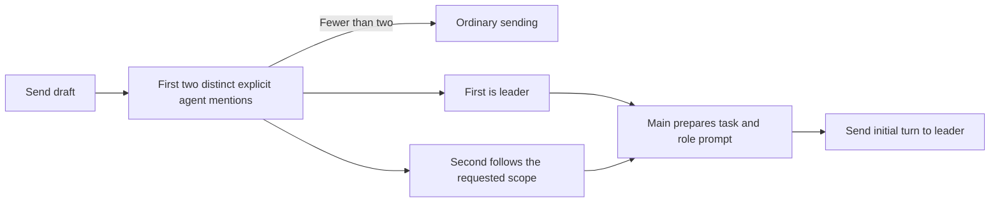

# Automatic collaboration from explicit mentions

## Current / Issue

The installed build requires the collaboration button to add the role prompt.
Normal Send can broadcast two leading mentions. The user now wants the button
removed and the prompt injected automatically when two agents are explicitly
mentioned with `@`.

Claude's source review found that expanding in Composer also captured `/team`
and put the whole workflow into saved messages. Up-arrow resend then nested one
workflow inside another. The approved correction separates the displayed message
from the delivered instruction and gives `/team` its own explicit route.

On 2026-10-01 the user reported runs that stop after the collaborator answers,
without control returning to the leader. Only the leader receives the workflow;
the collaborator receives the leader's request, the catch-up, and the generic
call rule, which also says to leave the call out when an answer is for the user.
The prompt asked the leader to remind the collaborator to return, but gave the
collaborator no fixed return contract and the leader no rule for what follows a
return. The specific stopped run was not reproduced, so this is recorded as an
explicit role and return-contract gap rather than a proven cause.

## Proposed

On Send, use the first two distinct, recognized participants explicitly mentioned
with `@` anywhere in the draft. The first leads and reviews; the second researches,
challenges the plan, or implements according to the requested scope.
Fewer than two keeps ordinary sending. Plain names, repeated mentions, unknown
names, and agents outside the conversation do not occupy a second role. Further
mentions do not change the pair. The transcript and recall history retain the
user's short message. Main expands the collaboration instruction only for the
leader's delivery, using the existing `go` intent boundary as the precedent.

`/team` stays an explicit team-introduction command. The menu inserts `/team`,
main addresses every participant, and recall preserves that command. It does not
enter the collaboration workflow. This does not add a general broadcast toggle.

The composer shows a small line naming the leader and collaborator before Send.
The leader states the selected scope in its first response. The UI does not guess
scope from keywords or claim an agent is working before a turn starts.

Known historical task-first prompt envelopes are unwrapped for display, recall,
and resend. This includes the installed 0.20.0 `# ROLES` format and the intermediate
`# ROLES AND SCOPE` format.
The task and any trailing editor context or attachment paths are preserved. The
append-only event log is not rewritten. Unrecognized historical envelopes remain
intact and must not acquire another collaboration wrapper. The original format
that appended the workflow after the user's task also remains intact under that
guard; shortening those older entries is outside this correction.

`@codex review what claude wrote` remains a Codex-only task.
`@codex review what @claude wrote` starts collaboration with Codex leading.

The injected prompt lets the lead interpret short natural-language scope requests:
`research only` ends with a report, `research and plan` ends with findings and an
implementation plan, and an ordinary feature request defaults to Full build.
Explicit review-only, explanation-only, and no-edit requests keep their stated
limits. Names still need `@` to select collaborators.

Scope selection is an agent instruction, not a new command parser or permission
profile. The lead states the scope briefly, carries it in each handoff, and adapts
when the user explicitly changes it. Existing testing and delivery permissions
remain applicable.

The leader starts the run and ends it. It owns the final deliverable and every
user checkpoint, and evaluates each return itself; a finished unit is not a
finished task. Every handoff names both roles and carries the scope, the
requested result, the stopping point, and a fixed return rule copied word for
word, because the collaborator never sees the workflow. That rule makes the
collaborator return every result to the leader — completed work, a review with no
findings, partial work, a failure, a blocker, or a question — on a plain final
line at column zero beginning with the leader's `@name`, after its last tool call
and after any status text, with no later line beginning with an agent's name,
because the parser follows the last call line. The rule applies only to that
delegated request: a direct user instruction wins, an explicit stop, pause, or
redirection is not undone by calling the leader, and the rule does not carry
into later solo tasks or change roles in a new collaboration. After a return the leader takes the next scoped step
or sends a correction, without acknowledgment-only calls or waiting for the user
to say continue. It answers questions the repository, documentation, or
authorized work can settle, and asks the user only for a real missing decision,
a required approval, or a blocker. Routing, catch-up, and the team introduction
are unchanged.



## Code Changes

### `apps/desktop/src/shared/collaboration.ts`

Move the existing pair selector into shared code. Add command detection and
conservative recovery of historical prompt envelopes so composer, transcript, and
main agree. Keep recovery separate from mention selection.

```ts
import { isAgentId, type AgentId } from '@chorus/shared'

export interface CollaborationPair {
  readonly leader: AgentId
  readonly partner: AgentId
}

const MENTION = /(?:^|\s)@([a-z][a-z0-9-]*)\b/gi

export function collaborationPair(
  draft: string,
  participants: readonly string[]
): CollaborationPair | null {
  let leader: AgentId | null = null
  for (const match of draft.matchAll(MENTION)) {
    const name = match[1]?.toLowerCase()
    if (!isAgentId(name) || !participants.includes(name) || name === leader) continue
    if (leader === null) {
      leader = name
      continue
    }
    return { leader, partner: name }
  }
  return null
}
```

### `apps/desktop/src/renderer/src/Composer.tsx`

Keep the collaboration button removed. Derive the preview from the current draft.
The shared Send callback used by Enter and the Send button sends the short text
with a `collaborate` intent when the draft has a pair. Editor context and attached
paths are composed as before. They do not independently trigger collaboration.

```tsx
await window.chorus.sendMessage({
  conversationId,
  text: withAttachments(body),
  ...(pair === null ? {} : { intent: 'collaborate' as const }),
})
```

### `apps/desktop/src/main/runtime.ts` and IPC

Allow the `collaborate` intent alongside `go`. Main determines the ordered pair,
logs the short message, explicitly routes the initial turn only to the leader,
and constructs the delivered prompt from a main-owned template. Normal sends and
`go` retain their behavior. `/team` is recognized before collaboration and expands
the existing team introduction for all participants. The title generator sees the
short task rather than the workflow. No new event type or permission is required.

### `apps/desktop/src/renderer/src/mention-menu.ts` and `transcript.ts`

Insert the literal `/team` command. Normalize recognized old collaboration
envelopes when reducing user messages, which also repairs Up-arrow recall because
Session derives its history from those messages. Leave stored events unchanged.

### `apps/desktop/src/main/collaboration-prompt.ts`

Own the existing collaboration and team-introduction instructions here. Replace
template variables in a single pass, so task text containing template syntax
stays literal. Keep Research only, Research and plan, default Full build, scoped
handoffs, and their stopping points unchanged.

Add the leader-owns-the-run paragraph to ROLES AND SCOPE and the return contract
to section 0: plain call-line format, required handoff contents, the verbatim
return rule, what the leader does after a return, which questions reach the user,
and a role-aware check before sending. Keep the envelope first line, `# TASK`,
the `# ROLES AND SCOPE` heading with its first role sentence, the single
`# 0. HOW TO HAND OVER` heading, and the final sentence byte-identical, because
`shared/collaboration.ts` recognizes saved prompts by them.

### `apps/desktop/src/renderer/src/i18n/en.json`

Remove the button's `collaborate` and `collaborateDisabled` tooltip keys. Move the
`collaboratePrompt` and `teamMessage` templates into main. Add localized preview
labels using the `actor.*` display names. The delivery prompt begins with
`@{{leader}} Run this task collaboratively with {{partner}}.`, followed by the
task and explicit role assignments. The word `Run` ends the leading recipient
list before the original draft, so only the leader receives the initial turn.
Keep the existing investigation, implementation, review, and handoff workflow.
Make that numbered engineering workflow conditional on Full build. Prepend the
two limited workflows and explicit stopping points. Define the partner's role by
scope and require each handoff to include that scope and its expected result.

### `apps/desktop/src/renderer/src/styles.css`

Remove `.composer-pair` and the `.composer-line > textarea` right-padding rule
that reserves space for the removed button. Style the short preview beneath the
textarea, allowing it to wrap in narrow panes.

## Status

| Part | Status |
| --- | --- |
| Pair selection | Moved to shared code; first two distinct explicit participating mentions keep their order |
| Automatic prompt injection | Implemented through a `collaborate` IPC intent and main-owned template; raw task is logged and only the leader receives the workflow |
| `/team`, history, and preview | Implemented: literal command broadcasts to the full cast; known old envelopes are recovered for display and recall; pair preview uses display names |
| Shipped-format recovery | Claude added the exact 0.20.0 role heading and a template fixture checked against the logged shipped message; Codex reviewed the changes; regression cases remain unrun |
| Short scope instructions | Implemented in the injected prompt; reviewed Research only, Research and plan, default Full build, and scoped handoffs; agent behavior unverified |
| Return contract | Added to the injected prompt on 2026-10-01: leader owns start, finish, and user checkpoints; handoffs carry both roles, scope, result, stopping point, and a verbatim return rule; collaborator returns every result on a plain final leader call with no later agent-name line; the rule is scoped to its delegated request and yields to direct user instructions. Packaged and installed as arm64 Chorus 0.20.0 at `/Applications/Chorus.app` on 2026-10-01, signed with "Chorus Local Dev"; the installer's `codesign --verify --deep --strict` passed and the installed `app.asar` contains the scoped return-rule text; the running copy was preserved at `/Applications/Chorus.app.replaced-1790882595000`. That is packaging and signature evidence only: the user's stopped run was not reproduced; tests, agent behavior, and live runs NOT VERIFIED |
| Button, tooltips, and CSS removal | Implemented; reserved textarea padding removed |
| Source review | Claude found no blocking defects in routing, history, or preview; its shipped-format recovery finding is corrected; runtime unverified |
| Previous button-based version | Reviewed by Claude and installed as signed arm64 Chorus 0.20.0 on 2026-09-30 |
| Current build and install | Rebuilt and installed signed arm64 Chorus 0.20.0 including Claude's shipped-format recovery correction at `/Applications/Chorus.app` on 2026-10-01; installer signature verification passed; running copy preserved |
| Regression cases | Added source cases for all pair orders, plain names, duplicates, unknown participants, template literals, preserved attachments, old/nested history, leader-only delivery, editor-context mentions, and `/team` send/recall; not run |
| Tests and app verification | Not run; the user requested build/install, not test execution or app launch |

## Final Flow

```mermaid
sequenceDiagram
    actor User
    participant Composer
    participant Main
    participant Leader
    participant Partner
    User->>Composer: Send @codex work with @claude to fix the issue
    Composer->>Main: Short task and collaboration intent
    Main->>Main: Log short task; choose leader
    Main->>Leader: Task, partner identity, and scope rules
    loop Until the scoped deliverable is complete or the user is needed
        Leader->>Partner: Roles, scope, requested work, stopping point, return rule
        Partner->>Leader: Result, no findings, partial work, failure, blocker, or question
    end
    Leader->>User: Deliverable or a real checkpoint
```
