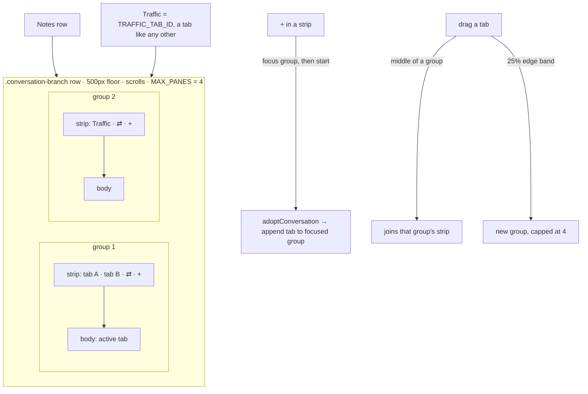
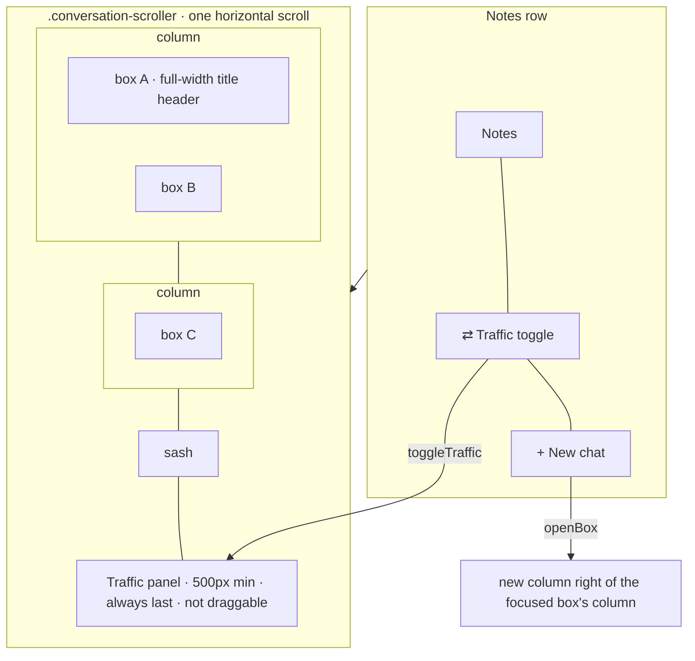
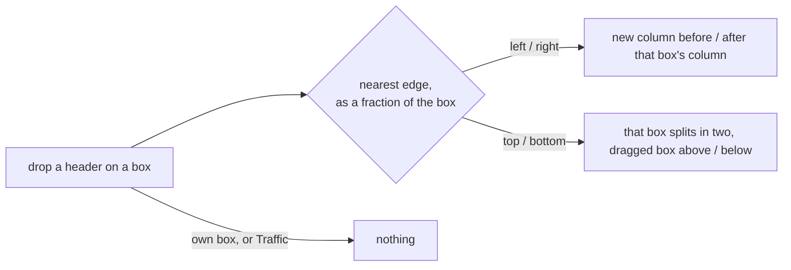
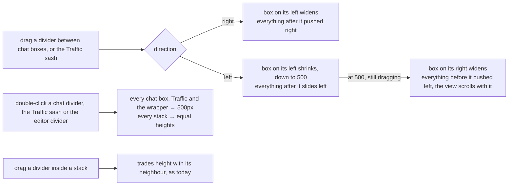
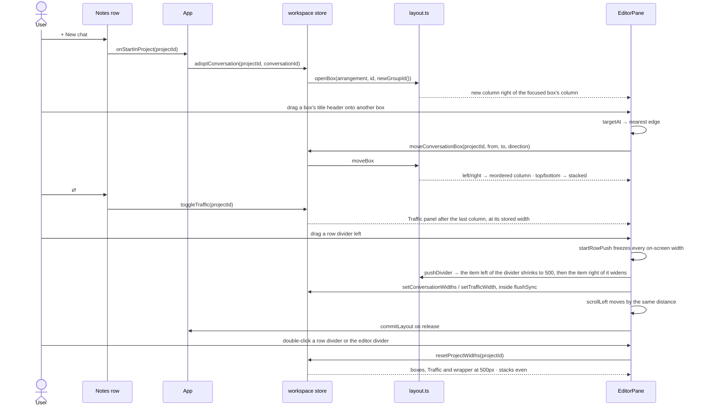

# One chat per box

**Status: built, not committed. Typecheck, lint and every unit test pass. Not yet driven in the running app.**

## Current / Issue



## Proposed







- A box holds exactly one chat. Its header is the title, full width. The header is the drag grip, double-click renames, and × ends the chat.
- The root is always a row of columns, and a column is one box or a vertical stack. No operation nests a row inside a column.
- Nearest edge is measured as a fraction of width and height, so a box divides into four triangles meeting at its centre whatever its shape.
- **Every column has a pixel width, 500px at least.** A new box opens at 500. A box moved left or right keeps its width. A box stacked into a column takes that column's width.
- **A divider shrinks the box on its left first, then pushes.** Dragging right widens the box on its left and pushes everything after it right. Dragging left shrinks the box on its left, down to 500, and everything after it slides left. Keep dragging past 500 and the box on its right widens instead, pushing everything before it left, with the view scrolling so the divider stays under the pointer. No other box changes width. A double-click still resets everything. (Revised 2026-09-28: the first build only ever widened, so a box could only get narrower through a double-click.)
- **The last chat box stretches** when the boxes don't fill the wrapper. A drag starts from the widths on screen, so once any divider moves, a stretched box keeps its stretched width. Nothing is ever narrowed by someone else's drag.
- **A double-click resets the whole project.** On a chat divider, the Traffic sash or the editor divider, every chat box, Traffic and the wrapper go to 500px, and every stack goes back to equal heights.
- **Dividers inside a stack don't change.** They trade height with their neighbour, and a double-click evens that stack only.
- The root row's `sizes` stop meaning anything. `normalizeTree` still keeps them valid, because `layout.ts` shares it with project panes.
- **Traffic leaves the tree.** It becomes a per-project panel, drawn after the last column inside the same horizontal scroll. Its width is 500px by default and at least, remembered per project. The sash on its left follows the same rule as every divider: dragging right widens the last chat box, and dragging left shrinks the last chat box to 500 before Traffic widens. With no chats open, dragging left widens Traffic straight away. Traffic itself only gets narrower through a double-click. It can't be dragged, and nothing can be dropped on it. `⇄` opens it and, pressed again, closes it. The × in its header also closes it.
- The Chorus column, which holds the boxes and Traffic, never goes below 500px. The editor/Chorus divider stops there. A stored width under 500 opens at 500. With the editor switched off, Chorus is the whole pane and this does not apply.
- The four-group cap stays on project panes, which share `layout.ts`, and does not apply to chats.
- No migration. A group that still holds several tabs shows its active one until you close them. A saved `traffic` tab is dropped by reconcile, so Traffic starts closed once.

## Code Changes

### `apps/desktop/src/shared/workspace-layout.ts`

```ts
export const CHORUS_WIDTH = { default: 500, min: 500 } as const
```

Was `{ default: 420, min: 100 }`. `clampChorusWidth` reads `min`, so the divider's drag, its arrow keys and `normalizeWorkspace` all stop at 500 with no other change. The default rises with it, because `useChorusWidth` returns the default unclamped for a project nobody has dragged.

```ts
export const BOX_WIDTH = { default: 500, min: 500 } as const

export const TrafficPanelState = z.object({ open: z.boolean(), width: z.number() })
export type TrafficPanelState = z.infer<typeof TrafficPanelState>

export const ConversationArrangement = z.object({
  layout: WorkspaceLayoutNode.nullable(),
  panes: z.record(z.string(), WorkspacePane),
  focusedPaneId: z.string().nullable(),
  widths: z.record(z.string(), z.number()).optional(),
})
```

`BOX_WIDTH` covers chat boxes and Traffic, which now follow one rule. It replaces the planned `TRAFFIC_WIDTH`.

`widths` is keyed by box id, and every box in a column carries that column's width. It can't live in the row's `sizes`, because `normalizeTree` turns those back into fractions after every structural change. It's optional, so an old snapshot and every arrangement literal in the tests parse unchanged. Box ids are UUIDs (`newGroupId`), so a stale entry can never land on a new box.

`WorkspaceSnapshot` gains `trafficPanels: z.record(z.string(), TrafficPanelState).default({})`, keyed by project like `chorusWidths`. `ProjectLayoutSlice` gains `trafficPanel: TrafficPanelState.optional()`. Column widths need no slice field, because they ride on `conversationGroups`.

`TRAFFIC_TAB_ID` and `isConversationTab` are removed. Nothing puts Traffic in an arrangement any more.

### `apps/desktop/src/renderer/src/workspace/layout.ts`

```ts
export const EMPTY_ARRANGEMENT: ConversationArrangement = {
  layout: null,
  panes: {},
  focusedPaneId: null,
}

export const CLOSED_TRAFFIC: TrafficPanelState = { open: false, width: BOX_WIDTH.default }

export function clampBoxWidth(width: number): number {
  if (!Number.isFinite(width)) return BOX_WIDTH.default
  return Math.round(Math.max(BOX_WIDTH.min, width))
}

export function columnsOf(layout: WorkspaceLayoutNode | null): WorkspaceLayoutNode[] {
  if (layout === null) return []
  return layout.kind === 'branch' && layout.orientation === 'row' ? layout.children : [layout]
}

function columnIndexOf(layout: WorkspaceLayoutNode, paneId: string): number {
  return columnsOf(layout).findIndex((column) => leafPaneIds(column).includes(paneId))
}

function withColumn(
  layout: WorkspaceLayoutNode,
  column: WorkspaceLayoutNode,
  at: number
): WorkspaceLayoutNode {
  const children = [...columnsOf(layout)]
  children.splice(at, 0, column)
  return { kind: 'branch', orientation: 'row', children, sizes: children.map(() => 1) }
}

function placeBox<T extends PaneTree>(
  tree: T,
  box: WorkspacePane,
  targetPaneId: string,
  direction: SplitDirection
): T {
  if (tree.layout === null) return tree
  const panes = { ...tree.panes, [box.id]: box }
  if (direction === 'up' || direction === 'down') {
    return normalizeTree({
      ...tree,
      layout: insertSplit(tree.layout, targetPaneId, box.id, direction),
      panes,
      focusedPaneId: box.id,
    })
  }
  const at = columnIndexOf(tree.layout, targetPaneId)
  if (at < 0) return tree
  return normalizeTree({
    ...tree,
    layout: withColumn(
      tree.layout,
      { kind: 'leaf', paneId: box.id },
      direction === 'left' ? at : at + 1
    ),
    panes,
    focusedPaneId: box.id,
  })
}

export function openBox<T extends PaneTree>(tree: T, tabId: string, boxId: string): T {
  const existing = tabLocation(tree, tabId)
  if (existing !== null) return focusPane(tree, existing.paneId)
  const box: WorkspacePane = { id: boxId, tabs: [tabId], activeTabId: tabId }
  const leaves = leafPaneIds(tree.layout)
  const beside = leaves.find((id) => id === tree.focusedPaneId) ?? leaves.at(-1)
  if (tree.layout === null || beside === undefined) {
    return {
      ...tree,
      layout: { kind: 'leaf', paneId: boxId },
      panes: { [boxId]: box },
      focusedPaneId: boxId,
    }
  }
  return placeBox(tree, box, beside, 'right')
}

export function moveBox(
  arrangement: ConversationArrangement,
  boxId: string,
  targetPaneId: string,
  direction: SplitDirection
): ConversationArrangement {
  const box = arrangement.panes[boxId]
  if (box === undefined || boxId === targetPaneId || arrangement.layout === null) return arrangement
  const lifted = normalizeTree({
    ...arrangement,
    panes: { ...arrangement.panes, [boxId]: { ...box, tabs: [] } },
  })
  if (lifted.layout === null) return arrangement
  if (direction === 'left' || direction === 'right') {
    return placeBox(lifted, box, targetPaneId, direction)
  }
  return placeBox(
    { ...lifted, widths: withEntry(lifted.widths ?? {}, boxId, lifted.widths?.[targetPaneId]) },
    box,
    targetPaneId,
    direction
  )
}

export function columnWidths(arrangement: ConversationArrangement): number[] {
  return columnsOf(arrangement.layout).map((column) => {
    const first = leafPaneIds(column)[0]
    const stored = first === undefined ? undefined : arrangement.widths?.[first]
    return clampBoxWidth(stored ?? BOX_WIDTH.default)
  })
}

export function withColumnWidths(
  arrangement: ConversationArrangement,
  widths: readonly number[]
): ConversationArrangement {
  const columns = columnsOf(arrangement.layout)
  if (widths.length !== columns.length) return arrangement
  return {
    ...arrangement,
    widths: Object.fromEntries(
      columns.flatMap((column, index) =>
        leafPaneIds(column).map((id) => [id, clampBoxWidth(widths[index] ?? BOX_WIDTH.default)])
      )
    ),
  }
}

export function pushDivider(
  widths: readonly number[],
  index: number,
  delta: number
): { widths: number[]; scroll: number } {
  const left = widths[index - 1]
  const right = widths[index]
  const next = [...widths]
  if (left === undefined || right === undefined) return { widths: next, scroll: 0 }
  if (delta >= 0) {
    next[index - 1] = left + delta
    return { widths: next, scroll: 0 }
  }
  const shrunk = Math.min(-delta, Math.max(0, left - BOX_WIDTH.min))
  const grown = -delta - shrunk
  next[index - 1] = left - shrunk
  next[index] = right + grown
  return { widths: next, scroll: grown }
}

function evened(node: WorkspaceLayoutNode): WorkspaceLayoutNode {
  if (node.kind === 'leaf') return node
  return {
    ...node,
    children: node.children.map(evened),
    sizes: node.children.map(() => 1 / node.children.length),
  }
}

export function resetBoxes(arrangement: ConversationArrangement): ConversationArrangement {
  return {
    ...arrangement,
    layout: arrangement.layout === null ? null : evened(arrangement.layout),
    widths: {},
  }
}
```

`moveBox` narrows from `PaneTree` to `ConversationArrangement`, because it now reads `widths`. Moving left or right leaves the box's own entry alone, so it keeps its width. Stacking copies the target's entry onto it. An empty entry means 500, so that copy removes it through `withEntry`. `openBox` stays generic, because a new box has no entry.

`columnWidths` reads a column's width from its first box. That's enough, because `withColumnWidths` writes the same width to every box in a column and rebuilds the record from the live layout, so stale entries go on the next resize. A widths list that doesn't match the columns is ignored, the same way `setBranchSizes` treats sizes.

`pushDivider` takes the widths of every item in the row and the index of the item right of the divider. Everything is measured from the widths at the start of the drag, so reversing mid-drag undoes it on the way back. Rightward, the left item grows by the distance moved. Leftward, the left item gives up everything it has above 500 first, and only the rest widens the right item. `scroll` is that rest: the shrink needs no scroll, because the items after it slide over, and the widening needs the view to move so the divider stays under the pointer.

`startRowPush` counts the empty state as already at 500, because it has no stored width to shrink. Otherwise dragging the Traffic sash left with no chats open would hit a dead zone before Traffic widened.

`reconcileConversationGroups`: the Traffic carve-outs (`keepsTraffic`, the `TRAFFIC_TAB_ID` filter) go, and a conversation no box holds gets its own box. `emptyArrangement` and `FIRST_GROUP_ID` go, since this was their only caller.

```ts
if (conversationIds.length === 0) return null
const live = new Set(conversationIds)
const seed: ConversationArrangement =
  saved?.layout == null
    ? EMPTY_ARRANGEMENT
    : {
        ...saved,
        panes: Object.fromEntries(
          Object.entries(saved.panes).map(([paneId, pane]) => [
            paneId,
            { ...pane, tabs: pane.tabs.filter((id) => live.has(id)) },
          ])
        ),
      }

let arrangement = normalizeTree(seed)
const focused = arrangement.focusedPaneId
const held = new Set(Object.values(arrangement.panes).flatMap((pane) => pane.tabs))
for (const id of conversationIds) {
  if (!held.has(id)) arrangement = openBox(arrangement, id, newGroupId())
}
return focused === null ? arrangement : { ...arrangement, focusedPaneId: focused }
```

`openBox` focuses what it opens, which is right for `+ New chat` and wrong here. Reconcile puts the focus back, so a restored layout keeps the box it had focused, as it does today.

The seed spreads `saved` rather than listing its fields, so `widths` survives reconcile.

`EMPTY_WORKSPACE` gains `trafficPanels: {}`. `sliceOf` / `mergeSlice` carry `trafficPanel` the way they carry `chorusWidth`. `normalizeWorkspace` clamps every `trafficPanels` width with `clampBoxWidth`. `onScreenConversations` drops its `isConversationTab` filter.

### `apps/desktop/src/renderer/src/workspace/store.ts`

`snapshot()` gains `trafficPanels: state.trafficPanels`; its own comment warns that a field left out there is dropped on every persist.

`adoptConversation` keeps its no-op for a conversation already held, because `App.tsx:1603` calls it for every session and must not move focus.

```ts
      adoptConversation: (projectId, conversationId) => {
        set((state) => {
          const current = state.conversationGroups[projectId]
          if (current !== undefined && tabLocation(current, conversationId) !== null) return {}
          return {
            conversationGroups: {
              ...state.conversationGroups,
              [projectId]: openBox(current ?? EMPTY_ARRANGEMENT, conversationId, newGroupId()),
            },
          }
        })
      },
      toggleTraffic: (projectId) => {
        set((state) => {
          const current = state.trafficPanels[projectId] ?? CLOSED_TRAFFIC
          return {
            trafficPanels: { ...state.trafficPanels, [projectId]: { ...current, open: !current.open } },
          }
        })
      },
      setTrafficWidth: (projectId, width) => {
        set((state) => {
          const current = state.trafficPanels[projectId] ?? CLOSED_TRAFFIC
          return {
            trafficPanels: {
              ...state.trafficPanels,
              [projectId]: { ...current, width: clampBoxWidth(width) },
            },
          }
        })
      },
      moveConversationBox: (projectId, boxId, targetGroupId, direction) => {
        set((state) => ({
          conversationGroups: editArrangement(state, projectId, (arrangement) =>
            moveBox(arrangement, boxId, targetGroupId, direction)
          ),
        }))
      },
      setConversationWidths: (projectId, widths) => {
        set((state) => ({
          conversationGroups: editArrangement(state, projectId, (arrangement) =>
            withColumnWidths(arrangement, widths)
          ),
        }))
      },
      resetProjectWidths: (projectId) => {
        set((state) => {
          const traffic = state.trafficPanels[projectId] ?? CLOSED_TRAFFIC
          return {
            conversationGroups: editArrangement(state, projectId, resetBoxes),
            trafficPanels: {
              ...state.trafficPanels,
              [projectId]: { ...traffic, width: BOX_WIDTH.default },
            },
            chorusWidths: { ...state.chorusWidths, [projectId]: CHORUS_WIDTH.default },
          }
        })
      },
```

Interface additions:

```ts
  setConversationWidths: (projectId: string, widths: readonly number[]) => void
  resetProjectWidths: (projectId: string) => void
```

`resetProjectWidths` is one `set`, so the boxes, Traffic and the wrapper land in one render and one persist.

Removed from the interface and the implementation: `openTraffic`, `closeConversationTab` (Traffic was its only caller), `placeConversation`, `splitConversation`. `placeSession` / `splitWithSession` stay for project panes.

### `apps/desktop/src/renderer/src/workspace/hooks.ts`

Both selector lists: drop `openTraffic`, `closeConversationTab`, `placeConversation`, `splitConversation`; add `toggleTraffic`, `setTrafficWidth`, `moveConversationBox`, `setConversationWidths`, `resetProjectWidths`.

```ts
export function useTrafficPanel(projectId: string | null): TrafficPanelState {
  return useWorkspaceStore((state) =>
    projectId === null ? CLOSED_TRAFFIC : (state.trafficPanels[projectId] ?? CLOSED_TRAFFIC)
  )
}
```

`useFocusedConversationId` returns `active` directly; its `isConversationTab` guard and the note about it go.

### `apps/desktop/src/renderer/src/App.tsx`

Line 515: `.filter((id): id is string => id !== null)`, and the `isConversationTab` import goes.

### `apps/desktop/src/renderer/src/workspace/useConversationDrag.ts`

```ts
export interface ConversationDropTarget {
  readonly groupId: string
  readonly direction: SplitDirection
}

export function useConversationDrag(options: {
  readonly onMove: (boxId: string, targetGroupId: string, direction: SplitDirection) => void
}): ConversationDrag

const target = targetAt(moved.clientX, moved.clientY, groupId)

if (finished?.target == null) return
latest.current.onMove(groupId, finished.target.groupId, finished.target.direction)

function targetAt(x: number, y: number, fromGroupId: string): ConversationDropTarget | null {
  const column = document.elementFromPoint(x, y)?.closest<HTMLElement>('.conversation-column')
  const groupId = column?.dataset['group']
  if (column == null || groupId === undefined || groupId === fromGroupId) return null
  const rect = column.getBoundingClientRect()
  const edges: { direction: SplitDirection; distance: number }[] = [
    { direction: 'left', distance: (x - rect.left) / rect.width },
    { direction: 'right', distance: (rect.right - x) / rect.width },
    { direction: 'up', distance: (y - rect.top) / rect.height },
    { direction: 'down', distance: (rect.bottom - y) / rect.height },
  ]
  const nearest = edges.reduce((best, edge) => (edge.distance < best.distance ? edge : best))
  return { groupId, direction: nearest.direction }
}
```

The Traffic panel is not a `.conversation-column`, so a drop over it finds no target.

Removed: the `group` target kind, `groupCount`, `MAX_PANES`, the 25% bands, `sourceWouldVanish`.

### `apps/desktop/src/renderer/src/workspace/ConversationColumn.tsx`

One chat per box, and no Traffic. The tab loop, `+`, `⇄`, the Traffic tab and body, the hover hint and the rename width pinning go. The native `title` covers a truncated name. Props `onNewConversation` and `trafficTerminals` go.

```tsx
  const [renaming, setRenaming] = useState(false)
  const tabId = props.group.activeTabId ?? props.group.tabs[0] ?? null
  const session = props.sessions.find((candidate) => candidate.conversationId === tabId)
  const drop = props.drag.drag?.target?.groupId === props.group.id ? props.drag.drag.target : null

    <div
      className="conversation-column"
      data-group={props.group.id}
      data-focused={props.focused}
      data-drop={
        drop === null
          ? undefined
          : drop.direction === 'left' || drop.direction === 'right'
            ? 'reorder'
            : 'split'
      }
      data-drop-direction={drop?.direction}
      onPointerDownCapture={/* unchanged */}
    >
      <div className="conversation-dock">
        <div className="conversation-dock-tabs">
          {session !== undefined && (
            <div
              className="conversation-dock-tab"
              data-tab-id={session.conversationId}
              data-dragging={
                props.drag.drag?.tabId === session.conversationId ? 'true' : undefined
              }
              data-active="true"
            >
              {renaming ? (
                <input
                  className="conversation-dock-tab-rename"
                  defaultValue={session.title}
                  size={1}
                  autoFocus
                  aria-label={t('conversation.renameTitle')}
                  placeholder={t('conversation.titlePlaceholder')}
                  onKeyDown={/* unchanged, setRenaming(false) */}
                  onBlur={/* unchanged, setRenaming(false) */}
                />
              ) : (
                <>
                  <button
                    type="button"
                    className="conversation-dock-tab-main"
                    title={session.title}
                    onPointerDown={(event) => {
                      props.drag.onPointerDown(
                        props.group.id,
                        session.conversationId,
                        session.title,
                        event
                      )
                    }}
                    onClick={() => {
                      if (props.drag.consumeSuppressedClick()) return
                      showConversationIn(props.projectId, props.group.id, session.conversationId)
                    }}
                    onDoubleClick={() => {
                      setRenaming(true)
                    }}
                  >
                    <span className="conversation-dock-tab-title">{session.title}</span>
                    <TabState conversationIds={[session.conversationId]} />
                  </button>
                  <button
                    type="button"
                    className="conversation-dock-tab-close"
                    aria-label={t('conversation.endTitled', { title: session.title })}
                    title={t('conversation.endTitled', { title: session.title })}
                    onClick={(event) => {
                      event.stopPropagation()
                      props.onEndConversation(session.conversationId)
                    }}
                  >
                    <span aria-hidden="true">×</span>
                  </button>
                </>
              )}
            </div>
          )}
        </div>
      </div>
      <div className="conversation-body">
        {session !== undefined && props.renderSession(session, props.focused, props.paneId)}
      </div>
    </div>
```

### `apps/desktop/src/renderer/src/workspace/ConversationTree.tsx`

`onNewConversation` and `trafficTerminals` removed from the props and from both render sites.

It no longer draws the root row. `EditorPane` walks `columnsOf(layout)` and hands in one column at a time, so the tree only ever sees a box or a stack. The stack's dividers keep `startResize` and `onEqualize` unchanged. The row path stays, for a saved layout that still nests a row inside a column.

### `apps/desktop/src/renderer/src/workspace/EditorPane.tsx`

```tsx
const traffic = useTrafficPanel(projectId)
const widths = arrangement === undefined ? [] : columnWidths(arrangement)
const {
  moveConversationBox,
  setConversationSizes,
  equalizeConversationBranch,
  setConversationWidths,
  resetProjectWidths,
  toggleTraffic,
  setTrafficWidth,
} = useWorkspaceActions()
const conversationDrag = useConversationDrag({
  onMove: (boxId, targetGroupId, direction) => {
    if (projectId === null) return
    moveConversationBox(projectId, boxId, targetGroupId, direction)
    commitLayout()
  },
})
const pushRow = (event: ReactPointerEvent<HTMLDivElement>): void => {
  if (projectId === null) return
  startRowPush(
    event,
    (boxWidths, trafficWidth) => {
      setConversationWidths(projectId, boxWidths)
      if (trafficWidth !== null) setTrafficWidth(projectId, trafficWidth)
    },
    commitLayout
  )
}
const resetWidths = (): void => {
  if (projectId === null) return
  resetProjectWidths(projectId)
  commitLayout()
}

{
  projectId !== null && (
    <div className="project-header">
      <ProjectNotes key={projectId} /* unchanged props */ />
      <button
        type="button"
        className="conversation-dock-add"
        data-traffic-open="true"
        aria-pressed={traffic.open}
        aria-label={t('traffic.tabTitle')}
        title={t('traffic.tabTitle')}
        onClick={() => {
          toggleTraffic(projectId)
          commitLayout()
        }}
      >
        <span aria-hidden="true">⇄</span>
      </button>
      <button
        type="button"
        className="conversation-dock-add"
        aria-label={t('conversation.newInGroup')}
        title={t('conversation.newInGroup')}
        onClick={() => {
          props.onStartInProject(projectId)
        }}
      >
        +
      </button>
    </div>
  )
}
;<div className="conversation-scroller">
  {/* the empty state, unchanged */}
  {projectId !== null &&
    arrangement?.layout != null &&
    columnsOf(arrangement.layout).map((column, index, columns) => (
      <Fragment key={index}>
        {index > 0 && (
          <div
            className="conversation-sash"
            role="separator"
            aria-orientation="vertical"
            tabIndex={0}
            onPointerDown={pushRow}
            onDoubleClick={resetWidths}
          />
        )}
        <div
          className="conversation-slot"
          style={{
            flex: `${index === columns.length - 1 ? '1' : '0'} 0 ${String(widths[index] ?? BOX_WIDTH.default)}px`,
          }}
        >
          <ConversationTree
            node={column}
            path={columns.length > 1 ? [index] : []}
            /* every other prop as today, less the two removed above */
          />
        </div>
      </Fragment>
    ))}
  {projectId !== null && traffic.open && (
    <>
      <div
        className="conversation-sash"
        role="separator"
        aria-orientation="vertical"
        tabIndex={0}
        onPointerDown={pushRow}
        onDoubleClick={resetWidths}
      />
      <section className="traffic-box" style={{ width: `${String(traffic.width)}px` }}>
        <div className="conversation-dock">
          <div className="conversation-dock-tabs">
            <div className="conversation-dock-tab" data-traffic-tab="true" data-active="true">
              <span className="conversation-dock-tab-main">
                <span className="conversation-dock-tab-title">{t('traffic.tabTitle')}</span>
              </span>
              <button
                type="button"
                className="conversation-dock-tab-close"
                aria-label={t('traffic.close')}
                title={t('traffic.close')}
                onClick={() => {
                  toggleTraffic(projectId)
                  commitLayout()
                }}
              >
                <span aria-hidden="true">×</span>
              </button>
            </div>
          </div>
        </div>
        <div className="conversation-body">
          <TrafficPanel projectId={projectId} terminals={props.trafficTerminals} />
        </div>
      </section>
    </>
  )}
</div>

function startRowPush(
  event: ReactPointerEvent<HTMLDivElement>,
  apply: (boxWidths: number[], trafficWidth: number | null) => void,
  commit: () => void
): void {
  if (event.button !== 0) return
  const sash = event.currentTarget
  const scroller = sash.parentElement
  if (scroller === null) return
  const children = [...scroller.children]
  const isItem = (child: Element): boolean => !child.classList.contains('conversation-sash')
  const items = children.filter(isItem)
  const index = children.slice(0, children.indexOf(sash)).filter(isItem).length
  const frozen = items.map((item) => item.getBoundingClientRect().width)
  const boxAt = items.map((item) => item.classList.contains('conversation-slot'))
  const trafficAt = items.findIndex((item) => item.classList.contains('traffic-box'))
  const originX = event.clientX
  const originScroll = scroller.scrollLeft
  let dragged = false
  sash.setPointerCapture(event.pointerId)
  const move = (moved: PointerEvent): void => {
    const delta = moved.clientX - originX
    if (!dragged && delta === 0) return
    dragged = true
    const pushed = pushDivider(frozen, index, delta)
    flushSync(() => {
      apply(
        pushed.widths.filter((_, at) => boxAt[at] === true),
        trafficAt < 0 ? null : (pushed.widths[trafficAt] ?? null)
      )
    })
    scroller.scrollLeft = originScroll + pushed.scroll
  }
  const stop = (): void => {
    sash.removeEventListener('pointermove', move)
    sash.removeEventListener('pointerup', stop)
    sash.removeEventListener('pointercancel', stop)
    sash.releasePointerCapture(event.pointerId)
    if (dragged) commit()
  }
  sash.addEventListener('pointermove', move)
  sash.addEventListener('pointerup', stop)
  sash.addEventListener('pointercancel', stop)
}
```

New imports: `Fragment` from `react`, `flushSync` from `react-dom`, `columnsOf`, `columnWidths` and `pushDivider` from `./layout.js`, and `BOX_WIDTH` from the shared layout.

How the push works:

- **One handler for every row divider.** It finds its own position among the scroller's children, so the chat dividers and the Traffic sash need no index prop.
- **Every item's on-screen width is frozen at pointer-down**, and every move writes all of them back. That's what stops the stretched last box shrinking when a box before it grows.
- **The last slot is `flex: 1 0 <width>`**, and every other one is `0 0 <width>`. So the last box fills any gap and never goes under its own width.
- **`flushSync`, then `scrollLeft`.** The widths have to render before the scroll is set, or the browser clamps it to the old width. deepseek traced the installed builds: zustand 5.0.14 goes through `useSyncExternalStore`, a store change is queued on SyncLane, and React 19.2.8's `flushSync` flushes sync work in its `finally`. The render order is sourced. The scroll landing under the pointer is still unverified until it runs.
- **Only a real drag writes.** A press with no horizontal movement writes and commits nothing, so a click can't turn a stretched box's width into a stored one. A non-primary button is ignored, as `Workspace.tsx`'s sash does.
- **The sash keeps its grab offset on a leftward drag.** While the left box shrinks, the sash moves with that box's right edge. Once it's at 500, everything left of the sash keeps its width, and scrolling by the rest moves the sash exactly with the pointer.
- **One place it can't track the pointer.** When the row is scrolled all the way to its right end, a shrink makes the content shorter and the browser pulls the scroll back. So the boxes before the divider slide right, instead of the divider sliding left. Nothing is lost, but the divider lags the pointer by however much it shrank. Unverified until it runs.
- **The empty state counts as an item but has no width to write.** Dragging the Traffic sash right with no chats open therefore does nothing, and dragging it left widens Traffic.

The empty-project state loses its "Open captured traffic" button, because the header's `⇄` now does that. Its "New conversation" button stays.

### `apps/desktop/src/renderer/src/workspace/ChorusSash.tsx`

The editor divider keeps its drag and its arrow keys. It gains the reset:

```tsx
  const { setChorusWidth, resetProjectWidths } = useWorkspaceActions()

      onDoubleClick={() => {
        resetProjectWidths(projectId)
        onCommit()
      }}
```

### `apps/desktop/src/renderer/src/styles.css`

The root row stops being the scroller, and stops being drawn at all. `.conversation-scroller` scrolls instead, and its items are the column slots, the empty state and the Traffic panel, with a sash between each pair. Each slot's width comes from its inline `flex`. The 500px floor is a `min-width` on every item.

```css
.project-header {
  flex: 0 0 auto;
  display: flex;
  align-items: flex-start;
  gap: var(--step);
  padding-right: calc(var(--step) * 2);
}

.project-header > .project-notes {
  flex: 1 1 auto;
  min-width: 0;
}

.project-header > .conversation-dock-add {
  margin-top: calc(var(--step) * 1.5);
}

.conversation-scroller {
  display: flex;
  flex: 1 1 auto;
  min-width: 0;
  min-height: 0;
  overflow-x: auto;
  overflow-y: hidden;
  scrollbar-width: thin;
}

.conversation-scroller > .conversation-sash {
  flex: 0 0 9px;
  cursor: col-resize;
  touch-action: none;
  border-left: 1px solid var(--border-default);
}

.conversation-slot {
  display: flex;
  min-width: 500px;
  min-height: 0;
}

.conversation-scroller > .conversation-empty {
  flex: 1 1 0;
  min-width: 500px;
}

.traffic-box {
  flex: 0 0 auto;
  min-width: 500px;
  display: flex;
  flex-direction: column;
  min-height: 0;
}

.traffic-box .conversation-dock-tab {
  cursor: default;
}
```

`.conversation-branch[data-orientation='row']` is left alone, scroll and 500px child floor included. After this change it matches only a legacy row nested inside a stack, which today's `splitConversation` can build, and that row still needs its own scroll.

`.workspace-pane-chorus`: `min-width: 0` → `min-width: 500px`, so the column cannot flex-shrink under the floor either when the pane narrows. `.workspace-pane-chorus[data-full='true']` keeps its own `min-width: 0`.

`.conversation-dock-tab`: `flex: 1 1 auto`, `min-width: 0`, `margin-right: 0`, `cursor: grab` (was `0 1 auto`, `160px`, a right margin, `default`).

The drop preview for left/right is a 3px bar on that edge, because it inserts between columns. Top/bottom keeps the half shading, because it splits the box.

```css
.conversation-column[data-drop='reorder']::after {
  background: var(--accent-text);
  border-radius: 2px;
}

.conversation-column[data-drop='reorder'][data-drop-direction='left']::after {
  right: auto;
  width: 3px;
}

.conversation-column[data-drop='reorder'][data-drop-direction='right']::after {
  left: auto;
  width: 3px;
}
```

Removed: `[data-drop='group']`, `[data-drop='split']` left/right, `.conversation-dock-hint`.

### `apps/desktop/src/renderer/src/i18n/en.json`

`dock.conversations` removed; it labelled the tablist that is gone.

### `apps/desktop/src/renderer/src/workspace/layout.test.ts`

The two Traffic cases in `reconcileConversationGroups` and the `the traffic tab through a place and a split` block go with `TRAFFIC_TAB_ID`. New cases:

```ts
describe('one chat per box', () => {
  it('opens a new box as a column right of the focused one', () => {})
  it('opens beside a stacked box as a new column, never inside the stack', () => {})
  it('focuses the box already holding the tab instead of opening a second', () => {})
  it('reorders a whole column and keeps its width', () => {})
  it('stacks a box above or below another, splitting that box in two', () => {})
  it('pulls a box out of a stack into its own column', () => {})
  it('ignores a drop on the box being dragged', () => {})
  it('reconcile gives each unheld conversation its own box', () => {})
  it('reconcile keeps the box that was focused', () => {})
  it('reconcile drops a saved traffic tab', () => {})
})

describe('traffic panel', () => {
  it('clamps a stored width to the floor', () => {})
  it('carries the panel through sliceOf and mergeSlice', () => {})
})

describe('box widths', () => {
  it('opens a new box at 500px', () => {})
  it('keeps a box moved left or right at its own width', () => {})
  it('gives a box stacked into a column that column width', () => {})
  it('writes one width to every box in a column and drops stale entries', () => {})
  it('ignores a widths list that does not match the columns', () => {})
  it('clamps a stored width up to 500', () => {})
  it('keeps widths through reconcile', () => {})
})

describe('pushDivider', () => {
  it('dragging right widens the item on the left and nothing else', () => {})
  it('dragging left widens the item on the right and scrolls by the same distance', () => {})
  it('reversing mid-drag measures from the start, so it undoes on the way back', () => {})
})

describe('resetBoxes', () => {
  it('clears every width and evens every stack', () => {})
})
```

`store.test.ts` gains one case: `resetProjectWidths` puts the boxes, Traffic and the wrapper at 500 in one update.

Any other test importing `TRAFFIC_TAB_ID` or `isConversationTab` is updated to match. Written, not run.

## Final Flow



## Not changed, and will break

`apps/desktop/e2e/traffic-drive.mjs` drives Traffic as a tab: the per-box `⇄`, the Traffic tab's drag, and a multi-tab strip. It is not updated here.
