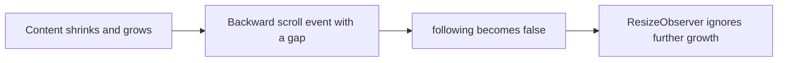
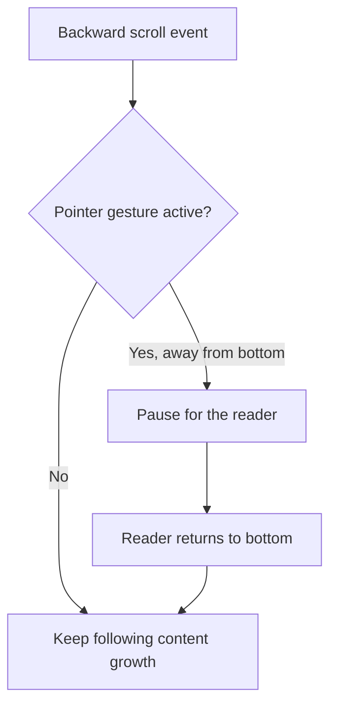

# Keep following a streaming response

## Current / Issue

`Session` still stops following on backward movement without requiring a user gesture. This defect is confirmed by source inspection. The exact timing that produced the user's intermittent stall has not been reproduced.



The thinking row disappears when a message starts, and `useTypewriter` initially renders an empty prefix. The existing `pinnedTop` guard covers recorded app writes, but not a browser clamp before the observer corrects it.

## Proposed

Use a transient pointer gesture ref to distinguish a scrollbar, selection, or touch drag from hands-off layout changes. Existing wheel and keyboard intent stays in place.

Release after one animation frame so the final frame-aligned scroll event can still pause following. Ignore a touch `pointercancel` when the browser takes over panning; release on `touchend` or `touchcancel`. Window blur clears the gesture immediately. Element blur must not clear it.

Chromium dispatches mouse pointer events before handling an element scrollbar and dispatches pointer-up after its scrollbar release. Mouse moves during a scrollbar drag are consumed by the scrollbar. This supports a held-pointer gate rather than a pointer-move heuristic. [Chromium event handler](https://raw.githubusercontent.com/chromium/chromium/main/third_party/blink/renderer/core/input/event_handler.cc).

## Code Changes

### apps/desktop/src/renderer/src/Session.tsx

Add `pointerHeld` and `pointerRelease` refs. Register captured passive release listeners for `pointerup`, `pointercancel`, `touchend`, and `touchcancel`, plus a non-captured window `blur` listener. Cancel pending releases on a new press and during cleanup.

```tsx
onPointerDownCapture={() => {
  cancelAnimationFrame(pointerRelease.current)
  pointerRelease.current = 0
  pointerHeld.current = true
}}
```

```ts
if (pointerHeld.current && !pinned && top < lastTop.current && gap > 1) stopFollowing()
else if (top > lastTop.current && gap <= 1) resumeFollowing()
```

One atomic implementation unit changes the refs, listener lifecycle, and scroller handlers together. Preserve all existing uncommitted work. Do not change transcript reduction, typewriter pacing, floor animation, APIs, dependencies, or wheel thresholds.

## Acceptance and verification

Hands-off multi-screen replies must continue following through thinking-row removal, tool/message transitions, markdown reflow, simultaneous agents, and completion. Deliberate wheel/key scrolling, scrollbar dragging, touch panning, and selection autoscroll must pause following. Returning to the bottom and sending a message must resume it. Following and parked panes must preserve their respective behavior across remounts. Release, cancellation, blur, and unmount must clean up gesture state.

Review the incremental diff against the saved pre-task `Session.tsx`, then review the complete integrated scroll path. Claude performs a final adversarial review.

Tests, typecheck, lint, builds, app launch, and UI reproduction are not run under the standing project preference. Runtime acceptance is NOT VERIFIED. If later authorized, run `pnpm check`, drive the streaming shrink/grow case with real layout, and use `node apps/desktop/e2e/split-scroll.mjs` for remount regression coverage.

Remaining limits: layout changes while a pointer is held can still pause following; native overlay scrollbars and compositor release timing need runtime verification. Find-in-page, accessibility scrolling, and middle-click autoscroll after release are not covered by this gesture gate.

## Final Flow


