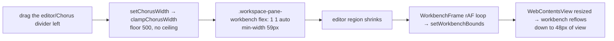
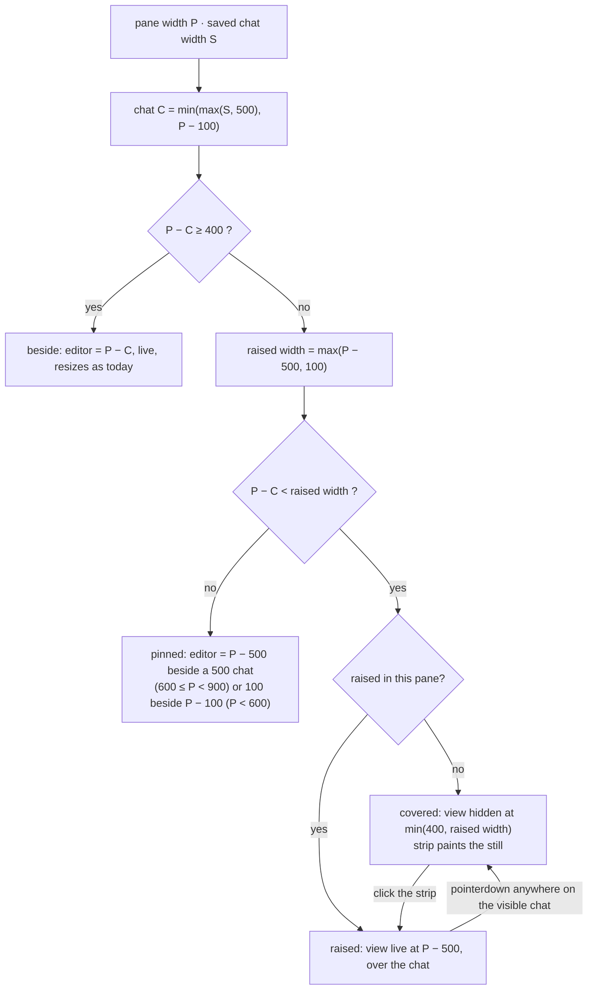
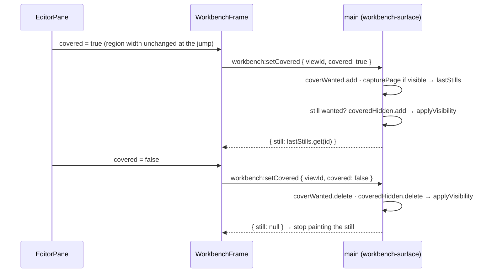
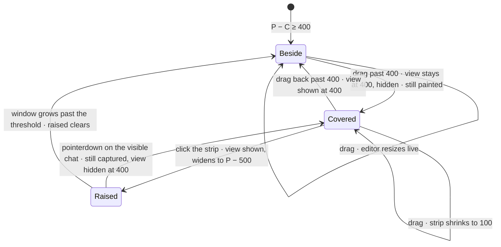

# The editor under the chat

**Status: built, not committed. Typecheck, lint, prettier and every unit test pass (2899 passed, 0 failed). Not yet driven in the running app, so acceptance criteria 1–10 are unverified. Builds on the uncommitted one-chat-per-box work (`docs/plans/one-chat-per-box-2026-09-28/plan.md`), which stays uncommitted and untouched.**

## Current / Issue



The editor always shrinks with the chat. Past a few hundred pixels it is unusable, and there is no way to widen the chat without crushing it.

## Proposed





- **The view never moves at the jump.** While covered, the editor region stays at 400, the width it had when it went under. It only widens to P − 500 when raised, which is when it is on top anyway. So the cover capture races nothing, and uncovering shows the view at the width it already had.
- The saved width stays `chorusWidths[projectId]`: remembered per project, no new field, no migration. The drag clamps to P − 100 so it stores what it shows. The ceiling is applied again at render, so a narrow window never rewrites the saved width.
- "Raised" is per pane and transient. It clears when coverage ends or the pane shows a different project.
- Coverage is a third reason in `applyVisibility`, keyed by view id. It never touches `editorHidden` (the Editor switch) or `overlayHidden` (dialogs).
- Main keeps the last still per surface, fed by both the cover capture and the overlay capture. So a cover that cannot capture still has a picture to hand back: the view already hidden by a dialog, or a surface handed to another window.

## Code Changes

### `apps/desktop/src/shared/workspace-layout.ts`

```ts
export const EDITOR_WIDTH = { resizeFloor: 400, peek: 100 } as const
```

### `apps/desktop/src/renderer/src/workspace/layout.ts`

```ts
export interface PaneSplit {
  readonly chorus: number
  readonly editor: number
  readonly raised: number
  readonly covered: boolean
}

export function paneSplit(pane: number, stored: number): PaneSplit {
  const chorus = Math.max(0, Math.min(Math.max(stored, CHORUS_WIDTH.min), pane - EDITOR_WIDTH.peek))
  const beside = pane - chorus
  if (beside >= EDITOR_WIDTH.resizeFloor) {
    return { chorus, editor: beside, raised: beside, covered: false }
  }
  const raised = Math.max(pane - CHORUS_WIDTH.min, EDITOR_WIDTH.peek)
  const covered = chorus > 0 && beside < raised
  return {
    chorus,
    editor: covered ? Math.min(EDITOR_WIDTH.resizeFloor, raised) : raised,
    raised,
    covered,
  }
}
```

### `apps/desktop/src/renderer/src/workspace/hooks.ts`

```ts
export function useRaisedEditor(
  projectId: string | null,
  covered: boolean
): readonly [raised: boolean, raise: () => void, lower: () => void] {
  const [raisedIn, setRaisedIn] = useState<string | null>(null)
  useLayoutEffect(() => {
    if (!covered || raisedIn !== projectId) setRaisedIn(null)
  }, [covered, projectId, raisedIn])
  const raise = useCallback(() => {
    setRaisedIn(projectId)
  }, [projectId])
  const lower = useCallback(() => {
    setRaisedIn(null)
  }, [])
  return [covered && raisedIn !== null && raisedIn === projectId, raise, lower]
}
```

### `apps/desktop/src/shared/workbench-ipc.ts`

```ts
'workbench:setCovered': {
  request: z.object({ viewId: z.string().min(1), covered: z.boolean() }).strict(),
  response: z.object({ still: z.string().nullable() }),
},
```

Plus `setWorkbenchCovered` on the shell API interface, and in `preload/index.ts`:

```ts
setWorkbenchCovered: invokeWorkbench('workbench:setCovered'),
```

### `apps/desktop/src/main/workbench-surface.ts`

```ts
const coveredHidden = new Set<string>()
const coverWanted = new Set<string>()
const lastStills = new Map<string, string>()

function applyVisibility(surface: Surface): void {
  surface.view.setVisible(
    !editorHidden.has(surface.projectRoot) &&
      !overlayHidden.has(surface.owner) &&
      !coveredHidden.has(surface.id)
  )
}

export async function setSurfaceCovered(
  caller: WebContents,
  viewId: string,
  covered: boolean
): Promise<string | null> {
  const surface = ownedSurface(caller, viewId)
  if (!covered) {
    coverWanted.delete(viewId)
    coveredHidden.delete(viewId)
    applyVisibility(surface)
    return null
  }
  coverWanted.add(viewId)
  if (surface.view.getVisible()) {
    try {
      const image = await surface.view.webContents.capturePage()
      if (!image.isEmpty()) {
        lastStills.set(viewId, `data:image/jpeg;base64,${image.toJPEG(85).toString('base64')}`)
      }
    } catch {
      lastStills.delete(viewId)
    }
  }
  if (!coverWanted.has(viewId) || byId.get(viewId) !== surface) return null
  coveredHidden.add(viewId)
  applyVisibility(surface)
  return lastStills.get(viewId) ?? null
}
```

- New `case 'workbench:setCovered'` in the handler switch, returning `{ still: await setSurfaceCovered(...) }`.
- `setSurfacesVisible`'s overlay capture loop skips `coveredHidden.has(id)`, alongside the existing `editorHidden` skip, and writes each capture into `lastStills` as well as returning it.
- `destroySurface` deletes the id from `coveredHidden`, `coverWanted` and `lastStills`.
- A handoff keeps all three. The destination frame re-asserts `covered` on mount: false shows the view, true hands back the stored still.

### `apps/desktop/src/renderer/src/workbench/WorkbenchFrame.tsx`

```tsx
readonly covered?: boolean

const [coverStill, setCoverStill] = useState<string | null>(null)
const [paintCover, setPaintCover] = useState(false)
const overlayStill = useWorkbenchStill(viewId)
const still = paintCover ? (coverStill ?? overlayStill) : overlayStill

useLayoutEffect(() => {
  if (viewId === null || hidden) return undefined
  let live = true
  if (covered) setPaintCover(true)
  window.chorus
    .setWorkbenchCovered({ viewId, covered })
    .then(({ still: captured }) => {
      if (!live) return
      if (!covered) setPaintCover(false)
      else if (captured !== null) setCoverStill(captured)
    })
    .catch((error: unknown) => {
      if (live) onFailed(error instanceof Error ? error.message : String(error))
    })
  return () => {
    live = false
  }
}, [viewId, covered, hidden, onFailed])
```

The `` gets `data-cover={paintCover || undefined}`. The still keeps painting until the uncover resolves, underneath the view, so neither the raise nor the drag back flashes blank.

### `apps/desktop/src/renderer/src/workspace/PaneWorkbench.tsx`

A `covered` prop, passed to `WorkbenchFrame` as `props.active && props.covered`.

### `apps/desktop/src/renderer/src/workspace/EditorPane.tsx`

```tsx
const content = useRef<HTMLDivElement>(null)
const [paneWidth, setPaneWidth] = useState(0)
const hasPane = pane !== undefined
useLayoutEffect(() => {
  const element = content.current
  if (element === null) return undefined
  setPaneWidth(element.clientWidth)
  const observer = new ResizeObserver(() => {
    setPaneWidth(element.clientWidth)
  })
  observer.observe(element)
  return () => {
    observer.disconnect()
  }
}, [hasPane])

const split = workbenchShown && paneWidth > 0 ? paneSplit(paneWidth, chorusWidth) : null
const [raised, raiseEditor, lowerEditor] = useRaisedEditor(projectId, split?.covered === true)
const covered = split?.covered === true && !raised
```

- `ref={content}` on `.workspace-pane-content`.
- Region: `style={split === null ? undefined : { flex: `0 0 ${String(raised ? split.raised : split.editor)}px` }}`, `data-covered={covered}`, `onClick={covered ? raiseEditor : undefined}`.
- `PaneWorkbench` gets `covered={covered}`.
- Chorus: `width` from `split?.chorus ?? chorusWidth`, and `onPointerDown={raised ? lowerEditor : undefined}`.
- `ChorusSash` moves inside `.workspace-pane-chorus` as its first child.

### `apps/desktop/src/renderer/src/workspace/ChorusSash.tsx`

The drag and arrow keys clamp to `pane.clientWidth - EDITOR_WIDTH.peek` before `setChorusWidth`.

### `apps/desktop/src/renderer/src/styles.css`

```css
.workspace-pane-content {
  position: relative;
} /* the row rule */
.workspace-pane-workbench {
  flex: 0 0 calc(100% - 500px);
  min-width: 0;
}
.workspace-pane-workbench[data-covered='true'] {
  cursor: pointer;
}
.workspace-pane-chorus:not([data-full='true']) {
  position: absolute;
  inset: 0 0 0 auto;
  min-width: 0;
  background: var(--bg-canvas);
}
.chorus-sash {
  position: absolute;
  inset: 0 auto 0 -5px;
  width: 9px;
  z-index: 2;
}
.workbench-still[data-cover] {
  width: auto;
  right: auto;
  object-fit: fill;
}
```

- `.workspace-pane-workbench` loses `flex: 1 1 auto` and `min-width: 59px`. Before the first measurement it is P − 500, never the whole pane.
- `.workspace-pane-chorus` loses `min-width: 500px` outside the full-pane case, and gains the opaque ground the still must not bleed through.
- `.chorus-sash` loses `flex` and `margin`.
- The cover still keeps `height: 100%`, so `width: auto` renders it at exactly the width it was captured at, top-left.

## Final Flow



## Acceptance criteria

1. In a pane of 900px or more, with the editor at 400px or more, the divider resizes it live, as today.
2. Past 400px, the editor goes under the chat, and the strip shows its frozen picture. No visible jump of the view.
3. The chat stops at pane − 100.
4. Dragging back until the strip is 400px or wider makes the editor live and resizable again.
5. Clicking the strip brings the editor to the front, live, pane − 500 wide, fully usable.
6. A pointerdown anywhere on the visible chat, its divider included, sends it back, and the click still does what it was aimed at.
7. The divider position survives a restart per project. "Raised" does not, and it clears when coverage ends or the pane switches project.
8. Detached windows behave identically. A covered editor handed to another window keeps its picture.
9. In a pane of 600–899px, the editor is pinned at pane − 500 beside a 500px chat. The divider only slides the chat over it.
10. In a pane under 600px, the chat is pane − 100, the editor is 100, and nothing overlaps.
11. Unchanged: the Editor switch, dialogs and hover cards over the editor, double-click reset to 500, the one-chat-per-box push drag, zoom.
12. A narrow window re-derives the layout and never rewrites the saved width.

## Units

| #   | Unit                                   | Files                                                                                          | Depends on |
| --- | -------------------------------------- | ---------------------------------------------------------------------------------------------- | ---------- |
| U1  | Geometry, the raised hook, their tests | `workspace-layout.ts`, `layout.ts`, `layout.test.ts`, `hooks.ts`, new `hooks.test.tsx` (jsdom) | none       |
| U2  | Main's covered channel and its tests   | `workbench-ipc.ts`, `preload/index.ts`, `workbench-surface.ts`, `workbench-surface.test.ts`    | none       |
| U3  | The pane                               | `WorkbenchFrame.tsx`, `PaneWorkbench.tsx`, `EditorPane.tsx`, `ChorusSash.tsx`, `styles.css`    | U1, U2     |

## Verification

- `paneSplit`: both regimes; the jump at beside 400/399 each way with an unchanged `editor`; the P − 100 cap; P = 599/600/899/900; stored below 500; chorus 0.
- `useRaisedEditor`: raise then uncover clears; raise then project switch clears; raise, uncover, re-cover stays lowered.
- `workbench-surface`:
  - cover captures while visible, then hides;
  - an uncover during the capture wins, and the view stays shown;
  - a second cover returns the stored still without capturing;
  - an overlay's `show` leaves a covered view hidden;
  - uncover leaves an Editor-switched-off view hidden;
  - a cover while the overlay is up returns the overlay's capture;
  - a destroy during the capture neither hides nor throws;
  - destroy prunes all three.
- `pnpm check`. `format:check` already fails on 12 unrelated files; ours must be clean.
- Driving the app is **not** planned unless asked. Criteria 1–10 stay NOT VERIFIED until someone drives it.

## Not doing

Chat as a native view. Container crop (Windows-only in Chromium). Hover. A keyboard shortcut. A badge. Remembering "raised". Refreshing the still while covered.

## Known costs

- **The still goes stale for as long as the editor is covered.** Agents write files, so it can show code that has since changed. A hidden view cannot be re-captured.
- **The divider cannot be grabbed while the editor is raised.** It sits under the view, so you click the chat first.
- **A fast drag across the threshold can paint the editor over the chat's left edge** for as long as the capture takes, tens of milliseconds. The capture must happen while the view is visible.
- A covered workbench keeps running (`backgroundThrottling: false`), exactly as it does with the Editor switch off.
- Existing comments that become inaccurate stay as they are, because comments are only changed on request: `CHORUS_WIDTH`'s "No ceiling", `.workspace-pane-workbench`'s gutter note, `.chorus-sash`'s flex notes, `.workspace-pane-chorus`'s `min-width` reasoning.

## Challenge record

deepseek challenged the first draft. Accepted: F1 (raised never cleared), F3 (600–899 undefined), F4 (`min-width: 500px`), F6 (divider under a raised view, now a stated cost), F8 (transparent chat), F10 (full-pane fallback), F11 (zero-width chat "covered"), F13 (blank on raise), and my own cover/uncover race. Accepted with a different fix: F2, where the view no longer moves at the jump instead of the renderer waiting for an acknowledgement; F5 and F9, where main keeps the last still per surface. Rejected: F7, since grabbing the chat's divider lowering the editor is the designed gesture; F12, since `clientWidth` matches the box the absolute chat and flex items resolve against; F14, since the old still only shows in the gap after the hide.

## Shipped differently

- **A failed cover capture keeps the previous still.** The plan deleted it, but a stale picture beats a blank strip.
- **A covered strip with no picture says so.** On a fresh surface, such as a relaunch into a covered layout or a project opened into a covered pane, there is nothing worth capturing yet, because the workbench is still booting. `WorkbenchFrame` shows `workbench.coveredHint` ("Click to show the editor") in a 100px `.workbench-covered-hint` until a real still exists. This came from deepseek's final review (F1). Its proposed fix, capturing when the first rectangle arrives, was rejected because that freezes a half-loaded page.
- **A raise reports the rectangle before it uncovers.** `WorkbenchFrame`'s cover effect sends `setWorkbenchBounds` ahead of `setWorkbenchCovered` only when `!covered && paintCover`, so the editor appears at its raised width instead of popping at 400 first (F3). An earlier version also did this on a cover, which sized a booting view before its capture and hid the hint. It is limited to the raise, and a test guards the fresh-mount order.
- **Final review, rejected:** F2 (the drag clamp rewriting a remembered width). A drag starts from the rendered width (`ChorusSash.tsx` `startWidth`), so it writes the rendered width with or without the clamp.
- **Final review, not built:** keyboard activation of the strip (F5), and tying `calc(100% - 500px)` to `CHORUS_WIDTH.default` (F6).
- **A toggle bar, added on request after the build.** While the chat covers the editor, a 10px `.editor-toggle-bar` button sits at the pane's left edge. Clicking it raises the editor, and clicking again lowers it. It is a real button, so the keyboard reaches it too, which closes F5. A raised editor gets `padding-left: 13px`, so the live view never covers the bar. Clicking the chat still lowers the editor as well.
- **At full slide, only the activity bar shows.** `EDITOR_WIDTH.peek` is 61: the 10px toggle bar, a 3px gap, and the workbench's default 48px activity bar. The toggle bar is always shown, and disabled when nothing is covered. The region always has `padding-left: 13px`, so the editor never shifts when coverage starts, and both the still and the raised view start right of the bar. Every "P − 100" above now reads P − 61, and the narrow-pane boundary is 561 instead of 600. A compact or relocated activity bar will not line up.
- **Double-clicking the editor/chat divider flips the chat between its two ends, on request.** At 500px it goes far left, where only the activity bar shows. From anywhere else it goes back to 500px. The dividers between chat boxes keep one-chat-per-box's reset-all double-click.
- **Double-clicking a divider between chat boxes no longer moves the editor.** `resetProjectWidths` resets every chat box and Traffic to 500px and leaves `chorusWidths` alone. Resetting it used to move the editor/chat divider back to 500px as a side effect.
- **⌘⇧/ toggles the editor, from the app only.** `EditorPane` listens on `document`, only in the focused pane and only while the chat covers the editor, using `primaryShift` and `event.code === 'Slash'`. Keys typed inside the editor go to the workbench, so ⌘⇧/ there does whatever the editor binds it to, and sending the editor back from inside it is a click on the bar or the chat. ⌘/ was declined because it is the editor's toggle-line-comment.
- **Leftover width goes to Traffic when it is open.** `.traffic-box` is `flex: 1 0 <width>` and the last chat box grows only while Traffic is closed. With no chats open, the empty state and Traffic share the leftover.
