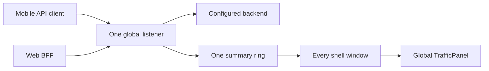
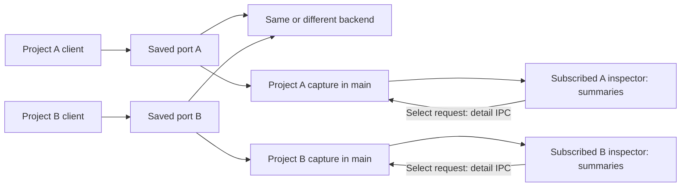

# Project traffic inspector

Date: 2026-09-23 · Lead: codex · Independent investigation: deepseek · Revision: 3, resolving focused review

**Revision 4 adds the amendment below** — traffic becomes a tab in the project's own column, and the rail entry point goes. Nothing above it is withdrawn; read the amendment before `## Acceptance and verification`, which it changes.

## Status

| Work                                         | Status                                         | Evidence                                                                                                                                                                                                                                                                         |
| -------------------------------------------- | ---------------------------------------------- | -------------------------------------------------------------------------------------------------------------------------------------------------------------------------------------------------------------------------------------------------------------------------------- |
| Repository investigation                     | PASS                                           | Capture, IPC, renderer, project registry, migration and window lifecycle read                                                                                                                                                                                                    |
| Existing targeted tests                      | PASS                                           | One stale assertion, not two: `logcat.test.ts:84` already matched the implementation, and `:111` was fixed on 2026-09-23. The recorded `2 failed` was measured against an `event-store` `dist` built 2026-09-13.                                                                 |
| Independent investigation                    | RECEIVED                                       | deepseek inspected the repository and the backend DPoP verifier                                                                                                                                                                                                                  |
| Proposed design                              | DRAFT                                          | Decisions below; not implemented                                                                                                                                                                                                                                                 |
| Adversarial plan review                      | REVISED                                        | deepseek confirmed F1–F6 resolved in revision 2; follow-up R1–R4 resolved below, final focused check pending                                                                                                                                                                     |
| Product implementation and full verification | UNITS 0 AND 1 — AWAITING INDEPENDENT RE-REVIEW | Implemented 2026-09-23 by claude, reviewed by codex twice; the second review required four corrections, all applied. codex exhausted its quota mid-third-pass and claude took the review over, finding one further defect. Units 2–5 are not started. See _Units 0 and 1_ below. |
| Amendment — traffic belongs to the project   | PROPOSED 2026-09-23, AWAITING APPROVAL         | Supersedes the rail entry point and the global `trafficOpen` flag: the panel becomes a tab in the project's own column. No code written for it. See _Amendment_ below.                                                                                                           |

### Units 0 and 1 — implemented 2026-09-23

Uncommitted. Unit 2 has not begun, and nothing calls any of this yet: `syncLegacyTraffic` has no startup caller until that unit wires it.

| Unit                      | State           | What is there                                                                                                                                                           |
| ------------------------- | --------------- | ----------------------------------------------------------------------------------------------------------------------------------------------------------------------- |
| 0 — Baseline repair       | DONE            | One stale assertion, not the two this plan recorded. `logcat.test.ts:84` already matched the implementation; `:111` expected `tag` where the service returns `filters`. |
| 1 — Project configuration | CHANGES APPLIED | Two review rounds. The four corrections the second required are in; units 2–5 untouched.                                                                                |

**Evidence.** 213 tests across seven files; `@chorus/event-store` build clean; focused `eslint` clean; `tsc -p tsconfig.node.json`, `tsc -p tsconfig.web.json` and `tsc -p tsconfig.json` all clean. codex's two review suites are now **stale and cannot be re-run as they stand**: both call `recordLegacyTrafficCandidate` with one argument, and the second round gave it a second one for the read error. Their last honest results were 7 passed / 3 failed and 7 passed / 1 failed, and re-basing them is codex's work when its quota returns.

**The takeover review found one more defect, and it was a false refusal.** The unknown-ownership gate was keyed on "this write carries a port" rather than "this write moves one". A project that already had a port could not have its origin edited while ownership was unknown, even though nothing was being assigned — which is neither of the two things the gate is for. The gate now fires only when the port actually changes. Found by claude reviewing its own work, which is the weakest kind of review there is, and flagged as such.

**A second guard went in for depth.** `ProjectStore.adoptLegacyTraffic` now refuses a candidate whose port is unknown on its own account, not only because `ProjectService` checks first. The service still produces the more specific error; the store no longer depends on that.

**Two things this plan had recorded wrongly.** The first review suite held ten cases, not eight, and failed three rather than eight. And `tsconfig.json`'s five errors were not a pre-existing failure outside these units — codex traced them to one helper in `traffic-stream.test.ts` returning the whole `TrafficRowShape` union where `Extract<…, { source: 'http' }>` belongs. Both statements are corrected, and the fixture is fixed here.

**Corrections the second review required.** All four are in.

1. **Migration 15 was edited in place, and that was wrong.** Its constraint was widened from `1` to `0` inside the migration itself — the exact mistake step 1 of this plan warns against, since a database already at version 15 skips the change entirely. Migration 15 is restored to its original text and **migration 16** rebuilds `traffic_legacy_import` with the widened constraint, carrying existing rows across.
2. **An unknown saved port now blocks allocation.** When the file cannot be read and names no port, no project may take one: a malformed file can hide a legacy listener on any port, and a stopped listener produces no bind collision for Start to catch later. Automatic allocation and explicit port assignment both refuse until the import is resolved or dismissed.
3. **A read error now blocks adoption.** A previously recorded candidate can be stale, so assigning it while the file is unreadable is refused rather than silently handing over an endpoint that may have moved.
4. **A newly disputed port is protected even when an older candidate exists.** `syncLegacyTraffic` now replaces the candidate with the port the failed read did name; it previously kept the older one and left the new port unclaimed.

**Decisions this plan did not specify.** The code contradicts the plan here, so the plan is corrected rather than the code.

1. **`traffic_legacy_import` gains `pending_recorded` and `pending_error`.** The first separates "a candidate was recorded" from "nothing was", which the value columns alone cannot express once a candidate may legitimately have no port. The second is why an unreadable read leaves adoption refused rather than silently wrong.
2. **`pending_port` accepts 0.** A saved 0 asks for an ephemeral port, which reserves nothing — but it is still a connection somebody saved, and storing it as NULL lost the candidate entirely. 0 means ephemeral; NULL means the port could not be read.
3. **`adoptLegacyTraffic` clears the completion marker before copying the configuration**, in one transaction. The candidate's own port is reserved against every write, so writing the project first had the reservation refuse the adoption it belonged to. A refusal after the marker — another project holding the port — rolls it back with it.
4. **The origin, port and read-error requirements live in `ProjectService`**, not the store, as `LegacyTrafficOriginMissingError`, `LegacyTrafficPortMissingError` and `UnresolvedLegacyTrafficError`. The read error is checked first, because reporting a missing origin when the origin could not be read names the wrong problem.
5. **The ownership gate fires only when a write moves a port.** An edit that leaves a project's port alone is not an assignment, so it is allowed while ownership is unknown.
6. **Migration 15 is append-only from here**, which is correction 1 restated as a rule for the units that follow.

**Disputed — and claude is the judge of its own dispute, which is the weakest arrangement available.** codex's case _upgrades the original version 15 constraint before recording explicit port 0_ mixes three API generations in a single test: it hand-writes the original migration-15 SQL, then calls `setTrafficConfig` (which reads a column migration 16 adds) and a one-argument `recordLegacyTrafficCandidate` (a signature that no longer exists), and only then migrates. The app cannot perform that sequence — `runtime.ts:5494` opens the log through `EventStore.open`, which migrates, and `runtime.ts:1617` builds `new ProjectStore(db)` over that same handle afterwards — so it fails for a reason the product cannot reach. What it is about is covered by _widens the port-0 constraint on a database that was already at version 15_, which seeds a version-15 database with raw SQL, migrates, reads the legacy row back and records `0` through it. An independent reviewer should settle this, not the author of the code it concerns.

## Current / Issue

Each project needs its own traffic history and connection settings. Selecting a request must expose the HTTP information Chorus actually receives. The earlier decision to retain only summary fields is superseded by the user's explicit request for headers and bodies. Captures still do not belong to conversation history.

يحتاج كل project إلى traffic history وconnection settings مستقلّتين. يجب أن يعرض selecting لأي request معلومات HTTP التي يستقبلها Chorus فعلياً. يحلّ طلب المستخدم الصريح للـ headers والـ bodies محل القرار السابق الذي يقتصر على الاحتفاظ بالـ summary fields. وتبقى الـ captures خارج conversation history.



| Verified current behavior                                                            | Source and symbol                                                                      | Consequence                                                  |
| ------------------------------------------------------------------------------------ | -------------------------------------------------------------------------------------- | ------------------------------------------------------------ |
| One service, origin, port and log source                                             | `apps/desktop/src/main/runtime.ts` → `traffic`, `attachTraffic`, `selectTrafficSource` | No project attribution                                       |
| HTTP row contains summary fields only                                                | `apps/desktop/src/main/traffic.ts` → `TrafficHttpRow`, `handle`, `tap`                 | Headers and bodies cannot be recovered after capture         |
| Response tap retains at most 8,192 encoded bytes; decoded output has no explicit cap | `traffic.ts` → `TAP`, `inflate`                                                        | Bigger capture must bound both input and decoding            |
| One `epoch`, one `ackedSeq`, one attachment                                          | `traffic.ts` → `attach`, `ack`, `detach`                                               | A second attachment supersedes the first                     |
| Push broadcasts to every BrowserWindow                                               | `apps/desktop/src/main/ipc.ts` → `forwardTrafficToRenderer`                            | Adding bodies to this push would fan them out unnecessarily  |
| Generic IPC registrar discards the sender                                            | `main/ipc.ts` → `registerIpcHandlers`                                                  | Sensitive detail reads need a sender-aware boundary          |
| Capture mounted only in Workspace                                                    | `renderer/src/workspace/Workspace.tsx`, `DetachedStage.tsx`                            | Detached windows need an explicit entry point                |
| Closing a detached window returns its project                                        | `main/detached-windows.ts` → `requestFlushAndReturn`, `returnProject`                  | Window closure is not project destruction                    |
| Project identity includes host and canonical root                                    | `packages/event-store/src/projects.ts` → `Project`                                     | Key by `Project.id`, not name or local path                  |
| Migrations append transactionally; current final version is 13                       | `packages/event-store/src/migrations.ts` → `MIGRATIONS`, `migrate`                     | Configuration can follow the existing project-record pattern |
| Mobile sets an Axios `baseURL`; no env-driven project header exists                  | `tpa-mobile/src/config/api.ts`, `src/services/http.ts`                                 | A different endpoint needs only existing configuration       |

## Proposed

### Ownership and routing

Use one saved local port per project, with a listener created only when that project's capture starts. Two projects may forward to the same backend and still show different requests. A port identifies the configured destination, not the repository that owns a process: a client pointed at project A's endpoint is attributed to A.

استخدم local port محفوظاً لكل project، مع إنشاء listener فقط عند بدء capture لذلك الـ project. يمكن لاثنين من الـ projects استخدام backend واحد مع عرض requests مختلفة. يحدّد الـ port الوجهة المُهيّأة، ولا يكتشف الـ repository التي تملك الـ process: يُنسَب أي client موجّه إلى endpoint الخاصة بالـ project A إلى A.



| Routing candidate                                 | Decision                                                                                                              |
| ------------------------------------------------- | --------------------------------------------------------------------------------------------------------------------- |
| Saved port per project                            | Selected: works with existing base-URL configuration and preserves the request path                                   |
| Header identifying project                        | Possible, but requires client transport/configuration changes; unnecessary for this scope                             |
| Hostname per project                              | Possible, but adds DNS or device hostname setup; not required                                                         |
| Path prefix stripped by Chorus                    | Rejected for the existing mobile proof: signed and received paths would differ                                        |
| Query marker                                      | Not selected: needs correct per-request URL construction in every client; it cannot be assumed from a base-URL suffix |
| Infer from backend, URL, focused tab or client IP | Rejected: these do not uniquely identify a project                                                                    |

deepseek read `NimbusMobileDeviceProofVerifier.kt` over `ssh tpa-be`: target matching compares the path and conditionally checks the origin. This supports preserving the path; it does not prove that every backend accepts a changed authority. The device proof remains opaque and is never rewritten. Authenticated flows must be verified against the actual target environment.

قرأ deepseek الملف `NimbusMobileDeviceProofVerifier.kt` عبر `ssh tpa-be`: يقارن target matching المسار ويفحص الـ origin بشروط. يدعم ذلك الحفاظ على المسار؛ لكنه لا يثبت أن كل backend يقبل authority مختلفة. يبقى الـ device proof كما هو ولا تجري إعادة كتابته. ويجب verification للـ authenticated flows أمام البيئة المستهدفة الفعلية.

### What the user sees

```text
Traffic · <Project name> · Capturing/Stopped        Start/Stop   Clear
Forward to [origin]   Port [saved port]   Access [This Mac/LAN]
Copy endpoint / Copy Expo env / Copy web BFF env
Search [________________]  Method [All]  Status [All]  Errors only

Time  Method  Path  Status  Duration  Size  code  nextAction
...select a request...

General | Headers | Payload | Response | Timing
Raw / Formatted / Hex where applicable       Find       Copy
Capture state: Complete / Streaming / Truncated / Evicted / Unavailable
```

| Surface            | Behavior                                                                                                                                                                                                                                                                                                                                                                                                                                                          |
| ------------------ | ----------------------------------------------------------------------------------------------------------------------------------------------------------------------------------------------------------------------------------------------------------------------------------------------------------------------------------------------------------------------------------------------------------------------------------------------------------------- |
| Project context    | Main window defaults to the focused project; explicit project selector includes capturing projects. Detached window is scoped to its own project. Switching the inspector never changes a listener's routing.                                                                                                                                                                                                                                                     |
| Connection setup   | Origin and saved port per project; HTTP/HTTPS origins only, no credentials/query/fragment in the origin. V1 origin is an authority with root path; application paths pass unchanged.                                                                                                                                                                                                                                                                              |
| Endpoint helpers   | Generate a bare endpoint and optional env templates for an explicitly selected target. This Mac / iOS Simulator can use loopback, including `EXPO_PUBLIC_API_BASE_URL`. Physical Android/iOS requires LAN capture and an available LAN address; otherwise show the setup action instead of a copyable device template. The local web BFF template is `JAVA_API_DEV_BASE_URL=<local-endpoint>`. No automatic `.env` edits or platform inference from project name. |
| Request list       | Start-time order, pending rows immediately, method, URL/path, nullable HTTP status, elapsed time, byte counts, `code`, `nextAction`; filters for method/status/outcome and substring search of method/URL/code/nextAction.                                                                                                                                                                                                                                        |
| History access     | Keep all retained metadata searchable and reachable; the current last-200-only display is replaced with 200-row paging, not silent hiding.                                                                                                                                                                                                                                                                                                                        |
| General            | Original request URL/target, forwarded URL, HTTP version, outcome, timing, size and capture limits. Distinguish upstream HTTP failure from a Chorus connection/timeout/refusal error.                                                                                                                                                                                                                                                                             |
| Headers            | Original request and upstream response header pairs, preserving duplicates/casing; clearly labelled forwarded-header view records intentional changes such as `Host`. Trailers appear separately after completion.                                                                                                                                                                                                                                                |
| Query parameters   | Raw query plus decoded ordered pairs; repeated keys and empty values preserved.                                                                                                                                                                                                                                                                                                                                                                                   |
| Payload / Response | Raw retained bytes, decoded text where supported, formatted complete JSON, structured URL-encoded fields; multipart stays raw in V1, binary is hex/base64. No rendering returned HTML or SVG as active content.                                                                                                                                                                                                                                                   |
| Timing             | Proxy-observed start, upstream headers, upstream completion and downstream finish/abort. Use monotonic elapsed durations. No fabricated browser queue, service-worker, initiator or browser-cache timings.                                                                                                                                                                                                                                                        |
| Copy               | Explicit copy of a field, displayed headers, selected body representation or URL through existing `window.chorus.copyText`. Report failure; copying has no network side effect.                                                                                                                                                                                                                                                                                   |
| UI states          | No project, never configured, stopped, starting, empty capture, no filter matches, detail loading, evicted, cleared, unsupported encoding, forwarding failure and live-view lag each have distinct wording. Paused live delivery identifies the snapshot time and offers Refresh/Resume; capture continues in main.                                                                                                                                               |
| Layout             | Resizable panel in the existing shell-owned editor region. List/detail split when wide, stacked when narrow. Keyboard selection, accessible tabs, focus return and RTL. Any overlay over native workbench views uses existing `useShellOverlay`.                                                                                                                                                                                                                  |

This is a request inspector. Request composition/replay, collections, HAR import/export, interception rules, browser-console attachment, native iOS logs, TLS interception, WebSocket message inspection and HTTP/2 protocol inspection are not part of this implementation. A later replay feature needs its own authentication design; captured DPoP proofs cannot be assumed reusable.

هذه الميزة request inspector. لا يشمل هذا الـ implementation الـ request composition/replay أو collections أو HAR import/export أو interception rules أو browser-console attachment أو native iOS logs أو TLS interception أو WebSocket message inspection أو HTTP/2 protocol inspection. تحتاج ميزة replay لاحقة إلى authentication design مستقل؛ فلا يجوز افتراض إمكانية إعادة استخدام DPoP proofs الملتقطة.

### Capture and data lifetime

Start explicitly enables header/body capture for new requests. Main must retain those bytes while they pass, before a row is selected; pulling a detail later only limits its delivery. Raw captures may contain credentials and personal data. They remain in volatile application memory and are never appended to the event store, diagnostics, settings, session snapshots or renderer persistence.

يُفعّل Start صراحةً capture للـ headers والـ bodies الخاصة بالـ requests الجديدة. يجب أن يحتفظ main بهذه الـ bytes أثناء مرورها وقبل selecting للـ row؛ فالـ pull للـ detail لاحقاً يحدّ من delivery فقط. قد تحتوي الـ raw captures على credentials وبيانات شخصية. تبقى في ذاكرة الـ application المؤقتة، ولا يجري appending لها إلى event store أو diagnostics أو settings أو session snapshots أو renderer persistence.

| Action                                          | Listener / sources                                                                                                            | Retained data                                                                                                                                                                                                                                                                                                                                                                                                                                                                                                           |
| ----------------------------------------------- | ----------------------------------------------------------------------------------------------------------------------------- | ----------------------------------------------------------------------------------------------------------------------------------------------------------------------------------------------------------------------------------------------------------------------------------------------------------------------------------------------------------------------------------------------------------------------------------------------------------------------------------------------------------------------- |
| Start                                           | Serialize start; bind once; publish capturing only after success                                                              | Create capture ID on first use; reuse that history generation until Clear/disposal. Retain stopped history within limits; internal listener-generation guards reject callbacks from an earlier run.                                                                                                                                                                                                                                                                                                                     |
| Stop                                            | Stop accepting and close forwarding connections, cancel owned upstream work; stop sources explicitly assigned to this project | Keep settled captured rows/details for inspection; active requests become cancelled. UI states that requests routed here stop until Start.                                                                                                                                                                                                                                                                                                                                                                              |
| Clear                                           | Keep the listener and existing request forwarding active; detach capture observers from pre-clear requests                    | Invalidate capture generation; clear rows, details and selection; release every old capture's admission slot, retained prefixes and queued decode inputs exactly once. Network handles stay tracked for Stop, separately from capture admission. Cancel active decoding where supported; keep its allocation charged until cancellation/completion actually releases it. Old streams retain no new bytes, cannot repopulate history and cannot release a new generation's slots. New requests enter the new generation. |
| Hide panel / switch project / close project tab | Capture continues, with active-project indication available from the traffic selector                                         | Detach this view and release its selected detail; main retains bounded capture                                                                                                                                                                                                                                                                                                                                                                                                                                          |
| Detach / redock / close detached window         | Transfer view ownership; capture continues                                                                                    | New view attaches to the same project; stale old-view calls are rejected                                                                                                                                                                                                                                                                                                                                                                                                                                                |
| Renderer reload/crash                           | Drop subscriptions and outstanding reads for that document                                                                    | Capture continues in main within limits                                                                                                                                                                                                                                                                                                                                                                                                                                                                                 |
| Forget project                                  | Await service disposal before deleting its registry entry; release assigned sources and port                                  | Clear all data, cancel decoding, reject late completions                                                                                                                                                                                                                                                                                                                                                                                                                                                                |
| App shutdown                                    | Stop every listener, owned upstream request and log child                                                                     | Release all captures; next boot starts stopped with empty histories                                                                                                                                                                                                                                                                                                                                                                                                                                                     |

| Proposed default limit                           | Value                                                                                                                               | Enforcement                                                                                                                                                                                                                              |
| ------------------------------------------------ | ----------------------------------------------------------------------------------------------------------------------------------- | ---------------------------------------------------------------------------------------------------------------------------------------------------------------------------------------------------------------------------------------- |
| Summary rows, including explicitly selected logs | 1,000/project; 4,000 overall                                                                                                        | Main owns eviction; retained rows remain browseable; source filters identify HTTP versus logs                                                                                                                                            |
| Encoded payload per direction                    | 1 MiB                                                                                                                               | Count actual bytes; copy only retained bytes, not Buffer slices holding larger backing allocations                                                                                                                                       |
| Decoded payload per direction                    | 1 MiB                                                                                                                               | Separate output cap; compression expansion cannot bypass it                                                                                                                                                                              |
| Capture-owned retained allocation                | 16 MiB/project; 64 MiB overall                                                                                                      | Include bodies, header/URL metadata, in-flight retained buffers, decode reservations, subscriber pending updates/snapshots and outgoing summary/detail copies; release accounting only when the retained allocation is actually released |
| Subscriber delivery                              | One subscription per shell document; one unacknowledged delivery; at most 64 pending updates or 256 KiB, whichever is reached first | At most 64 KiB of serialized summary data per delivery, including snapshot pages. On lag/overflow discard pending updates, mark snapshot required and stop deltas. Never accumulate Electron sends for a stalled renderer.               |
| Body IPC page                                    | 64 KiB decoded or encoded bytes                                                                                                     | Base64 expansion included in outgoing-copy accounting; no body data in summary pushes                                                                                                                                                    |
| Decode jobs                                      | At most 2 active application-wide; bounded pending work                                                                             | Deduplicate reads, cancel obsolete interest, discard late results; capture forwarding never waits for decoding                                                                                                                           |
| Rejected capture intake                          | Bounded counters and one visible gap marker                                                                                         | If metadata/in-flight accounting cannot admit another captured request, forwarding continues without an unbounded pending-row queue                                                                                                      |

These are initial product limits, not measured performance claims or limits on forwarded traffic. Evict least-recent retained detail first, mark metadata as detail-evicted, and continue forwarding. If an in-flight capture loses its budget, stop retaining further bytes and report the reason. A selected request never pins data beyond the budget. Account separately for bounded per-window display buffers; this budget is not a promise about Electron's total RSS.

هذه حدود أولية للمنتج، وليست performance claims مقاسة أو حدوداً على الـ traffic التي يجري forwarding لها. ابدأ eviction للـ detail الأقل استخداماً، وعلّم الـ metadata بأن الـ detail أُزيلت، مع استمرار forwarding. إذا فقد in-flight capture حصّته من الـ budget، توقّف عن الاحتفاظ بمزيد من الـ bytes واذكر السبب. ولا يمنح selecting لأي request حق الاحتفاظ ببيانات تتجاوز الـ budget. احسب display buffers المحدودة لكل window على نحو مستقل؛ فهذا الـ budget ليس وعداً بشأن إجمالي RSS في Electron.

| Detail rule                  | Contract                                                                                                                                                                                                                                                                                                                                                                 |
| ---------------------------- | ------------------------------------------------------------------------------------------------------------------------------------------------------------------------------------------------------------------------------------------------------------------------------------------------------------------------------------------------------------------------ |
| Completeness                 | Empty, not yet received, complete, truncated, aborted, evicted, unsupported and unavailable must be distinguishable. Track observed and retained byte counts independently.                                                                                                                                                                                              |
| Streaming/SSE                | Forward continuously; insert row at request start; expose a bounded live prefix. Poll only the selected active detail at a capped rate with one read outstanding per view. Never wait for an SSE end to create a row.                                                                                                                                                    |
| Compression                  | Support identity, gzip, deflate and Brotli through Node built-ins. Decode retained complete payloads off the forwarding path. Incomplete or unsupported encodings retain raw access and explicit state. Bound the existing envelope decode too.                                                                                                                          |
| Forwarding                   | Preserve body bytes, method, path/query and auth values; preserve repeated headers where protocol permits. Remove hop-by-hop headers and those named by `Connection`, regenerate hop framing, and show original versus forwarded headers. Reject unsupported protocols explicitly.                                                                                       |
| WebSocket upgrade            | Register an explicit `upgrade` handler on project and legacy listeners: reply HTTP 501 with `Connection: close`, record an `unsupported-upgrade` refusal subject to capture limits, and close with a bounded cleanup deadline. No tunnel or frame capture in this scope. The existing silent socket destruction must not be mistaken for supported WebSocket forwarding. |
| Origin listener              | Confine forwarding to the configured origin. Reject absolute targets for a different origin, scheme-relative escapes, self-targets and cycles among configured Chorus endpoints. Restrict protocols to HTTP/HTTPS.                                                                                                                                                       |
| Existing proxy compatibility | Keep the existing explicit forward-proxy/CONNECT behavior in the legacy shared connection until retired. Project listeners use origin mode; no claim that blind CONNECT exposes encrypted headers/bodies.                                                                                                                                                                |
| Masking                      | Known auth/cookie header values masked in the default view; Reveal applies only to the selected request and resets on selection change. This is display masking, not sanitization or protection of raw retained bodies.                                                                                                                                                  |
| Trust                        | Bodies are treated as untrusted data. Render text/typed values; no `dangerouslySetInnerHTML`, scripts, embedded navigation or automatic external fetches.                                                                                                                                                                                                                |

### Stable settings and migration

There is no evidence assigning the current shared endpoint to a particular project. Do not assign it by project order or focused tab. Present the saved connection as **Legacy shared** until the user explicitly assigns it to one project. Preserve its configured port/origin and existing summary-only behavior during that transition. Other clients need their own project's endpoint for attribution; two clients still using one old endpoint cannot be separated automatically.

لا يوجد دليل يربط الـ shared endpoint الحالية بـ project محدّد. لا تُسنِدها بحسب ترتيب الـ projects أو الـ focused tab. اعرض الـ connection المحفوظة باسم **Legacy shared** إلى أن يُسنِدها المستخدم صراحةً إلى project واحد. حافظ على الـ port والـ origin المُهيّأتين وسلوك الـ summary-only الحالي خلال الانتقال. تحتاج الـ clients الأخرى إلى endpoint الخاصة بالـ project التابعة لها حتى يصحّ الإسناد؛ ولا يمكن فصل اثنين من الـ clients تلقائياً إذا استمرّا في استخدام endpoint قديمة واحدة.

| Configuration case      | Behavior                                                                                                                                                                                                                                                                                                                                                                                                                                                                                                                                                                                                                                                                                                                                     |
| ----------------------- | -------------------------------------------------------------------------------------------------------------------------------------------------------------------------------------------------------------------------------------------------------------------------------------------------------------------------------------------------------------------------------------------------------------------------------------------------------------------------------------------------------------------------------------------------------------------------------------------------------------------------------------------------------------------------------------------------------------------------------------------- |
| Project has saved port  | Bind that port on Start; on collision name the port and owner when known. Never silently move it. An explicit edit while stopped validates range and logical reservations, then saves without opening any socket or probing OS availability. Show that the value takes effect on the next Start, which performs the real bind and may report an external collision.                                                                                                                                                                                                                                                                                                                                                                          |
| New project has no port | Choose first logically unreserved candidate from a bounded range beginning at `DEFAULT_TRAFFIC_PORT`. Perform the real listener bind at its exact configured host (`127.0.0.1` for This Mac, `0.0.0.0` for IPv4 LAN), not a separate availability probe. Keep the socket open while persisting the chosen port; close it if persistence fails.                                                                                                                                                                                                                                                                                                                                                                                               |
| Allocation race         | One registry mutation lock covers automatic allocation, explicit port edits and legacy assign/dismiss/config changes across projects. Logical reservations are saved positive project ports **plus the validated pending legacy port**, even while listeners are stopped. The unique project-port index is an additional check, not the legacy reservation mechanism. Serialize each project's start/stop/config lifecycle too.                                                                                                                                                                                                                                                                                                              |
| Legacy connection       | Before accepting configuration/start operations, classify the raw saved legacy fields by the rules below and load `traffic_legacy_import.completed`. While import is unresolved, confirmed legacy and ambiguous-default candidates reserve their positive effective port against automatic and explicit project choices, even while stopped. Assign only while both legacy and destination project are stopped and an origin is configured; show any destination configuration being replaced, then copy configuration and mark completion in one DB transaction under the same lock. Dismiss explicitly releases the reservation. A completed marker wins over a leftover settings file, including after the assigned project is forgotten. |
| Legacy settings read    | Inspect raw field presence before Zod inserts defaults; do not classify using `readSettings()` alone. A completed marker always skips import. A missing file or neither traffic field present means no candidate: mark completion before other settings writes introduce default fields. Malformed saved JSON or invalid traffic fields produce a recoverable settings error, without resetting unrelated preferences, allocating the disputed port, or silently dismissing import.                                                                                                                                                                                                                                                          |
| Ephemeral port 0        | `TrafficService.listen(0)` remains available for fixtures and existing explicit legacy use; reserve an active legacy listener's actual port while it is open. An existing legacy 0 must be replaced by an explicitly chosen positive port before project adoption; normal per-project setup always saves a positive port.                                                                                                                                                                                                                                                                                                                                                                                                                    |
| Access scope            | New projects default to This Mac; LAN is explicit for a physical device. Adopted legacy configuration keeps its existing reachability. Refuse port/access edits while starting or capturing. Show actual local/LAN endpoint choices, never `0.0.0.0` as a usable address; label loopback Expo templates as simulator-only.                                                                                                                                                                                                                                                                                                                                                                                                                   |
| Restart                 | Persist connection configuration only. Every capture remains stopped at boot, history empty.                                                                                                                                                                                                                                                                                                                                                                                                                                                                                                                                                                                                                                                 |
| Rename / relocate       | Project ID stays the key; settings follow the project.                                                                                                                                                                                                                                                                                                                                                                                                                                                                                                                                                                                                                                                                                       |
| Remote project          | Listener still runs on this Mac. `localhost` from a remote process refers to that remote host; show this explicitly. No automatic SSH tunnel, remote listener or network reconfiguration.                                                                                                                                                                                                                                                                                                                                                                                                                                                                                                                                                    |

The legacy classifier must preserve the current forward-proxy mode, which works without an origin (`TrafficService.targetOf` accepts an absolute HTTP URL). A valid, non-empty saved origin is a confirmed candidate. An empty/missing origin with an explicitly saved valid non-default port, including 0, is also a confirmed candidate for the legacy forward proxy. A default port by itself is not proof of use. If raw traffic fields exist but amount only to the empty-origin/default-port configuration, classify them as ambiguous rather than inventing a connection or discarding one. Before first project traffic setup, offer one explicit choice: keep the old shared endpoint or start fresh. Keep reserves it as a legacy connection; start fresh marks import complete and releases the candidate reservation. Until that choice, reserve the candidate port but open no listener. This owner's saved non-empty origin takes the confirmed path without this extra choice.

يجب أن يحافظ الـ legacy classifier على وضع forward-proxy الحالي، الذي يعمل دون origin؛ إذ يقبل `TrafficService.targetOf` رابط HTTP مطلقاً. تُعدّ الـ saved origin الصالحة وغير الفارغة confirmed candidate. وتُعدّ الـ origin الفارغة أو المفقودة، مع valid non-default port محفوظة صراحةً، بما فيها 0، confirmed candidate أيضاً للـ legacy forward proxy. ولا تُثبت default port وحدها الاستخدام. إذا كانت raw traffic fields موجودة لكنها لا تتجاوز إعداد empty-origin/default-port، فصنّفها ambiguous بدلاً من اختلاق connection أو إسقاط واحدة. قبل أول project traffic setup، اعرض اختياراً صريحاً واحداً: الاحتفاظ بالـ old shared endpoint أو البدء من جديد. يحجز اختيار الاحتفاظ بها الـ endpoint بوصفها legacy connection؛ ويضع اختيار البدء من جديد import في حالة complete ويحرّر candidate reservation. وحتى ذلك الاختيار، احجز candidate port دون فتح listener. وتسلك الـ saved origin غير الفارغة الخاصة بهذا المستخدم مسار confirmed دون هذا الاختيار الإضافي.

### IPC and state ownership

Use a sender-aware traffic registrar, following `registerWorkbenchHandlers` and the detached-window handlers. The generic registrar currently discards `event`; widening every unrelated handler is unnecessary. Register shell window identity/role in main, validate the main frame, and bind each traffic subscription to that document and permitted project. A client-supplied project ID alone grants no access.

استخدم traffic registrar يراعي هوية الـ sender، وفق نمط `registerWorkbenchHandlers` والـ detached-window handlers. يتجاهل الـ generic registrar الحالي الـ `event`؛ ولا حاجة لتوسيع كل handler غير مرتبط. سجّل هوية ودور الـ shell window داخل main، وتحقّق من الـ main frame، واربط كل traffic subscription بذلك الـ document والـ project المسموح بها. ولا يمنح project ID يرسله الـ client وحده حق access.

| Owner                            | State                                                                                                                                                                                                                                                                                                              |
| -------------------------------- | ------------------------------------------------------------------------------------------------------------------------------------------------------------------------------------------------------------------------------------------------------------------------------------------------------------------ |
| ProjectStore / database          | Origin, port, access scope; import marker. No traffic payload or capture history.                                                                                                                                                                                                                                  |
| Project traffic registry in main | Map keyed by project ID, listener lifecycle, config snapshot per request, bounded captures, start/stop serialization, overall budgets                                                                                                                                                                              |
| Capture service                  | Immutable request ID, capture generation, request/response byte intake, terminal outcome exactly once, monotonic measurements                                                                                                                                                                                      |
| Traffic IPC registrar            | Subscription IDs bound to sender/document/project, independent acknowledgment state, targeted summary pushes, detail access and destruction cleanup. Main shell may explicitly inspect an adopted project; detached shells only their registered project. Workbench views and child frames have no traffic access. |
| Renderer reducer                 | Apply insert/update/evict/reset in sequence; reject wrong project/generation/subscription; update row in place by request ID                                                                                                                                                                                       |
| TrafficPanel                     | Project selection, filters, paging and connection controls; pending/error state for actions                                                                                                                                                                                                                        |
| Request inspector                | Only the selected request's detail and body pages; discard stale responses and release pages when selection/context changes                                                                                                                                                                                        |

The stream sequence orders updates; it is not the request ID. A request gets one ID at arrival and may change from pending to streaming to complete. Each subscription has its own cursor, so a slow view cannot throttle another. A shell document owns at most one subscription; replacing it invalidates its previous token. Project switches and clears must reject responses already in flight.

يرتّب الـ stream sequence الـ updates؛ وهو ليس request ID. تحصل الـ request على ID واحد عند وصولها، وقد تتغيّر من pending إلى streaming ثم complete. لكل subscription الـ cursor الخاصة بها، فلا يستطيع عرض بطيء تعطيل عرض آخر. يملك كل shell document subscription واحدة على الأكثر؛ ويؤدي replacing لها إلى إبطال الـ token السابقة. ويجب رفض الـ responses الجارية التي أصبحت قديمة بعد switching للـ project أو Clear.

Delivery is credit-based: main sends one bounded batch, then waits for that subscriber's ACK before another send. Retain at most 64 pending updates or 256 KiB per subscriber within the project/global budgets. At either bound, discard pending updates and set `needsSnapshot`; do not queue more deltas or repeated invalidations. After any outstanding batch is acknowledged, send one invalidation and await a snapshot request. A stalled renderer therefore has at most one delivery outstanding. Other subscribers and network forwarding continue.

تعتمد delivery على credit: يرسل main batch واحدة محدودة، ثم ينتظر ACK من ذلك الـ subscriber قبل إرسال أخرى. احتفظ بحد أقصى 64 pending updates أو 256 KiB لكل subscriber ضمن الـ project/global budgets. عند بلوغ أي حد، تخلّص من pending updates واضبط `needsSnapshot`؛ ولا تُضِف deltas أخرى أو invalidations متكرّرة إلى queue. بعد ACK لأي batch معلّقة، أرسل invalidation واحدة وانتظر snapshot request. لذلك لا يملك renderer متوقّف إلا delivery واحدة معلّقة على الأكثر. وتستمر بقية الـ subscribers والـ network forwarding.

Resync pages come from one bounded immutable metadata snapshot at sequence S, with each page limited to 64 KiB serialized data and charged to the same budgets. Never restart that snapshot merely because newer changes arrive. Buffer changes after S within the pending limit. If it overflows, discard those deltas, mark `livePaused`, and finish the existing snapshot without allocating another one. The view then shows a consistent snapshot as of S, a visible delivery-gap/lag indicator and Refresh/Resume. Do not advance its applied cursor beyond S or claim it is live. Capture in main and other subscribers continue; capture loss and view-delivery lag are distinct states.

تأتي resync pages من immutable metadata snapshot واحدة محدودة عند sequence اسمها S، وتقتصر كل page على 64 KiB من serialized data محسوبة ضمن الـ budgets نفسها. لا تُعِد بدء تلك الـ snapshot لمجرّد وصول تغييرات أحدث. احتفظ بالتغييرات بعد S ضمن pending limit. إذا تجاوزتها، تخلّص من تلك الـ deltas واضبط `livePaused`، وأكمِل الـ snapshot الحالية دون allocation لأخرى. يعرض الـ view عندئذ snapshot متّسقة حتى S، مع delivery-gap/lag indicator ظاهر وRefresh/Resume. ولا تنقل applied cursor إلى ما بعد S ولا تدّعِ أن الـ view في حالة live. تستمر capture داخل main وبقية الـ subscribers؛ وتبقى capture loss وview-delivery lag حالتين مختلفتين.

Refresh/Resume explicitly starts one new snapshot; no automatic retry loop runs while paused. When a snapshot completes without overflow, apply its contiguous buffered updates before resuming deltas. Budget failure or eviction cancels the snapshot with a visible unavailable/paused state and releases its allocations; it does not retry automatically. Clear/detach also cancels it. With an acknowledging renderer, an admitted snapshot has a finite page count independent of arrival rate; a renderer that never ACKs retains only the bounded outstanding state. Only one snapshot per subscription may exist.

يبدأ Refresh/Resume صراحةً snapshot جديدة واحدة؛ ولا تعمل automatic retry loop أثناء pause. عندما تكتمل snapshot دون overflow، طبّق contiguous buffered updates الخاصة بها قبل استئناف deltas. يُلغي budget failure أو eviction الـ snapshot مع unavailable/paused state ظاهرة ويحرّر allocations الخاصة بها؛ ولا يُعيد المحاولة تلقائياً. وتُلغيها Clear/detach أيضاً. عندما يرسل الـ renderer الـ ACK، تملك أي snapshot جرى admission لها عدداً محدوداً من pages لا يعتمد على arrival rate؛ أما الـ renderer الذي لا يرسل ACK أبداً، فلا يحتفظ إلا بالـ outstanding state المحدودة. لا يُسمح إلا بـ snapshot واحدة لكل subscription.

Log sources remain available but are explicitly assigned. Global terminal output has no automatic project identity. Keep the existing singleton logcat process under one project's lease; a second project receives a clear source-busy result. Label it device/tag output rather than claiming app isolation. Switching or releasing a source invalidates old callbacks so late lines cannot land in another project's history. No workbench-terminal integration or device picker is added.

تبقى الـ log sources متاحة، لكن يجري إسنادها صراحةً. لا يملك global terminal output هوية project تلقائية. أبقِ الـ singleton logcat process الحالية تحت lease تخص project واحدة؛ وتتلقّى project ثانية نتيجة source-busy واضحة. اعرضها بوصفها device/tag output دون ادعاء عزل output الخاصة بالـ app. يؤدي switching للـ source أو تحريرها إلى invalidating للـ callbacks القديمة، حتى لا تصل lines متأخرة إلى history تخص project أخرى. ولا تُضاف workbench-terminal integration أو device picker.

## Code Changes

These are proposed code shapes, not changes applied to product files. Existing project and terminal types remain authoritative. New contracts use Zod-inferred types and keep the repository's strict TypeScript settings.

هذه code shapes مقترحة، وليست تغييرات طُبّقت على product files. تبقى الـ project types والـ terminal types الحالية هي المرجع. تستخدم الـ contracts الجديدة types مشتقّة من Zod، وتحافظ على strict TypeScript settings الخاصة بالـ repository.

### `packages/event-store/src/migrations.ts` and `projects.ts`

Append the next migration; do not edit versions 1–13. Recheck the next number before implementation. Extend `Project`, its row decoder, `COLUMNS`, creation defaults and a `setTrafficConfig` transaction. The legacy marker is application migration state, not captured traffic.

أضِف الـ migration التالية، ولا تعدّل versions 1–13. أعد فحص الرقم التالي قبل implementation. وسّع `Project` والـ row decoder و`COLUMNS` والـ creation defaults وأضِف transaction باسم `setTrafficConfig`. الـ legacy marker هي application migration state وليست captured traffic.

```sql
ALTER TABLE projects ADD COLUMN traffic_origin TEXT;
ALTER TABLE projects ADD COLUMN traffic_port INTEGER
  CHECK (traffic_port IS NULL OR traffic_port BETWEEN 1 AND 65535);
ALTER TABLE projects ADD COLUMN traffic_access TEXT NOT NULL DEFAULT 'loopback'
  CHECK (traffic_access IN ('loopback', 'lan'));
CREATE UNIQUE INDEX projects_traffic_port ON projects (traffic_port)
  WHERE traffic_port IS NOT NULL;

CREATE TABLE traffic_legacy_import (
  id INTEGER PRIMARY KEY CHECK (id = 1),
  completed INTEGER NOT NULL DEFAULT 0 CHECK (completed IN (0, 1)),
  assigned_project_id TEXT
);
INSERT INTO traffic_legacy_import (id, completed) VALUES (1, 0);
```

### NEW: `apps/desktop/src/shared/traffic-ipc.ts`

```ts
import { z } from 'zod'

export const TrafficRequestKey = z
  .object({
    projectId: z.string().min(1),
    captureId: z.string().min(1),
    requestId: z.string().min(1),
  })
  .strict()

export const TrafficHeader = z.tuple([z.string(), z.string()])

export const TrafficBodyDescriptor = z.object({
  state: z.enum(['pending', 'streaming', 'complete', 'aborted', 'unavailable', 'evicted']),
  truncation: z.enum(['body-limit', 'project-budget', 'global-budget']).nullable(),
  observedBytes: z.number().int().nonnegative(),
  capturedBytes: z.number().int().nonnegative(),
  contentType: z.string().nullable(),
  contentEncoding: z.string().nullable(),
  decoding: z.enum(['not-requested', 'ready', 'unsupported', 'invalid', 'limit']),
})

export const TrafficDetailRequest = TrafficRequestKey.extend({
  subscriptionId: z.string().min(1),
})

export const TrafficBodyReadRequest = TrafficDetailRequest.extend({
  side: z.enum(['request', 'response']),
  representation: z.enum(['encoded', 'decoded']),
  offset: z.number().int().nonnegative(),
  length: z.number().int().min(1).max(65_536),
})

export const TrafficReadResult = z.discriminatedUnion('kind', [
  z.object({
    kind: z.literal('page'),
    key: TrafficRequestKey,
    offset: z.number().int().nonnegative(),
    dataBase64: z.string(),
    body: TrafficBodyDescriptor,
  }),
  z.object({
    kind: z.enum(['evicted', 'cleared', 'not-found', 'unsupported']),
    key: TrafficRequestKey,
  }),
])
```

| Contract change                                                     | Required semantics                                                                                                                                                                                |
| ------------------------------------------------------------------- | ------------------------------------------------------------------------------------------------------------------------------------------------------------------------------------------------- |
| Existing `traffic:attach/start/stop/selectSource/setOrigin/setPort` | Add explicit project target; move out of generic sender-discarding registrar as one atomic IPC/preload/runtime cutover                                                                            |
| Existing `traffic:detach/ack`                                       | Require sender-bound subscription ID, project and stream cursor; reject stale document/subscription                                                                                               |
| New `traffic:detail`                                                | Return header pairs, target information, body descriptors and timing, never entire bodies                                                                                                         |
| New `traffic:readBody`                                              | Return only requested bounded page; authorize before lookup, budget before allocation                                                                                                             |
| New `traffic:clear`                                                 | Increment capture generation, detach old capture observers, release retained buffers and reset subscribers; existing forwarding stays active, late decoder results cannot restore cleared history |
| New `traffic:snapshot`                                              | Sender-bound resync with bounded pages at an explicit sequence; count snapshot and pending-delta allocations, never silently skip missed changes                                                  |
| New legacy assign/dismiss operation                                 | Explicit setup action; no inferred project; only while stopped; transactionally mark completion                                                                                                   |
| `traffic:push`                                                      | Project/subscription identity plus ordered row upsert/evict, capture state, reset or snapshot-invalidation; no headers/body bytes                                                                 |
| Legacy scope                                                        | Explicit tagged legacy target during migration, never a fake project ID; its listener remains summary-only and cannot use project detail channels                                                 |

### NEW: `apps/desktop/src/main/project-traffic.ts`

Own service entries and budgets here rather than adding a second large feature to `ChorusRuntime`. Reuse `TrafficService` for forwarding; inject configuration read/write and clock seams for deterministic tests. This is a concrete registry for current projects, not a plugin or transport-provider framework.

ضَع service entries والـ budgets هنا بدلاً من إضافة feature كبيرة ثانية إلى `ChorusRuntime`. أعد استخدام `TrafficService` لأجل forwarding؛ ووفّر seams للـ configuration read/write والـ clock حتى تكون الـ tests حتمية. هذا registry محدّد للـ projects الحالية، وليس plugin أو transport-provider framework.

### `apps/desktop/src/main/traffic.ts`

Replace completion-only `record` with start/update/settle keyed by request ID. Keep forwarding independent of capture retention. Own bounded request and response capture, immutable config at request start, exact-once completion, counters, decoder cancellation and upstream disposal. Decoding limits must also cover the existing envelope extraction.

استبدل `record` التي تعمل عند completion فقط بعمليات start/update/settle مرتبطة بـ request ID. أبقِ forwarding مستقلاً عن capture retention. اجعل هذا الملف يملك capture المحدودة للـ request والـ response، وconfig ثابتة عند بدء الـ request، وcompletion مرة واحدة فقط، والـ counters، والـ decoder cancellation، والـ upstream disposal. ويجب أن تشمل decoding limits أيضاً الـ envelope extraction الحالية.

### NEW: `apps/desktop/src/main/traffic-ipc.ts`

Register traffic handlers with `event.sender` and document identity. Register main/detached shell roles from `index.ts` when windows are created, release them on navigation/destruction, and validate project access on every operation. Maintain bounded ACK-based delivery and snapshot resync per subscriber; route pushes only to that subscriber. Do not infer detached access from a renderer-supplied role or use root alone for remote-project identity.

سجّل traffic handlers مع `event.sender` وهوية الـ document. سجّل أدوار main/detached shell من `index.ts` عند إنشاء الـ windows، وحرّرها عند navigation/destruction، وتحقّق من project access في كل operation. احتفظ بـ ACK-based delivery محدودة وsnapshot resync لكل subscriber، ووجّه الـ pushes إلى ذلك الـ subscriber فقط. ولا تستنتج detached access من role يرسلها الـ renderer، ولا تستخدم root وحده لهوية remote project.

### Renderer and integration files

| File                                                                | Change                                                                                                                   |
| ------------------------------------------------------------------- | ------------------------------------------------------------------------------------------------------------------------ |
| `main/runtime.ts`                                                   | Delegate traffic to registry, use project lifecycle for forget/shutdown, lease selected log sources                      |
| `main/ipc.ts`, `main/index.ts`                                      | Remove old traffic handlers/broadcast; register sender-aware boundary and shell roles                                    |
| `main/project-service.ts`, `main/settings.ts`                       | Project configuration operations and validated legacy import source; preserve unrelated settings                         |
| `preload/index.ts`, `shared/ipc.ts`                                 | Atomic typed bridge update; import dedicated traffic contract; keep payloads out of logs                                 |
| `renderer/src/traffic-stream.ts`                                    | Project-scoped upsert/reset/evict reducer and bounded snapshot resync                                                    |
| `renderer/src/TrafficPanel.tsx`                                     | Project context, setup, controls, filters, paging, request selection                                                     |
| NEW `renderer/src/TrafficRequestInspector.tsx`                      | Selected detail lifecycle, safe body views and bounded page reads; independent of list-update frequency                  |
| `renderer/src/workspace/Workspace.tsx`, `hooks.ts`, `QuickRail.tsx` | Focused-project identity, access to capturing projects and active capture badge                                          |
| `renderer/src/workspace/DetachedStage.tsx`, `renderer/src/App.tsx`  | Traffic entry/control and panel for the detached project's ID                                                            |
| `renderer/src/i18n/en.json`, `styles.css`                           | Accessible states, strings, tabs, split layout; verify keys both used-to-defined and defined-to-used within this feature |

## Reviewable implementation units

| Unit                                 | Objective / files / symbols                                                                                                                                                                          | Depends on              | Verification / definition of done                                                                                                                                                                                                          |
| ------------------------------------ | ---------------------------------------------------------------------------------------------------------------------------------------------------------------------------------------------------- | ----------------------- | ------------------------------------------------------------------------------------------------------------------------------------------------------------------------------------------------------------------------------------------ |
| 0 — Baseline repair                  | Correct the two `tag` expectations in `main/logcat.test.ts`; run current affected tests and compiler checks, record unrelated failures separately                                                    | Approved implementation | Existing 51 tests pass; no product behavior changed by this repair; current type/lint failures recorded rather than assumed absent                                                                                                         |
| 1 — Project configuration            | `migrations.ts`, `projects.ts`, `project-service.ts`, settings import; saved port, origin, access and explicit legacy adoption                                                                       | 0                       | Fresh and upgraded populated DBs preserve projects; pending legacy 30100 is reserved while stopped against automatic/manual assignment; adopt once, dismiss, crash retry, duplicate port, rename/relocate/forget covered                   |
| 2 — Project isolation through the UI | New `project-traffic.ts` and `traffic-ipc.ts`, dedicated shared contract, runtime/main/preload atomic bridge cutover, main/detached project-scoped panel, log leases; reuse existing summary capture | 1                       | Concurrent projects, real bind/persist cleanup, bounded subscriptions/resync, wrong sender/project denial, switching, redocking, legacy adoption and shutdown verified. Complete the Milestone A observation below before payload capture. |
| 3 — Bounded full capture             | `traffic.ts`, project registry budgets and dedicated shared/detail IPC contracts; request IDs and start/update/settle, raw headers/bodies, decoders, clear semantics and explicit upgrade refusal    | 2                       | Fake upstreams prove byte preservation, early streaming rows, truthful failure/truncation, payload and delivery budgets, clear during SSE/decode, upgrade refusal and start/stop races without leaks                                       |
| 4 — Inspector and navigation         | `TrafficPanel`, new `TrafficRequestInspector`, reducer, i18n, CSS, scoped hook/rail changes                                                                                                          | 3                       | Select→load→headers/body/timing→copy path plus empty/loading/error/evicted states; every retained row reachable; no stale detail or executable response markup                                                                             |
| 5 — Integrated verification          | Complete diff, all affected tests, full check, real Android/iOS-simulator/web flows and adversarial review                                                                                           | 4                       | Acceptance matrix below has evidence; unrelated failures explicit; no release/install/commit implied                                                                                                                                       |

Milestone A is project isolation with today's summary rows: route two distinguishable requests from real clients to two project endpoints, including the adopted legacy endpoint, and verify isolation plus Stop/restart and detached-window return. This validates attribution before adding payload retention. Milestone B adds the inspector and all remaining acceptance criteria. Both milestones belong to the requested feature; completing A alone does not complete this plan.

تتمثّل Milestone A في project isolation باستخدام summary rows الحالية: وجّه اثنتين من الـ requests الممكن تمييزهما من real clients إلى project endpoints مختلفتين، إحداهما الـ legacy endpoint بعد adoption، وتحقّق من isolation مع Stop/restart وعودة الـ detached window. يثبت ذلك attribution قبل إضافة payload retention. وتضيف Milestone B الـ inspector وجميع acceptance criteria المتبقية. تنتمي كلتا الـ milestones إلى الميزة المطلوبة؛ ولا يُعدّ إنجاز A وحدها إكمالاً لهذه الـ plan.

Shared types, schemas and runtime wiring are sequential. Independent protocol research and UI review may run in parallel without editing overlapping files. After each unit, codex reads the actual diff and runs its narrow checks; deepseek challenges the integrated result. No unit is accepted solely on an agent's report.

تجري تغييرات الـ shared types والـ schemas والـ runtime wiring بالتتابع. يمكن تنفيذ protocol research وUI review مستقلّتين بالتوازي دون editing لملفات متداخلة. بعد كل unit، يقرأ codex الـ diff الفعلية ويُشغّل checks المحدودة الخاصة بها؛ ثم يجري deepseek challenge للنتيجة المتكاملة. ولا تُقبَل أي unit اعتماداً على report من agent وحده.

## Adversarial review disposition

These are design corrections, not verified fixes to product code. deepseek supplied the scenarios; codex checked their implications against the proposed ownership and lifecycle rules. Focused re-review is requested on the revised reservation, delivery and Clear contracts.

هذه design corrections وليست fixes مُتحقَّقة في product code. قدّم deepseek الـ scenarios، وفحص codex آثارها مقابل قواعد ownership وlifecycle المقترحة. ويُطلَب focused re-review للـ reservation وdelivery وClear contracts المعدّلة.

| Finding                                            | Ruling                                   | Change / evidence required                                                                                                                                                                                                                                                                           |
| -------------------------------------------------- | ---------------------------------------- | ---------------------------------------------------------------------------------------------------------------------------------------------------------------------------------------------------------------------------------------------------------------------------------------------------- |
| F1 — Legacy reservation missing from project index | ACCEPTED                                 | Reservation is the union of saved project ports and pending validated legacy configuration, enforced for every allocation/edit under one lock. Test with legacy stopped at 30100 before first project starts; test manual conflict, adoption/dismissal, cleanup failure and fresh install.           |
| F2 — Subscriber queues omitted from bounds         | ACCEPTED                                 | One outstanding delivery per subscriber; count pending/snapshot/send allocations; discard deltas and resync on lag. Freeze one ACK stream during a sustained burst and prove its queue/sends stay bounded while another view advances.                                                               |
| F3 — Clear leaves invisible in-flight capture      | ACCEPTED, correction refined             | End old capture retention, not network forwarding. Release prefixes and queued decoding; account active decoding until it actually releases memory. Keep an SSE forwarding after Clear and prove old capture bytes stop growing and old callbacks cannot restore rows.                               |
| F4 — Physical-device helper may copy loopback      | ACCEPTED, correction refined             | Explicit target: loopback remains valid for iOS Simulator; physical-device template requires LAN capture and an available LAN address. Test each copy result against target/access selection.                                                                                                        |
| F5 — Probe differs from real bind                  | CLARIFIED; no separate probe was planned | Bind the real listener at its actual host and persist only the successful automatic choice. Never silently move a saved port; an explicit stopped-state port edit remains allowed. Test collision and failed persistence close their sockets.                                                        |
| F6 — Silent WebSocket upgrade failure              | ACCEPTED as a scope/behavior gap         | An explicit bounded HTTP 501 refusal replaces silent destruction; no WebSocket forwarding/frames promised. Test the response, failure row and socket cleanup with a raw upgrade fixture. Client source searches did not find a current WebSocket consumer; that is not a runtime reachability proof. |
| Scope — Validate attribution before inspector      | ACCEPTED as implementation order         | Milestone A verifies project routing end to end with existing summaries; Milestone B completes full inspection. No part of the requested inspector is removed.                                                                                                                                       |

## Amendment — traffic belongs to the project (2026-09-23)

The plan above puts the panel beside the global terminal and opens it from a button in the app rail. The person using it said three things, in this order: _"not good user experience"_, _"no traffic icon on main rail should be"_, and _"just when i open project let's have it own trafic"_. Asked to choose, they picked **a tab in the project's pane**, **Start stays manual**, and **each project keeps its own backend URL, changeable later**.

So the design changes in one respect and one only: **where the panel lives, and who owns its open state.** Everything from `### Capture and data lifetime` onward stands. No capture, IPC, budget, migration or permission code changes, because none of it was global — `projectId` has keyed all of it since unit 2. The store field this amendment relies on already exists: `Project.trafficOrigin` is per project and editable, which is exactly what was asked for, so the origin needs no new column and no new dialog.

### What is wrong now

Two facts, both in the renderer, and they are the whole complaint:

- `Workspace.tsx:170` — `const [trafficOpen, setTrafficOpen] = useState(false)`. **One flag for the whole app.** Two projects open side by side share it, so opening traffic in one opens it in both, and closing it in either closes it in both.
- `Workspace.tsx:544` — the panel renders at the end of `<main>`, below every pane, and its project is `focusedProjectId`. So the panel describes whichever project was last focused while the flag that shows it belongs to nobody.

The rail button (`QuickRail.tsx:327-342`) turns that global flag into what looks like a destination, which is what _"no traffic icon on main rail"_ objects to. Traffic is a fact about a project, so its control belongs where the project is.

### Proposed

**Traffic becomes a tab inside the project's own conversation group**, in the same strip as that project's conversations.

The outer workspace tree already holds project ids in `pane.tabs` (`PaneTabStrip.tsx:224` says so in as many words). This is the level further in — `ConversationArrangement.panes[].tabs`, which `ConversationColumn.tsx:184` maps to conversation tabs. A traffic tab is a reserved id in that list, so the tree algebra needs no change: `splitTab`, `closeTab`, `moveTab` and `reorderTab` are all generic over `PaneTree` and already move opaque strings around.

Consequences that follow from that placement, and each is a decision rather than a detail:

1. **One traffic tab per project, not per group.** A split project shows the same capture in whichever group holds the tab, because the capture is one listener per project. Two tabs for one listener would be two views of one stream, which the registry can already serve — but the reconcile becomes ambiguous about which group owns the tab, so the rule is one, and the second open focuses the first.
2. **The tab's open state is the layout itself.** No new field, and nothing to default: `conversationGroups` is already per project and already persisted, so a project that had traffic open reopens with it.
3. **Start stays manual.** Opening the tab shows the list, the origin field and the port field; it does not bind a socket. That is the answer that was chosen, and it is also the only honest one — a project whose `trafficOrigin` is null has nothing to forward to, and starting on open would produce a refusal every time a project is opened.
4. **The rail button and `trafficOpen` go.** `QuickRail` loses `data-rail-traffic` and its icon, `Workspace` loses the flag and the `trafficTerminals` memo, and `DetachedStage` keeps its own bar, which already scopes to one project by construction.

### Code Changes

**`shared/workspace-layout.ts`.** `TRAFFIC_TAB_ID = 'traffic'`, beside `WorkspacePane`, because the reconcile and the strip must agree on it and a literal in two places is a literal that drifts. `tabs` is `z.array(z.string())` and stays that way: the id is reserved by agreement, not by the schema, which is what keeps this a widening rather than a new tab type.

`WorkspacePane.tabs`' comment says "Conversation ids" and is **wrong for the outer tree**, which holds project ids — `PaneTabStrip.tsx:92` and `:224` both rely on that. It was already wrong before this amendment, and it is left as it is rather than corrected: this work does not add or rewrite comments.

**`renderer/src/workspace/layout.ts`** — three sites, and they are the work. Each is a place where the code assumes every tab names a live conversation:

- `reconcileConversationGroups` filters saved tabs with `pane.tabs.filter((id) => live.has(id))`. A traffic tab is not in `live`, so **it is dropped on the next reconcile** — it would vanish whenever a conversation started or ended. This is the one that actually breaks, and it fails on the ordinary path rather than an edge.
- The same function returns `null` for a project with no conversations (`conversationIds.length === 0`). A project with no conversations would have no arrangement at all, so its traffic tab could not exist. The early return has to become "no conversations **and** no traffic tab".

**A third site was claimed here and does not exist.** This draft said `normalizeTree` would drop a group holding only traffic. It does not: the filter at `layout.ts:273-277` removes duplicates and nothing else, and `tabs.length === 0` drops a pane with _no_ tabs — a group holding one traffic tab is neither. No change is needed there, and none is made.

**`renderer/src/workspace/ConversationColumn.tsx`.** `group.tabs.flatMap(...)` at `:184` resolves each id to a conversation and yields nothing for an unknown one, so the strip renders the traffic tab as a fixed entry beside the conversations, and `:507` renders the panel instead of `renderSession` when it is the active tab.

**The native view, and this part turned out to need nothing.** A project pane composites a Code-OSS `WebContentsView` over the window (`PaneWorkbench.tsx` → `WorkbenchFrame`), so an active traffic tab covers that region and the view must be hidden while it is on screen.

**This draft first claimed a narrower call did not exist. It was wrong, and the correction is worth recording because it removes the only expensive part of the amendment.** `setSurfacesVisible` decides _which reason_ is being set by whether a surface was named (`workbench-surface.ts:547-552`): naming none is the overlay — every view the caller owns, a TTL, and a JPEG still of each — while **naming one is the Editor switch**, which adds that project's root to `editorHidden`, captures nothing and never expires. The renderer already uses that path per surface: `WorkbenchFrame.tsx:236` sends `setWorkbenchVisible({ visible: false, viewId })`.

So the traffic tab hides its own project's editor through the call the Editor switch already makes, and touches no other pane. No main-process change, no new channel, no flash anywhere.

**And it does not need to hide anything at all.** Both halves of the paragraph are true and the question is moot: the workbench is a sibling of the Chorus column rather than something the column sits on — `EditorPane.tsx:207` renders `PaneWorkbench`, `:224` the sash, `:227` the column — so a traffic tab never covers an editor view. Unit C is withdrawn rather than deferred.

That is three obstacles this amendment invented and then retired: the hidden pane limit, the `normalizeTree` pane drop, and now the overlay. Each was written from the shape of the code rather than read out of it, and each cost a read to disprove. The habit worth keeping is the one that found them — read the site before the plan claims it.

### What this amendment does not change

- `Project.trafficOrigin`, `trafficPort`, `trafficAccess` — untouched. Per project and editable, which is what was asked for.
- Every `TRAFFIC_CONTRACT` channel and the sender-aware registrar. `mayInspect` already refuses a detached window inspecting another project, and the main window may inspect any adopted one.
- Capture, budgets, eviction, decoding, the inspector's five tabs and the list's filters. Not one line.
- The legacy connection. Its banner stays where it is, in the panel, which now lives in the tab.

### Units

| Unit                                              | What it does                                                                                                                                                                                                                  | Files                                               |
| ------------------------------------------------- | ----------------------------------------------------------------------------------------------------------------------------------------------------------------------------------------------------------------------------- | --------------------------------------------------- |
| A — The reserved id and the three reconcile sites | One constant for the traffic tab id, plus the exemption in `reconcileConversationGroups` (twice) and `normalizeTree`, so the tab survives a conversation starting or ending and a project with none.                          | `shared/workspace-layout.ts`, `workspace/layout.ts` |
| B — The tab in the strip                          | The traffic tab renders beside a project's conversations, the panel renders when it is active, and the empty state offers the way in.                                                                                         | `ConversationColumn.tsx`                            |
| C — **Does not exist**                            | The workbench and a project's Chorus column are siblings separated by `ChorusSash` — `EditorPane.tsx:207`, `:224`, `:227` — so traffic in the column never covers the editor, and no hide is needed. Withdrawn, not deferred. | none                                                |
| D — The rail gives it up                          | `QuickRail` loses the button and its icon; `Workspace` loses the global flag, the toggle and the `trafficTerminals` memo. The panel leaves `<main>`.                                                                          | `QuickRail.tsx`, `Workspace.tsx`                    |
| E — Strings, styles, tests                        | The new strings, the tab's styles, and the cases that prove the tab survives a reconcile.                                                                                                                                     | `i18n/en.json`, `styles.css`, `layout.test.ts`      |

Unit D must land with B, or the panel is reachable from neither place. Units A and C are independent of each other and of D.

**State, 2026-09-23:** A, B, D and E are written; C is withdrawn. B and D landed together, as the row above requires. `reconcileConversationGroups` had **no test file at all** before this, and E adds the first three cases for it.

**Verified:** `tsc -p tsconfig.node.json && tsc -p tsconfig.web.json && tsc -p tsconfig.json` passes. **Not verified:** the new tests have not been run, nor has lint, format, or the app. Nothing is committed.

### Open questions this amendment leaves for the units

1. **How the tab is opened, once the rail button is gone.** A group strip with no conversations has no tab to click, so the affordance has to exist in the empty state as well as beside a full strip. The unit decides whether it is a `+` menu on the strip or an entry in the project's own settings.
2. **Whether the traffic tab can be dragged to another pane.** `moveTab` accepts any string, so it would move — into a pane showing a different project, where it would have no project to name. The cheap answer is to refuse the drag; the honest one is to say so in the code.

## Acceptance and verification

All feature criteria are NOT VERIFIED until implemented. The table defines what must be observed, not a claim that the proposed code works.

جميع feature criteria في حالة NOT VERIFIED حتى تنفيذها. يحدّد الجدول ما يجب ملاحظته، ولا يدّعي أن الكود المقترح يعمل.

| ID  | Criterion                                           | Required evidence                                                                                                                                                                                                                                                       | Current status |
| --- | --------------------------------------------------- | ----------------------------------------------------------------------------------------------------------------------------------------------------------------------------------------------------------------------------------------------------------------------- | -------------- |
| A1  | Concurrent projects, same backend, distinct traffic | Interleave uniquely tagged requests at two saved ports; no cross-project rows/details; stopping A leaves B working                                                                                                                                                      | NOT VERIFIED   |
| A2  | Stable setup and honest migration                   | Restart preserves ports/origins, no auto-listen; pending stopped legacy port cannot be auto/manually claimed; assign/dismiss/crash-retry obey the reservation; legacy endpoint works unchanged until explicit assignment                                                | NOT VERIFIED   |
| A3  | Full retained HTTP information                      | POST JSON, repeated query/header fields, multiple `Set-Cookie`, empty body, form body, multipart raw, binary bytes, trailers; compare captured data with fixture input                                                                                                  | NOT VERIFIED   |
| A4  | Forwarding unaffected by inspection                 | Request and response bodies byte-identical; intentional header transformations asserted; valid DPoP proof and HTTP/HTTPS upstream flows observed                                                                                                                        | NOT VERIFIED   |
| A5  | Correct streaming and failures                      | Early row and first client chunk before end; SSE, gzip/deflate/Brotli, malformed/unsupported encoding, pre-header timeout, mid-body abort and downstream disconnect settle truthfully once; upgrade receives recorded HTTP 501 and closes                               | NOT VERIFIED   |
| A6  | Bounded retention and delivery                      | Oversized upload/download, compressed expansion, multiple active projects, stalled ACK and repeated detail reads stay within accounting; one outstanding send, bounded pending/snapshot copies, visible eviction/resync; forwarding and responsive subscribers continue | NOT VERIFIED   |
| A7  | Context and lifecycle isolation                     | Two subscribers, delayed attach/detail, renderer reload, project switch, clear during SSE/decode, detach/redock/return and forget; old requests forward after Clear without retaining new bytes, no stale rows/cross-talk/orphan port                                   | NOT VERIFIED   |
| A8  | Authorized detail access                            | Forged project/subscription, wrong detached window, iframe/non-shell sender and stale document denied before data delivery                                                                                                                                              | NOT VERIFIED   |
| A9  | No automatic persistence                            | Canary header/body absent from event DB, settings, runtime diagnostics and serialized UI state after actions and restart                                                                                                                                                | NOT VERIFIED   |
| A10 | Usable inspector                                    | Keyboard/RTL/narrow layout, filters across all retained rows, selection stays stable, copy success/failure, unsafe HTML inert; list bursts do not restart selected-body loading                                                                                         | NOT VERIFIED   |
| A11 | Existing log features preserved                     | Explicit terminal/logcat assignment, source-busy, late callback after reassignment, source exit and project stop/forget; no misleading automatic attribution                                                                                                            | NOT VERIFIED   |
| A12 | Real supported paths and usable setup               | Android physical device with LAN helper, iOS simulator with local helper and existing web BFF each routed through its intended project; no loopback template offered as a physical-device endpoint; private API credentials never printed in test reports               | NOT VERIFIED   |

### Commands

| Stage                 | Command                                                                                                                                                                                                                                                                       | Result                                                                                                                                                                                                                                                      |
| --------------------- | ----------------------------------------------------------------------------------------------------------------------------------------------------------------------------------------------------------------------------------------------------------------------------- | ----------------------------------------------------------------------------------------------------------------------------------------------------------------------------------------------------------------------------------------------------------- |
| Baseline              | `pnpm test apps/desktop/src/main/traffic.test.ts apps/desktop/src/main/settings.test.ts apps/desktop/src/main/logcat.test.ts apps/desktop/src/renderer/src/traffic-stream.test.ts`                                                                                            | Rerun 2026-09-23 after rebuilding `@chorus/event-store`: 51 passed. One failure existed, at `logcat.test.ts:111`.                                                                                                                                           |
| Persistence unit      | `pnpm test packages/event-store/src/projects.test.ts packages/event-store/src/store.test.ts apps/desktop/src/main/settings.test.ts` — plus `apps/desktop/src/main/project-service.test.ts`, which this plan's command did not name and where the adopt and dismiss cases live | Green. The event-store build must be current first, or the desktop tests exercise an older `dist` — the recorded 49/2 baseline was measured against one built 2026-09-13.                                                                                   |
| Engine unit           | `pnpm test apps/desktop/src/main/traffic.test.ts apps/desktop/src/main/project-traffic.test.ts`                                                                                                                                                                               | Second file will be new; NOT RUN                                                                                                                                                                                                                            |
| IPC/reducer unit      | `pnpm test apps/desktop/src/main/traffic-ipc.test.ts apps/desktop/src/renderer/src/traffic-stream.test.ts`                                                                                                                                                                    | First file will be new; NOT RUN                                                                                                                                                                                                                             |
| Inspector lifecycle   | `pnpm test apps/desktop/src/renderer/src/TrafficRequestInspector.test.tsx`                                                                                                                                                                                                    | New focused jsdom lifecycle suite; NOT RUN                                                                                                                                                                                                                  |
| Full integration gate | `pnpm check`                                                                                                                                                                                                                                                                  | NOT RUN whole, but every stage of it that these units touch is green: the seven named test files (212 tests), `@chorus/event-store` build, focused `eslint`, and all three compiler stages — `tsconfig.node.json`, `tsconfig.web.json` and `tsconfig.json`. |
| Full build            | `pnpm build`                                                                                                                                                                                                                                                                  | NOT RUN in this planning task                                                                                                                                                                                                                               |
| App observation       | `pnpm dev`, then the A12 flows plus detach/redock and capture-limit cases                                                                                                                                                                                                     | NOT RUN in this planning task                                                                                                                                                                                                                               |

Use the repository's existing injected clocks/frame schedulers/fake spawners and real local HTTP fixtures. DOM tests are justified for selection races and mount/unmount ownership that pure reducers cannot prove. Never launch real `adb` in unit tests. Full checks follow integration, not every small edit.

استخدم الـ injected clocks والـ frame schedulers والـ fake spawners الموجودة في الـ repository، مع real local HTTP fixtures. تبرّر selection races وmount/unmount ownership استخدام DOM tests لأن pure reducers لا تثبتها. لا تُشغّل `adb` الحقيقي في unit tests. تأتي الـ full checks بعد integration، وليس بعد كل edit صغيرة.

## Research and remaining limits

| Source                                                                                                                       | Finding used                                                                                                                                                            |
| ---------------------------------------------------------------------------------------------------------------------------- | ----------------------------------------------------------------------------------------------------------------------------------------------------------------------- |
| [Node 22.22.1 HTTP](https://nodejs.org/download/release/v22.22.1/docs/api/http.html#messagerawheaders)                       | `rawHeaders` preserves received casing and duplicate header entries; parsed header objects do not. Original and forwarded representations must be distinguished.        |
| [Node 22.22.1 Zlib](https://nodejs.org/download/release/v22.22.1/docs/api/zlib.html)                                         | Built-in decompression; `maxOutputLength` applies to convenience methods. A stream decoder needs explicit bounded output handling.                                      |
| [Electron IPC security](https://www.electronjs.org/docs/latest/tutorial/security#17-validate-the-sender-of-all-ipc-messages) | Validate the sender before returning user data; a schema-valid request is not authorization.                                                                            |
| [Chrome Network reference](https://developer.chrome.com/docs/devtools/network/reference)                                     | Product reference for request list/detail navigation, filtering, header/payload/response views and explicit capture controls. No promise of Chrome's browser-only data. |

The listener captures only requests routed through its endpoint. In the existing web setup this is BFF-to-backend traffic, not browser-to-BFF requests, browser cookies, static assets, browser cache hits or console objects. A direct browser API caller still needs compatible CORS and transport configuration; this plan does not silently rewrite CORS or cookie policies. HTTPS upstream inspection works through origin mode because Chorus initiates that TLS connection; blind CONNECT traffic remains opaque.

يلتقط الـ listener فقط الـ requests الموجّهة عبر endpoint الخاصة به. وفي إعداد الويب الحالي تكون هذه BFF-to-backend traffic، وليست browser-to-BFF requests أو browser cookies أو static assets أو browser cache hits أو console objects. ويظل direct browser API caller بحاجة إلى CORS وtransport configuration متوافقتين؛ ولا تغيّر هذه الـ plan سياسات CORS أو cookies بصمت. يعمل HTTPS upstream inspection عبر origin mode لأن Chorus يُنشئ TLS connection تلك؛ بينما تبقى blind CONNECT traffic غير قابلة للفحص.

No new dependency is planned. Runtime versions, packaged behavior, supported encodings, client proof acceptance and the proposed memory/latency behavior need implementation evidence. No backend, mobile transport or web application change is included, beyond the user's existing choice of endpoint configuration.

لا تخطّط هذه الـ plan لإضافة dependency جديدة. تحتاج runtime versions والـ packaged behavior والـ supported encodings وقبول client proof والـ memory/latency behavior المقترحة إلى implementation evidence. ولا تشمل التغييرات الـ backend أو mobile transport أو web application، باستثناء اختيار endpoint configuration الذي يجريه المستخدم بالفعل.

## Final Flow

```mermaid
sequenceDiagram
    actor User
    participant Panel as Project TrafficPanel
    participant IPC as Sender-aware traffic IPC
    participant Main as Project capture in main
    participant Backend
    User->>Panel: Configure/select project and Start
    Panel->>IPC: Start(projectId)
    IPC->>Main: Validate owner; bind saved port
    Main-->>Panel: Capturing + usable endpoint
    Note over Main,Backend: Client calls this project's endpoint
    Main->>Backend: Forward request without waiting for inspection
    Main-->>Panel: Pending summary, then ordered updates
    Backend-->>Main: Stream response
    Note over Main: Retain within explicit budgets; forward immediately
    User->>Panel: Select request
    Panel->>IPC: Detail(projectId, subscriptionId, captureId, requestId)
    IPC->>Main: Authorized bounded lookup
    Main-->>Panel: Headers, timing, body state
    Panel->>IPC: Read selected body page
    IPC-->>Panel: Bounded page or explicit unavailable state
    User->>Panel: Clear
    IPC->>Main: Clear generation; keep forwarding
    Main-->>Panel: Reset; discard stale detail responses
```
